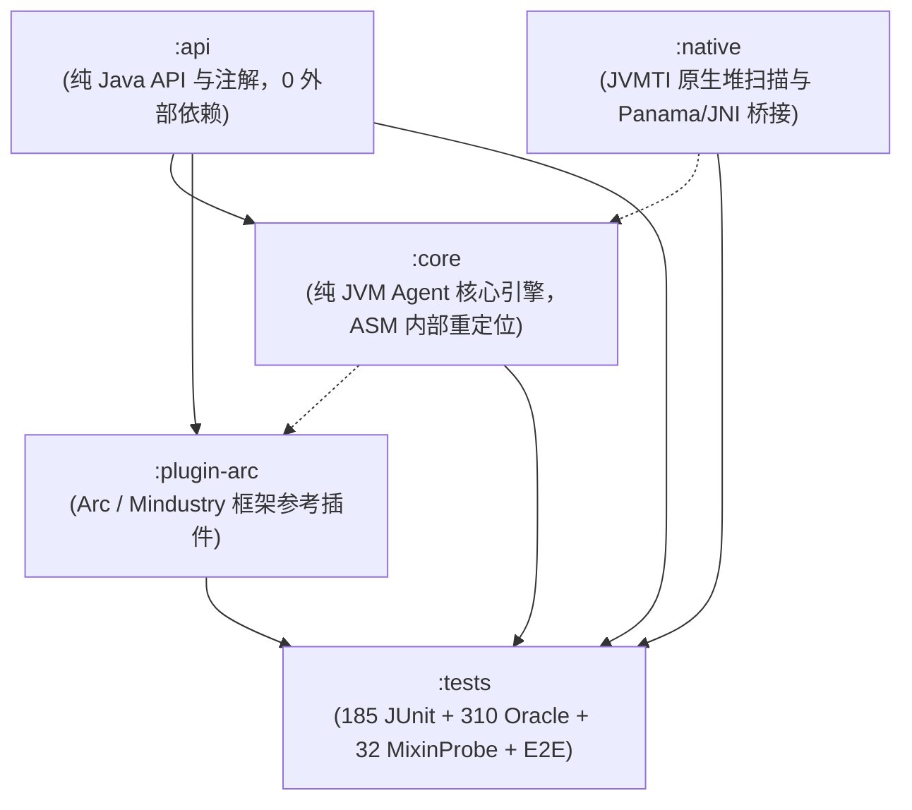

# Remold

**Robust JVM Class Redefinition, Anonymous Class Topological Alignment & Legacy State Reinitialization**

`Remold` 是一个面向 JVM 热重载（Class Redefinition / Retransformation）领域的底层 Agent 引擎与字节码对齐框架。针对类热更新过程中的深层拓扑漂移、存量实例状态丢失、字节码切片被冲刷等痛点，提供了一整套基于置信梯队与安全门的系统性解决方案。

---

## 1. 快速开始与使用 (Quick Start)

Remold 作为一个 Java Agent 运行。为了获得类结构变更高性能热更新体验，推荐配合 **JetBrains Runtime (JBR 17/21/25+)** 或 **DCEVM (8/11)** 的增强重定义能力使用。

### 1.1 运行环境与版本基线

- **推荐运行时**：**JetBrains Runtime (JBR 17/21/25+)**，需附带 `-XX:+AllowEnhancedClassRedefinition` 启动参数。
- **Panama 模块版本注意**：`remold-panama` 依赖 JDK 22+ 的 Foreign Function & Memory (FFM) API 定稿标准。若运行在 JBR 17/21 环境，建议优先使用 `remold-agent` 内置的 JNI Native 加速库 (`LibTool`)。
- **Java 24+ 原生访问**：高版本 JDK 需附带 `--enable-native-access=ALL-UNNAMED`。

---

### 1.2 方式一：Gradle 脚本插件自动化 (推荐，开箱即用)

通过引入轻量脚本插件，免去手动查找类输出路径与拼写复杂 JVM 参数，自动装配并注册 `runRemold` 启动任务：

#### Groovy DSL (`build.gradle`):
```groovy
// 引入脚本插件（可直接使用 GitHub 原始链接，或下载到本地引入）
apply from: 'https://raw.githubusercontent.com/I-hope1/Remold/main/remold.gradle'

remold {
    // 可选：指定 Remold 版本（默认 '0.1.0'）
    // 插件将自动从仓库解析或从 Releases 下载对应版本的 agent jar 并缓存至本地，开发者无需手动下载
    // version = '0.1.0'

    // 可选：显式指定本地 remold-agent.jar 路径（若不指定，将优先使用本地 libs/remold-agent.jar，不存在时自动下载缓存）
    // agentJar = "libs/remold-agent.jar"

    // 可选：指定 JBR 路径（默认自动读取环境变量 JBR_HOME 或系统属性 jbr.home）
    // jbrPath = "/path/to/jbr"

    // 可选：文件变动防抖窗口（毫秒，默认 1200）
    // fileShakeMs = 1200

    // 可选：开启本机 JDWP 远程调试（默认 false，监听安全回环 127.0.0.1:5005）
    // debug = true
    // debugPort = 5005

    // 可选：主类（若已引入 application 插件会自动推导）
    // mainClass = "your.package.Main"
}
```

#### Kotlin DSL (`build.gradle.kts`):
```kotlin
// 引入脚本插件
apply(from = "https://raw.githubusercontent.com/I-hope1/Remold/main/remold.gradle.kts")

remold {
    // version = "0.1.0"
    // agentJar = "libs/remold-agent.jar"
    // jbrPath = "/path/to/jbr"
    // fileShakeMs = 1200
    // debug = true
    // debugPort = 5005
    // mainClass = "your.package.Main"
}
```

一键启动热重载：
```bash
./gradlew runRemold
```

> [!TIP]
> **想立即体验？** 仓库自带完整演示模块，克隆后直接运行：
> ```bash
> ./gradlew :example:runRemold
> ```
> 详细操作指引参见 [`example/README.md`](example/README.md)。

---

### 1.3 方式二：IntelliJ IDEA 运行配置 (IDE Run Configuration)

对于日常在 IDEA 中直接点击 "Run / Debug" 的开发者，直接在运行配置中配置 VM Options 即可：

1. 在 IDEA 顶部导航栏打开 `Run` → `Edit Configurations...`；
2. 选中你的 Application 或启动任务；
3. 点击 `Modify options` → 勾选 `Add VM options`；
4. 在 VM options 输入框中填入：

```text
-XX:+AllowEnhancedClassRedefinition
-javaagent:/path/to/remold-agent.jar=build/classes/java/main;build/classes/kotlin/main
--add-exports=java.base/jdk.internal.misc=ALL-UNNAMED
--add-exports=java.base/jdk.internal.reflect=ALL-UNNAMED
--add-exports=java.base/jdk.internal.loader=ALL-UNNAMED
--enable-native-access=ALL-UNNAMED
```

> [!WARNING]
> 若需附带 JDWP 远程调试，监听地址务必限定为本机回环 `127.0.0.1:5005`，切勿配置为 `*:5005` 或 `0.0.0.0:5005`（避免远程代码执行风险）：
> ```text
> -agentlib:jdwp=transport=dt_socket,server=y,suspend=n,address=127.0.0.1:5005
> ```

---

### 1.4 方式三：手动配置 Gradle `JavaExec` 任务

若不使用脚本插件，也可在项目中直接手动注册 `JavaExec` 任务，从 `sourceSets` 读取编译输出目录并传给 Agent：

#### Kotlin DSL (`build.gradle.kts`):
```kotlin
tasks.register<JavaExec>("runWithRemold") {
    group = "application"
    description = "Run application with Remold Agent & JBR DCEVM"
    classpath = sourceSets["main"].runtimeClasspath
    mainClass.set("your.package.Main")

    // 1. 指定 JBR 路径（推荐配置，或通过 javaLauncher / toolchains 指定）
    // executable = "/path/to/jbr/bin/java"

    // 2. 自动获取编译输出目录并传给 Agent（免手动配置 build/classes 路径）
    val watchDirs = sourceSets["main"].output.classesDirs.asPath
    val agentJar = file("libs/remold-agent.jar").absolutePath

    jvmArgs(
        "-XX:+AllowEnhancedClassRedefinition",
        "-javaagent:$agentJar=$watchDirs",
        "--add-exports=java.base/jdk.internal.misc=ALL-UNNAMED",
        "--add-exports=java.base/jdk.internal.reflect=ALL-UNNAMED",
        "--add-exports=java.base/jdk.internal.loader=ALL-UNNAMED",
        "--enable-native-access=ALL-UNNAMED"
    )
}
```

#### Groovy DSL (`build.gradle`):
```groovy
tasks.register("runWithRemold", JavaExec) {
    group = "application"
    description = "Run application with Remold Agent & JBR DCEVM"
    classpath = sourceSets.main.runtimeClasspath
    mainClass = "your.package.Main"

    // 1. 指定 JBR 路径（推荐配置，或通过 javaLauncher / toolchains 指定）
    // executable = "/path/to/jbr/bin/java"

    // 2. 自动获取编译输出目录并传给 Agent
    def watchDirs = sourceSets.main.output.classesDirs.asPath
    def agentJar = file("libs/remold-agent.jar").absolutePath

    jvmArgs "-XX:+AllowEnhancedClassRedefinition",
            "-javaagent:${agentJar}=${watchDirs}",
            "--add-exports=java.base/jdk.internal.misc=ALL-UNNAMED",
            "--add-exports=java.base/jdk.internal.reflect=ALL-UNNAMED",
            "--add-exports=java.base/jdk.internal.loader=ALL-UNNAMED",
            "--enable-native-access=ALL-UNNAMED"
}
```

---

### 1.5 方式四：终端 CLI 启动

从 [Releases](https://github.com/I-hope1/Remold/releases) 下载最新版本的 `remold-agent.jar`（已内嵌重定位 ASM 9.9.1 及原生加速库）：

```bash
java -XX:+AllowEnhancedClassRedefinition \
     -javaagent:remold-agent.jar=build/classes/java/main \
     --add-exports java.base/jdk.internal.misc=ALL-UNNAMED \
     --add-exports java.base/jdk.internal.reflect=ALL-UNNAMED \
     --add-exports java.base/jdk.internal.loader=ALL-UNNAMED \
     --enable-native-access=ALL-UNNAMED \
     -jar your-application.jar
```

---

### 1.6 Gradle 依赖接入 (JitPack)

若在代码中需要使用注解（如 `@RemoldReinit`、`@OnReload`）或扩展 SPI（如 `HotswapPlugin`、`BytecodeTransformerBridge`），可在 Gradle 中引入 `api` 模块：

```groovy
repositories {
    maven { url 'https://jitpack.io' }
}

dependencies {
    compileOnly 'com.github.I-hope1.Remold:api:0.1.0'
}
```

Maven Central 预留坐标：`io.github.i-hope1.remold:api:0.1.0`。

---

## 2. 解决什么、没解决什么 (What is Solved vs Known Limitations)

坚持工程事实第一，明确界定能力边界：

### 2.1 明确解决的核心领域 (What is Solved)
1. **源码变动导致的匿名类拓扑篡夺与错位**：
   - 通过 `AnonClassAligner` 的 Tier 1~4 置信梯队（精确指纹、拓扑同构、Self Hash、调用链追溯），跨编译版本稳定对齐匿名类，彻底废除不可靠的类名直通。
2. **扩容后存量实例新增字段丢失初值**：
   - 通过 `InitFix` 结合构造器参数回溯、NestView 单写证明与字节码反向切片，以条件 CAS 安全注入存量活体堆实例与静态环境，杜绝静默读零。
3. **Mixin / AOP 增强切片在热更重定义时被冲刷 (Washout)**：
   - 通过 `BytecodeTransformerBridge` 与双基线体系（源码基线 vs 生效基线），在类热更时自动重新织入 Mixin 注入的钩子与字段，保持 AOP 链完整。
4. **破坏性字段变更破坏存活对象**：
   - 通过 `LayoutGate` 与 `LocalClassGuard`，在字段被删除或改类型且堆中存在存活实例时坚决熔断阻断重定义，保护内存安全。
5. **外部 IDE / JDWP 直接重定义的无感接管**：
   - 通过 `ThreadLocal` 状态标记精准区分调用来源，在开发者直接于 IDE 点击 "Reload Changed Classes" 时自动补齐 Mixin 重新织入并执行安全门复核。
6. **JVMTI 原生全堆实例检索与并发安全隔离**：
   - 底层 C++ 原生动态库通过全局互斥锁与动态 Tag 隔离实现亚毫秒级全堆实例精确扫描，热更全流程严格由 `HOTSWAP_LOCK` 重入锁串行化保护。

### 2.2 客观承认的已知限制 (Known Limitations)
1. **孤儿 Lambda 的调用栈逃逸**：
   - 仅对受保护的框架分发点（通过 `OrphanBreakerPredicate` 注册）实施局部熔断抛出 `NoSuchMethodError` 以驱动注销；普通非受控业务栈降级为零值，无法物理撤销业务线程持有的 CallSite 引用。
2. **具名局部类嵌套匿名类**：
   - 局部类内部嵌套深层匿名类在特定场景存在原名直通盲区。
3. **`static final` 的 JIT 常量折叠**：
   - JIT 编译内联折叠的常量无法单纯通过内存写入逆转。
4. **实例快照时钟窗口**：
   - JVMTI 堆遍历快照到补丁生效之间，并发线程新建的对象存在微小时钟窗口。
5. **复杂控制流切片**：
   - 含分支（if/switch）、循环、try-catch、外部可变 Builder 的复杂切片会被安全门坚决拒绝，记入 `FieldLedger` 台账而不静默写入。

---

## 3. 模块架构 (Modular Architecture)

本仓库采用彻底解耦的多模块工程设计：



- **`:api`**：对外公开发行的轻量级 API 包（包含 `@RemoldReinit`、`@OnReload`、`@Profile` 注解以及 `HotswapPlugin`、`OrphanBreakerPredicate`、`BytecodeTransformerBridge` 等扩展 SPI）。
- **`:core`**：核心 Java Agent 引擎。**ASM 9.9.1 100% Shade 且重定位至 `remold.internal.asm.*`**，杜绝与任何应用层框架（如 Mixin、ByteBuddy、Spring）发生 ASM 版本与 ClassLoader 冲突。
- **`:native`**：JVMTI 原生加速与 Panama/JNI 后端，提供亚毫秒级全堆实例检索能力，支持 Windows (x64)、Linux (x64)、macOS (x64/arm64) 全平台。
- **`:plugin-arc`**：官方参考插件，展示如何通过 SPI 无缝扩展 UI 布局树比对与框架级轮询事件熔断。
- **`:example`**：极简演示应用，开箱即用体验 Agent 监听、存量实例字段初始化与 `@OnReload` 生命周期回调。
- **`:tests`**：完备的回归与兼容性测试套件，包含 185 项多版本编译矩阵拓扑 JUnit 测试、310 项 InitFix Oracle 正负向断言，以及 32 项 Mixin 与 JDWP 端到端兼容性断言。

---

## 4. 常用 API 与用法示例 (API & Examples)

### 4.1 显式注册插件与分发器
由于 Agent 处于系统类加载器，避免使用 `ServiceLoader`，直接通过静态 API 显式注册：
```java
import remold.RemoldAgent;

// 1. 设置主线程事件分发器（默认：Runnable::run）
RemoldAgent.setMainThreadDispatcher(myAppDispatcher::post);

// 2. 注册自定义框架扩展插件
RemoldAgent.registerPlugin(new MyFrameworkHotswapPlugin());

// 3. 注册字节码重新织入桥接器（例如 Mixin 兼容）
RemoldAgent.addTransformerBridge((loader, className, targetClass, currentBytes) -> {
    return myMixinTransformer.transform(className, currentBytes);
});
```

### 4.2 注解控制存量字段初始化与生命周期
```java
import remold.annotation.RemoldReinit;
import remold.annotation.OnReload;

public class PlayerService {
    // 默认情况：新增字段仅在存量实例中该字段为零值（0/null）时才注入初值
    private String nickname = "DefaultName";

    // 显式声明 OVERWRITE：强制以 CAS 覆写存量实例中的非默认初值
    @RemoldReinit(mode = RemoldReinit.Mode.OVERWRITE)
    private int scoreVersion = 2;

    // 热重载完成后的实例生命周期回调
    @OnReload
    private void onReload() {
        System.out.println("PlayerService reloaded for: " + nickname);
    }
}
```

---

## 5. 构建与测试 (Building & Verification)

本项目使用 Gradle 构建，要求构建环境具备 JDK 21+。

### 运行全量验证测试矩阵
```bash
./gradlew check
```

验证流程将严格执行：
1. **185 项 JUnit 拓扑对齐与 Native 堆扫描测试**（跨 javac 8/11/17/21/25 现编夹具矩阵，断言 0 skipped 0 failure）；
2. **310 项 InitFix Oracle 差分断言**（涵盖 Java 与真实 Kotlin 编译产物，正向状态回溯与负向安全阻断）；
3. **32 项 Mixin & JDWP 重定义端到端实测**；
4. **LayoutGate 规则表、GhostProbe 栈探测、并发加固多线程实测、指纹延后落账 E2E 断言**；
5. **规范文档与源码状态标记纯净度扫描 (`verifyDocStatusMarkers`)**。

---

## 6. 许可协议 (License)

本项目采用分模块的多许可证策略（Multi-licensing）：

- **核心引擎、Panama 扩展与 API 规范**（`:api`、`:core`、`:panama`）：采用商业友好的 **[Apache License 2.0](LICENSE)** 协议开源。允许商业化集成、无 Copyleft 传染性，包含专利授权保护；
- **Mindustry / Arc 框架插件**（`:plugin-arc`）：采用 **[GNU General Public License v3.0 (GPL-3.0)](plugin-arc/LICENSE)** 协议开源，与 Mindustry 及 Arc 的上游 GPL-3.0 许可完全对齐。
