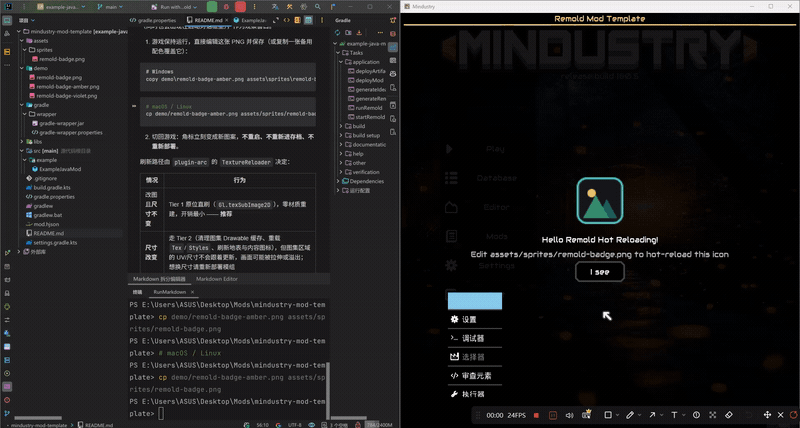
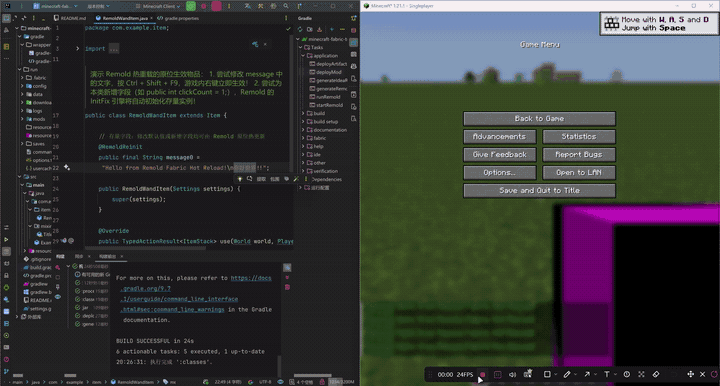
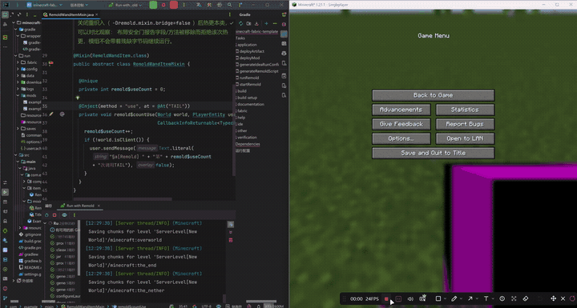
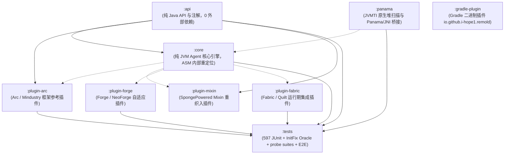

# Remold

**改完代码不用重启 —— 应用跑着，改动半秒生效。**

[](https://github.com/I-hope1/Remold/releases)
[](https://jitpack.io/#I-hope1/Remold)
[](https://github.com/I-hope1/Remold/releases)
[](https://github.com/I-hope1/Remold/releases)
[](https://github.com/I-hope1/Remold/issues)
[](https://github.com/I-hope1/Remold/graphs/contributors)
[](https://github.com/I-hope1/Remold/actions)
[](LICENSE)

简体中文 | [English](README_EN.md)

> **English summary** — Remold is a JVM hot-reload agent. It watches your compiled output and swaps new bytecode
> into the running JVM in place, backfills newly added fields on live instances (InitFix), realigns anonymous
> classes and lambdas by structural fingerprint, and re-weaves Mixin hooks before redefining. 0.2.6 adds a
> two-phase schema-first redefine (read-through protection), opt-in initializer replay for live objects, and
> Mixin anonymous/inner-class hot-swap. The bundled Gradle plugin (`io.github.i-hope1.remold`) wires the agent,
> the JBR/DCEVM arguments and the `runRemold` task for you.
> Full English documentation: [README_EN.md](README_EN.md) · [Gradle plugin reference](gradle-plugin/README.md).

Remold 是一个 Java Agent：它盯着你的编译输出目录，文件一变就把新字节码原地换进正在运行的 JVM。
为 Mindustry 与 Minecraft（Fabric）模组开发各准备了一套开箱即用的模板。

## 你是不是这样？

- 改一个数值 → 关游戏 → 重新编译 → 启动 → 读档 → 跑到那个场景 → 发现改错了 → 再来一遍。
- 给类加了个字段，热更后老对象里全是 `0` / `null`，跑到一半 NPE。
- 加了 Mixin 的 `@Inject`，热更一次钩子就没了，只能重启。
- 改了个匿名类里的逻辑，热更后行为串到另一个匿名类上。

## Remold 做了什么

| 你遇到的 | Remold 的处理 |
|:--|:--|
| 改完必须重启才生效 | 监视 `build/classes`，保存后约 0.5 秒原位替换字节码，不用重启、不用重进存档 |
| 新增字段在存量对象里是零值 | 热更后给已存在的对象补初值；只补零值，绝不覆盖你手动改过的状态 |
| 匿名类 / Lambda 热更后串位 | 按结构指纹把新旧匿名类对齐，不依赖会随编译漂移的类名与编号 |
| Mixin 钩子被冲掉 | 重定义前先把源码级字节码重新交给 Mixin 织入，保住 `@Inject` / `@Unique` / `@Shadow` |
| 热更瞬间新代码读到还没补上的新增字段（读到 `0` / NPE） | 内部批次路径走两阶段重定义：先上「新结构 + 旧方法体」，补完存量实例再上新方法体（0.2.6 默认开启） |
| Mixin 注入方法里第一次新增匿名类，或只改已加载匿名类的逻辑 | 新字节喂给 Mixin 的字节码通道、生成的 `Target$Anonymous$<uuid>` 原地重定义，不再 `ClassNotFoundException` / 静默 no-op |
| 存量对象的初值改了，但对象不想重建 | 可选的双括号 / Kotlin `apply {}` 静态持有者初值重放：仅当实例仍是旧常量时按条件 CAS 写入（默认关闭，白名单开启） |
| 启动期落批次把 JVM 拖死 | 启动就绪门闩 + 批次卡死看门狗，超阈值时输出一次带 `[HOTSWAP-STALL]` 的全线程栈 |
| 删字段、改类型后热更崩 | 堆里还有存活实例时坚决拒绝这次重定义，而不是把内存改坏 |

## 演示

**Mindustry：改一张 PNG，游戏里的角标立刻变**（不重启、不重进存档）



**Minecraft (Fabric)：改 `message0` 的字符串值 → `Ctrl+Shift+F9` → 游戏内右键立刻显示新文案**



**Minecraft (Fabric)：把 Mixin 的注入点从 `@At("TAIL")` 改成 `@At("HEAD")`，`[MixinReload]` 后目标类被重新织入**



## 实战记录：给 Mindustry 加一个 DPS 靶子

一次真实会话的完整记录 —— 游戏开着，用 Remold 边改边热更，用 IDEA Debugger 在主线程里取数验证。
下面每个数字都是调试器实测输出，不是推算。

**新增内容**

- `DpsDummyUnit` —— DPS 测试靶单位
  - 实体 `DpsDummyEntity extends UnitEntity`，覆写 `rawDamage(float)`。反编译确认 v160 里
    `damage()` 是 `applyArmor → /healthMultiplier → /rules.unitHealth(team) → rawDamage`，
    `damagePierce` 也直接进 `rawDamage`，所以这是所有伤害路径的唯一汇合点，一处覆盖全统计。
  - 血量 1e7，单次扣血夹到 `health - 1`，永远剩 1 点血，可连续测几分钟。
  - 挂敌方阵营（`rules.waveTeam`）—— 玩家炮塔/单位只锁敌对阵营，挂自己阵营永远没人打。
  - 1 秒窗口报「窗口 DPS / 峰值 / 累计」；停火满 1 秒按「起点 → 最后一击」结算，不把停火时间算进分母。
  - `EntityMapping.register("dps-dummy-entity", ...)`，存档 / 联机可按名字还原自定义实体。
  - 复用 `UnitTypes.flare` 的贴图（判 `error` 占位，不只判空），`@OnReload` 里刷新构造期属性和本地化。
- `ExampleJavaMod` —— 刷靶入口：游戏内鼠标指位置按 <kbd>F8</kbd> 生成靶子
  （`Trigger.update` 轮询，聊天框聚焦时不抢键）；另留 `spawnDummyAt(x, y)` 给调试器 / 控制台直调。bundle 里补了中英文案。

**实测（Debugger 主线程执行，非推算）**

```plaintext
[VT-0] spawned=true cls=DpsDummyEntity team=crux hp=1.0E7
[VT-A] healthDrop=6000.0 counted=6000.0 diff=0.0          ← 60x100 伤害，计数与实际扣血完全一致
[VT-B] overkillDrop=9993999.0 healthLeft=1.0 alive=true   ← 打进 2 倍满血仍留 1 点血
[VT-C] windowDamage=0.0 windows=1 bestDps=249.99998       ← 1.20s 窗口 300 伤害 → 250.0/s
[VT-E] windowsDelta=1 windowStart=-1.0 closed=true        ← 停火收口 400 伤害/1.00s → 400.0/s
[VT-D] dummyTotalUnchanged=true                           ← 对照组：打原版 flare 不影响靶子计数
```

**过程中抓到一个真 bug**：`Time.time` 的单位是 tick，而 `Time.toSeconds` 的实测值是 60（每秒多少 tick），
不是 1/60。第一版乘了它，1.2 秒窗口被算成 4320 秒、DPS 变成 0.07/s；改成相除后 250.0/s 精确对上。
同时修了「窗口永不关闭 → 停火后每秒刷 0/s」。

**热更链路上的实测信号**：加方法 `+Added: [debugDpsSelfTest, runDpsSelfTest, lambda]` → `HotSwap successful`；
删方法 `[LAYOUT-READERS] ↓ ... dangling=0` → `-Removed: [...]` → `HotSwap successful`。
这一轮既加过 3 个方法，也删过它们，全程没重启。临时自检代码删除后热更立即生效，
随后冷启动一次游戏，日志确认 `[ExampleJavaMod] Loading content...` 正常无异常。

**关于调试器**：`evaluate_expression` 生成的求值类在独立编译，lambda 里一引用 `arc`、`mindustry`
或项目中的类型就会失败。所以把验证步骤临时写成模组内的静态方法，由调试器调用，验证完再删掉
—— 这条路径能走通，但要绕。

## 30 秒跑起来

```bash
git clone https://github.com/I-hope1/Remold && cd Remold
./gradlew :example:runRemold
```

- Mindustry 模组模板：[`mindustry-mod-template/`](mindustry-mod-template/README.md)（内置 PNG 贴图热更新演示）
- Minecraft Fabric 模组模板：[`minecraft-fabric-template/`](minecraft-fabric-template/README.md)（**MC 1.21.1 基准**，内置 Mixin 重织入 + 客户端 HotSwap Toast 演示）
- 1.21.4 Fabric 客户端 gametest 探针：[`tests/fabric-gametest-1.21.4/`](tests/fabric-gametest-1.21.4/README.md)（1.21.1 的 fabric-api 不含 `fabric-client-gametest-api-v1`，该能力独立保存，不随模板发布）

## v0.2.6 更新亮点

- **两阶段 Schema-First 重定义（默认开启）**：先提交「新结构 + 旧方法体」（构造器/`<clinit>` 保留新体），补完存量实例后再提交新方法体，关闭 `redefineClasses` 返回后、`InitFix` 完成前的读穿窗口；纯方法体热更仍走单次重定义快路径。`-Dremold.agent.two_phase=false` 可回退。
- **存量对象初值重放（L1 / A 档，默认关闭）**：双括号初始化写继承字段、Kotlin `object` / 顶层 `val` 的 `apply {}` 静态持有者，按**旧常量条件 CAS** 重放新初值，运行期改过的值不会被覆盖。
- **Mixin 匿名/内部类热更闭环**：`@Inject` 方法里第一次新增匿名类不再崩溃；只改已加载匿名类体时原地重定义 `Target$Anonymous$<uuid>`；织入期生成的合成类字节接入 `BytecodeSources`，`InitFix` 能读到构造器可见性。
- **结构化批次报告 + 客户端 Toast**：`api` 新增 `HotswapBatchReport` 与 `HotswapBatchListener.afterInternalBatchReport()`（耗时 / 重定义类 / Mixin 成员增量 / InitFix 统计）；Fabric 模板的客户端 Toast 直接展示这些数据。
- **启动就绪门闩 + 批次看门狗**：`HotswapPlugin.isHostReady()` 让宿主自己决定批次何时可以开始；批次超过 `batch_stall_ms`（默认 15s）打印一次全线程栈，用于定位挂死。
- **同形匿名类歧义消解 + 持有者点名**：体相似度分层 + 零存活实例兜底，孤儿告警点名真实持有字段（赋值流证明 / 父类型候选）与 `@RemoldReinit` 逃生舱。
- **Class / 资源防抖分离**：`.class`/jar 与资源/配置各自一条 trailing-edge 静默窗口（默认 800ms / 250ms），资源改动不再推迟 Class 批次。

完整变更与已知边界见 [v0.2.6 Release Notes](docs/releases/v0.2.6.md)。

## 想看原理？

上面这些能力背后是匿名类拓扑对齐、置信梯队与安全门、字节码切片与效应检查、存量实例补丁驱动等一整套机制。
不了解它们也能把 Remold 用起来 —— 需要时再看下文 §2「解决什么、没解决什么」与 §3「模块架构」。

> 技术定位：Robust JVM Class Redefinition, Anonymous Class Topological Alignment & Legacy State Reinitialization.

---

## 1. 快速开始与使用 (Quick Start)

Remold 作为一个 Java Agent 运行。为了获得类结构变更高性能热更新体验，推荐配合 **JetBrains Runtime (JBR 17/21/25+)** 或 **DCEVM (8/11)** 的增强重定义能力使用。

### 1.1 运行环境与版本基线

- **推荐运行时**：**JetBrains Runtime (JBR 17/21/25+)**，需附带 `-XX:+AllowEnhancedClassRedefinition` 启动参数。
- **热更新行为开关**：两阶段重定义默认开启（`-Dremold.agent.two_phase=false` 回退单阶段）；L1 / A 档初值重放默认关闭、需白名单开启；启动门闩与看门狗阈值、两条防抖窗口等见 §1.7。
- **Panama 模块版本注意**：`remold-panama` 依赖 JDK 22+ 的 Foreign Function & Memory (FFM) API 定稿标准。若运行在 JBR 17/21 环境，建议优先使用 `remold-agent` 内置的 JNI Native 加速库 (`LibTool`)。
- **Java 24+ 原生访问**：高版本 JDK 需附带 `--enable-native-access=ALL-UNNAMED`。

---

### 1.2 方式一：Gradle 脚本插件自动化 (推荐，开箱即用)

`remold.gradle(.kts)` 只是一个**薄壳**：它把构建逻辑所在的二进制插件挂到当前工程上，
免去手动查找类输出路径与拼写复杂 JVM 参数，自动装配并注册 `runRemold` 等任务。
解析、任务注册与参数拼装只有一份实现，在 `:gradle-plugin` 里（脚本不复制任何逻辑）。

> [!IMPORTANT]
> **脚本插件也必须锁定版本。** `apply(from = ...)` 没有 `plugins { id(...) version ... }` 那样的版本坐标，
> 因此**务必用 tag 地址**（`.../v0.2.6/remold.gradle.kts`）而不是 `.../main/...`；
> 壳里的默认插件版本与 `agent`/`api` 必须同版本，否则按新接口拼参数、agent 还是旧版本，问题只会在运行期才暴露。
>
> **首次配置需要能解析到插件**（脚本按 `v<version>` 从 JitPack 取 `com.github.I-hope1.Remold:gradle-plugin:v<version>`）。
> 离线或内网环境用 `-Premold.pluginJar=<path/to/remold-gradle-plugin.jar>`（或环境变量 `REMOLD_PLUGIN_JAR`）
> 直接指定本地插件 jar；`-Premold.version=<版本>` 可覆盖脚本内联的默认版本。

#### Groovy DSL (`build.gradle`):
```groovy
// 引入脚本插件（tag 锁版本；本地开发可换成 rootProject.file('remold.gradle')）
def remoldRef = (findProperty('remold.version') ?: '0.2.6')
apply from: "https://raw.githubusercontent.com/I-hope1/Remold/v${remoldRef}/remold.gradle"

remold {
    // 可选：指定 Remold 版本（默认读取 gradle.properties 中的 remoldVersion）
    // 插件将自动从仓库解析或从 Releases 下载对应版本的 agent jar 并缓存至本地，开发者无需手动下载
    // version = '0.2.6'

    // 可选：显式指定本地 remold-agent.jar 路径（若不指定，将优先使用本地 libs/remold-agent.jar，不存在时自动下载缓存）
    // agentJar = "libs/remold-agent.jar"

    // 可选：指定 JBR 路径（默认自动读取环境变量 JBR_HOME 或系统属性 jbr.home）
    // jbrPath = "/path/to/jbr"

    // 可选：Class/jar 变动防抖窗口（毫秒，默认 800；每次 .class 变化都会重置）
    // fileShakeMs = 800
    // 可选：资源/配置变动独立防抖窗口（毫秒，默认 250；不会推迟 Class 批次）
    // assetShakeMs = 250

    // 可选：开启本机 JDWP 远程调试（默认 false，监听安全回环 127.0.0.1:5005）
    // debug = true
    // debugPort = 5005

    // 可选：主类（若已引入 application 插件会自动推导）
    // mainClass = "your.package.Main"

    // 可选：JAR 启动模式（例如游戏模组/独立客户端开发，纯净拉起目标 JAR，免去类加载器冲突与手动 mainClass）
    // jar = "libs/game.jar"
    // args = ["-loadmods"] // 可选：传递给启动程序的主参数
    // autoDeploy = true    // 可选：启动前自动打包当前产物并复制到目标部署目录
    // deployDir = "mods"   // 可选：目标部署目录（若指定则自动激活 autoDeploy，亦支持兼容别名 modsDir）
    // dependsOn 'jar'       // 可选：自定义启动前的前置任务
}
```

#### Kotlin DSL (`build.gradle.kts`):
```kotlin
// 引入脚本插件（tag 锁版本；本地开发可换成 file("../remold.gradle.kts")）
val remoldRef = (findProperty("remold.version") as String?) ?: "0.2.6"
apply(from = "https://raw.githubusercontent.com/I-hope1/Remold/v$remoldRef/remold.gradle.kts")

// 注意：Kotlin DSL 下 `remold { }` 不可用——扩展类型 RemoldExtension 定义在脚本里，
// IDE 无法为脚本类生成类型安全访问器（Groovy DSL 是动态语言，不受影响）。
// 配置改走 gradle.properties 或 extra，等价写法如下：
extra["remold.mainClass"] = "your.package.Main"
// extra["remold.version"] = "0.2.6"
// extra["remold.agentJar"] = "libs/remold-agent.jar"
// extra["remold.jbr"] = "/path/to/jbr"
// extra["remold.debug"] = true
// extra["remold.jar"] = "libs/game.jar"       // JAR 启动模式
// extra["remold.autoDeploy"] = true
// extra["remold.deployDir"] = "mods"
```

#### 本地开发 / 版本锁定

加载脚本插件其实只有一件事要决定：**从哪拿**。模板里就这两行：

```kotlin
// 本地源码树里开发 Remold 时用上一层的脚本（改了立即生效），否则按 tag 拉取对应版本
apply(from = file("../remold.gradle.kts").takeIf { it.isFile }
    ?: "https://raw.githubusercontent.com/I-hope1/Remold/v${findProperty("remold.version") ?: "0.2.6"}/remold.gradle.kts")
```

- 仓库内开发：`../remold.gradle.kts` 存在 → 直接用本地脚本，改完立即生效、不联网；
- 外部用户：文件不存在 → 按 `remold.version` 的 tag 拉取，版本与 agent / api 同源。

#### 变体：Gradle 插件坐标（走 Gradle 依赖缓存，可离线）

把逻辑全交给插件 jar，构建脚本只剩 4 行，且走 Gradle 的依赖缓存 / 校验 / 离线：

```kotlin
buildscript {
    repositories { maven("https://jitpack.io") }
    dependencies { classpath("com.github.I-hope1.Remold:gradle-plugin:v0.2.6") }   // 版本 = Git tag
}
apply(plugin = "io.github.i-hope1.remold")
```

两条入口共用同一份实现：构建逻辑只存在于 `:gradle-plugin`，仓库根的 `remold.gradle(.kts)` 只是把该插件
挂到工程上的薄壳（`apply(from=...)` 走的是它），所以行为一致。配置方式同方式一
（`gradle.properties` / `extra[...]`；Groovy 与 Kotlin DSL 的 `plugins {}` 入口都可用 `remold { }`；
纯 `apply(from=...)` 的 Kotlin DSL 工程因类型安全访问器不可用，请用属性配置或改用 `plugins {}` 入口）。

> [!TIP]
> `gradle-plugin` 模块从 **`v0.2.0`** 起正式提供稳定的构建产物；在那之前可以写 `master-SNAPSHOT` 尝鲜
> （随分支变化，不适合长期锁定）。

> [!NOTE]
> 想写成 `plugins { id("io.github.i-hope1.remold") version "v0.2.6" }` 也可以，但 JitPack 不托管「插件标记」
> （`<插件id>:<插件id>.gradle.plugin`），需要在 `settings.gradle.kts` 的 `pluginManagement.resolutionStrategy.eachPlugin`
> 里 `useModule("com.github.I-hope1.Remold:gradle-plugin:v${requested.version.removePrefix("v")}")` 映射一次。发到 Gradle Plugin Portal
> 才能省掉这段。

二进制插件自身的参考资料（坐标、DSL 选项、任务清单、环境要求）见
[`gradle-plugin/README.md`](gradle-plugin/README.md)。

一键启动热重载：
```bash
./gradlew runRemold
```

> [!TIP]
> **如何避免独占 Gradle Daemon？**
> `runRemold` 作为标准的 Gradle `JavaExec` 任务，在前台运行时会阻塞当前构建进程。若希望释放常驻 Gradle Daemon 以便随时执行 `./gradlew compileJava`，可选用以下任一轻量方案：
> 1. **命令行临时模式**：`./gradlew runRemold --no-daemon`（单次临时 JVM 运行，退出即销毁，绝不占用常驻 Daemon）；
> 2. **独立窗口脱离启动**：`./gradlew startRemold`（在独立窗口启动应用，启动完成后 Gradle 任务立即结束，Daemon 瞬间恢复为 IDLE）；
> 3. **生成原生运行脚本**：`./gradlew generateRemoldScript`（自动在 `build/` 下生成 `run-remold.bat` 和 `run-remold.sh`，直接双击或命令行运行，完全脱离 Gradle 进程）；
> 4. **IDEA 原生启动**：直接使用 IDEA Application 运行配置（见下文方式二，0 Daemon 开销）。

> [!TIP]
> **想立即体验？** 仓库自带完整演示模块，克隆后直接运行：
> ```bash
> ./gradlew :example:runRemold
> ```
> 详细操作指引参见 [`example/README.md`](example/README.md)。

---

### 1.3 方式二：IntelliJ IDEA 原生运行配置 (IDE Run Configuration，推荐 ⭐)

对于习惯在 IDEA 中直接点击 "Run / Debug" 的开发者，Remold 脚本插件提供了全自动就绪 IDEA 运行配置的能力：
* **全自动就绪**：在 IntelliJ IDEA 打开项目或执行构建时，插件会自动解析参数并在 `.idea/runConfigurations/` 下生成便携式的 `Run_with_Remold.xml`（亦可随时运行 `./gradlew generateIdeaRunConfig` 强制刷新）；
* **路径统一**：agent 与插件 Jar 一律同步到项目本地 `.gradle/remold/`（插件在 `plugins/` 子目录），运行配置只引用 `$PROJECT_DIR$/.gradle/remold/...`，不会混入 `build/libs` 这类会被 `clean` 清掉、或 `~/.gradle` 这类跨机器失效的绝对路径；
* **开箱即用**：用 IDEA 打开项目后，右上角运行下拉菜单将直接出现 **`Run with Remold`**，点击运行或调试即可；
* **极速原生**：直接使用 IDEA 原生 JVM 进程运行，完美支持断点调试，零 Gradle Daemon 占用。

> [!TIP]
> **开发热更秘诀：0.2 秒极速增量编译（彻底告别 Gradle Daemon 争抢）**
> IDEA 默认可能将构建委托给 Gradle（*Settings -> Build Tools -> Gradle -> Build and run using: Gradle*），这会导致前台运行游戏或服务时占用唯一的 Gradle Daemon，再次编译时被迫冷启动第 2 个 Gradle 守护进程（耗时 15~30 秒）。
> **最佳实践推荐**：
> 1. 打开 IDEA 设置：*Settings (设置) -> Build, Execution, Deployment -> Build Tools -> Gradle*，将 **`Build and run using`** 与 **`Run tests using`** 改为 **`IntelliJ IDEA`**；
> 2. 修改代码后，无需点击绿色运行按钮，直接在编辑器中按快捷键 **`Ctrl + Shift + F9`**（macOS 为 `Cmd + Shift + F9`，重新编译当前类）；
> 3. IDEA 内置 Javac 仅需 **0.1 ~ 0.2 秒** 便能增量写出单个 `.class`，完全绕过 Gradle，零 Daemon 开销，Remold 瞬时完成热更！

> [!NOTE]
> **Fabric Loom 项目运行配置自动同步**：
> 在 Minecraft Fabric 模组开发中，Loom 生成的 `Minecraft Client` / `Minecraft Server` 运行配置在首次生成后不会自动刷新 VM 参数。Remold 脚本在 `classes` 或生成配置阶段会**自动检测并补全 `Minecraft_Client.xml` 与 `Minecraft_Server.xml`**（Application 风格的 `VM_PARAMETERS` 与 Gradle 风格的 `vmOptions` 均支持），自动将 `-javaagent`、`-Dremold.plugins=mixin` 与对应插件 Jar 同步进去。同时，Fabric Loom / ForgeGradle / NeoForge ModDevGradle 的 **`server` 运行容器与 Fabric 的 `clientGameTest` / `gameTest` gametest 运行也会注入同一套 JVM 参数**，因此 `./gradlew runServer`、`./gradlew runClientGameTest` 与 IDEA 的 `Minecraft Server` 启动同样自带 Agent，无需手动改 VM options。

若需纯手动在 IDEA 运行对话框中配置，步骤如下：

1. 在 IDEA 顶部导航栏打开 `Run` → `Edit Configurations...`；
2. 选中你的 Application 或启动任务；
3. 点击 `Modify options` → 勾选 `Add VM options`；
4. 在 VM options 输入框中填入：

```text
-XX:+AllowEnhancedClassRedefinition
-javaagent:/path/to/remold-agent.jar=build/classes/java/main;build/classes/kotlin/main
--add-exports=java.base/jdk.internal.misc=ALL-UNNAMED
--add-exports=java.base/jdk.internal.reflect=ALL-UNNAMED
--add-exports=java.base/jdk.internal.loader=ALL-UNNAMED
--enable-native-access=ALL-UNNAMED
```

> [!WARNING]
> 若需附带 JDWP 远程调试，监听地址务必限定为本机回环 `127.0.0.1:5005`，切勿配置为 `*:5005` 或 `0.0.0.0:5005`（避免远程代码执行风险）：
> ```text
> -agentlib:jdwp=transport=dt_socket,server=y,suspend=n,address=127.0.0.1:5005
> ```

---

### 1.4 方式三：手动配置 Gradle `JavaExec` 任务

若不使用脚本插件，也可在项目中直接手动注册 `JavaExec` 任务，从 `sourceSets` 读取编译输出目录并传给 Agent：

#### Kotlin DSL (`build.gradle.kts`):
```kotlin
tasks.register<JavaExec>("runWithRemold") {
    group = "application"
    description = "Run application with Remold Agent & JBR DCEVM"
    classpath = sourceSets["main"].runtimeClasspath
    mainClass.set("your.package.Main")

    // 1. 指定 JBR 路径（推荐配置，或通过 javaLauncher / toolchains 指定）
    // executable = "/path/to/jbr/bin/java"

    // 2. 自动获取编译输出目录并传给 Agent（免手动配置 build/classes 路径）
    val watchDirs = sourceSets["main"].output.classesDirs.asPath
    val agentJar = file("libs/remold-agent.jar").absolutePath

    jvmArgs(
        "-XX:+AllowEnhancedClassRedefinition",
        "-javaagent:$agentJar=$watchDirs",
        "--add-exports=java.base/jdk.internal.misc=ALL-UNNAMED",
        "--add-exports=java.base/jdk.internal.reflect=ALL-UNNAMED",
        "--add-exports=java.base/jdk.internal.loader=ALL-UNNAMED",
        "--enable-native-access=ALL-UNNAMED"
    )
}
```

#### Groovy DSL (`build.gradle`):
```groovy
tasks.register("runWithRemold", JavaExec) {
    group = "application"
    description = "Run application with Remold Agent & JBR DCEVM"
    classpath = sourceSets.main.runtimeClasspath
    mainClass = "your.package.Main"

    // 1. 指定 JBR 路径（推荐配置，或通过 javaLauncher / toolchains 指定）
    // executable = "/path/to/jbr/bin/java"

    // 2. 自动获取编译输出目录并传给 Agent
    def watchDirs = sourceSets.main.output.classesDirs.asPath
    def agentJar = file("libs/remold-agent.jar").absolutePath

    jvmArgs "-XX:+AllowEnhancedClassRedefinition",
            "-javaagent:${agentJar}=${watchDirs}",
            "--add-exports=java.base/jdk.internal.misc=ALL-UNNAMED",
            "--add-exports=java.base/jdk.internal.reflect=ALL-UNNAMED",
            "--add-exports=java.base/jdk.internal.loader=ALL-UNNAMED",
            "--enable-native-access=ALL-UNNAMED"
}
```

---

### 1.5 方式四：终端 CLI 启动

从 [Releases](https://github.com/I-hope1/Remold/releases) 下载最新版本的 `remold-agent.jar`（已内嵌重定位 ASM 9.11.1 及原生加速库）：

```bash
java -XX:+AllowEnhancedClassRedefinition \
     -javaagent:remold-agent.jar=build/classes/java/main \
     --add-exports java.base/jdk.internal.misc=ALL-UNNAMED \
     --add-exports java.base/jdk.internal.reflect=ALL-UNNAMED \
     --add-exports java.base/jdk.internal.loader=ALL-UNNAMED \
     --enable-native-access=ALL-UNNAMED \
     -jar your-application.jar
```

---

### 1.6 Gradle 依赖接入 (JitPack)

若在代码中需要使用注解（如 `@RemoldReinit`、`@OnReload`）或扩展 SPI（如 `HotswapPlugin`、`BytecodeTransformerBridge`），可在 Gradle 中引入 `api` 模块：

```groovy
repositories {
    maven { url 'https://jitpack.io' }
}

dependencies {
    compileOnly 'com.github.I-hope1.Remold:api:v0.2.6'
}
```

Maven Central 预留坐标：`io.github.i-hope1.remold:api:0.2.6`。

---

### 1.7 热更新行为开关 (Behaviour switches)

以下系统属性可直接传给应用 JVM（Gradle 插件已自动透传所需的 agent 参数；括号内为 Gradle DSL 等价项）：

| 系统属性 | 默认值 | 作用 |
|:--|:--|:--|
| `-Dremold.agent.two_phase` | `true` | 两阶段 Schema-First 重定义（关闭读穿窗口）；`false` 回退单阶段快路径 |
| `-Dremold.agent.init_drift.parents` | 空（关闭） | L1 双括号初值重放的父类白名单（逗号分隔） |
| `-Dremold.agent.init_drift.apply_holders` | 空（关闭） | A 档 Kotlin `object` / 顶层 `val` 持有者白名单（逗号分隔） |
| `-Dremold.agent.ready_timeout_ms` | `0` | 启动就绪门闩的超时自动放行；`0` = 不自动放行（宁可不生效，也不在没就绪时落批次） |
| `-Dremold.agent.batch_stall_ms` | `15000` | 批次卡死看门狗阈值（下限 `5000`）；超阈值输出一次带 `[HOTSWAP-STALL]` 的全线程栈 |
| `-Dremold.agent.file_shake_ms` | `800` | Class/jar 变动防抖窗口（Gradle DSL：`fileShakeMs`） |
| `-Dremold.agent.asset_shake_ms` | `250` | 资源/配置变动防抖窗口，独立于 Class 窗口（Gradle DSL：`assetShakeMs`） |

其余安全门开关（`remold.agent.layout_gate`、`anon_align`、`anon_strict`、`local_class_guard`、`offset_strict` 等）见 [`AGENTS.md`](AGENTS.md) 与 [`docs/status.md`](docs/status.md)。

---

## 2. 解决什么、没解决什么 (What is Solved vs Known Limitations)

坚持工程事实第一，明确界定能力边界：

### 2.1 明确解决的核心领域 (What is Solved)
1. **源码变动导致的匿名类拓扑篡夺与错位**：
   - 通过 `AnonClassAligner` 的 Tier 1~4 置信梯队（精确指纹、拓扑同构、Self Hash、调用链追溯），跨编译版本稳定对齐匿名类，彻底废除不可靠的类名直通。
2. **扩容后存量实例新增字段丢失初值**：
   - 通过 `InitFix` 结合构造器参数回溯、NestView 单写证明与字节码反向切片，以条件 CAS 安全注入存量活体堆实例与静态环境，杜绝静默读零；另有可选的双括号 / Kotlin `apply {}` 静态持有者初值重放（L1 / A 档，白名单开启、只在实例仍等于旧常量时重放）。
3. **Mixin / AOP 增强切片在热更重定义时被冲刷 (Washout)**：
   - 通过 `BytecodeTransformerBridge` 与双基线体系（源码基线 vs 生效基线），在类热更时自动重新织入 Mixin 注入的钩子与字段，保持 AOP 链完整；Mixin 模板自身新增成员、配置删除/重新加入、新增 Mixin 类，以及 Mixin 注入方法里新增/编辑匿名类与内部类，都走同一套共享反射引擎与内部类热更闭环。
4. **破坏性字段变更破坏存活对象**：
   - 通过 `LayoutGate` 与 `LocalClassGuard`，在字段被删除或改类型且堆中存在存活实例时坚决熔断阻断重定义，保护内存安全。
5. **外部 IDE / JDWP 直接重定义的无感接管**：
   - 通过 `ThreadLocal` 状态标记精准区分调用来源，在开发者直接于 IDE 点击 "Reload Changed Classes" 时自动补齐 Mixin 重新织入并执行安全门复核。
6. **JVMTI 原生全堆实例检索与并发安全隔离**：
   - 底层 C++ 原生动态库通过全局互斥锁与动态 Tag 隔离实现亚毫秒级全堆实例精确扫描，热更全流程严格由 `HOTSWAP_LOCK` 重入锁串行化保护。
7. **重定义到补丁完成之间的读穿窗口**：
   - 内部批次路径（文件监听 → `processChanges`）由两阶段 Schema-First 重定义关闭；外部 IDE/JDWP 与 `redefineDynamic` 单类通道仍为单阶段（见 §2.2）。
8. **启动期批次与热更链路的可观测性**：
   - `StartupGate` + `HotswapPlugin.isHostReady()` 押住启动期批次，`BatchWatchdog` 在批次超阈值时输出一次 `[HOTSWAP-STALL]` 全线程栈，`HotswapBatchReport` 提供每批耗时 / 重定义类 / Mixin 增量 / InitFix 统计。

### 2.2 客观承认的已知限制 (Known Limitations)
1. **孤儿 Lambda 的调用栈逃逸**：
   - 仅对受保护的框架分发点（通过 `OrphanBreakerPredicate` 注册）实施局部熔断抛出 `NoSuchMethodError` 以驱动注销；普通非受控业务栈降级为零值，无法物理撤销业务线程持有的 CallSite 引用。
2. **具名局部类嵌套匿名类**：
   - 局部类内部嵌套深层匿名类在特定场景存在原名直通盲区。
3. **`static final` 的 JIT 常量折叠**：
   - JIT 编译内联折叠的常量无法单纯通过内存写入逆转。
4. **实例快照时钟窗口**：
   - JVMTI 堆遍历快照到补丁生效之间，并发线程新建的对象存在微小时钟窗口。
5. **复杂控制流切片**：
   - 含分支（if/switch）、循环、try-catch、外部可变 Builder 的复杂切片会被安全门坚决拒绝，记入 `FieldLedger` 台账而不静默写入。
6. **外部重定义通道仍是单阶段**：
   - 外部 IDE/JDWP 重定义与 `redefineDynamic` 单类通道先提交完整新字节码再补丁，读穿窗口仍在；被安全门拒绝、根本没生成补丁的字段两阶段也无法代偿（保持"重启"语义）。
7. **NeoForge 26.x / FML 10+ 与生产 installer 启动路径未适配/未验证**：
   - NeoForge 26.x 已移除 ModLauncher（入口 `net.neoforged.fml.startup.Client`），现有跨 ClassLoader 桥按 ModLauncher 语义实现，21.1 的证据不可外推；生产 installer（`unix_args.txt`）的模块归属与 `--add-opens` 需求需另测。
8. **plugin 与 core 必须同版本发布；Mixin 匿名类成员结构变化仍需重启**：
   - 插件/内核版本错位会退化为 `NoSuchMethodError`（有逐插件 catch 与定向日志，但不受支持）；Mixin 生成的匿名类新增/删除字段或方法会被拒绝并点名诊断，`ForgeMixinHotSwap` 也未接入内部类热更闭环。
9. **真实客户端 GUI 验收仍为手动**：
   - 容器探针覆盖专用服务端（Fabric KnotServer / Forge `runServer`）；模板场景 1–8 的客户端结果列见 [`docs/acceptance/01-manual-checklist.md`](docs/acceptance/01-manual-checklist.md)，待人工确认。

---

## 3. 模块架构 (Modular Architecture)

本仓库采用彻底解耦的多模块工程设计：



- **`:api`**：对外公开发行的轻量级 API 包（包含 `@RemoldReinit`、`@OnReload`、`@Profile` 注解，`HotswapPlugin`、`OrphanBreakerPredicate`、`BytecodeTransformerBridge` 等扩展 SPI，以及 `HotswapBatchReport` / `HotswapBatchListener.afterInternalBatchReport()` 结构化批次报告与 `HotswapPlugin.isHostReady()` 就绪投票）。
- **`:core`**：核心 Java Agent 引擎。**ASM 9.11.1 100% Shade 且重定位至 `remold.internal.asm.*`**，杜绝与任何应用层框架（如 Mixin、ByteBuddy、Spring）发生 ASM 版本与 ClassLoader 冲突。引擎内部还包含两阶段重定义编排（`applyTwoPhase`）、启动就绪门闩 `StartupGate`、批次看门狗 `BatchWatchdog`、Class/资源双流防抖 `DebounceWindow`、织入生成类字节登记口 `BytecodeSources`、偏移漂移安全门与 `remold.reflect.mixin` 共享反射引擎。
- **`:panama`**：Panama（FFM）与 JNI/JVMTI 绑定层；JVMTI 原生加速库（C++ 源码与 `libtool` 预编译产物）随 `:core` 打包，二者共同提供亚毫秒级全堆实例检索能力，支持 Windows (x64)、Linux (x64)、macOS (x64/arm64) 全平台。
- **`:plugin-arc`**：官方参考插件，展示如何通过 SPI 无缝扩展 UI 布局树比对与框架级轮询事件熔断。
- **`:plugin-mixin`**：SpongePowered Mixin 生态插件。热重定义前把源码级字节码重新交给 Mixin 织入（保住 `@Inject` / `@Unique` / `@Shadow` 产物），并在 Mixin 类自身被修改时刷新 Mixin 运行时状态、级联重织入其目标类。Fabric Loom 工程由 Gradle 脚本自动挂载。
- **`:plugin-forge`**：Minecraft Forge 与 NeoForge 统一自适应插件。穿透 ModLauncher / NeoForge 类加载器隔离执行 Mixin 增量重织入，并在 `@SubscribeEvent` / `@EventBusSubscriber` 增删时自动刷新与重挂载事件总线。ForgeGradle 与 ModDevGradle 工程由 Gradle 脚本自动挂载。
- **`:plugin-fabric`**：Fabric / Quilt 开发运行期集成插件。负责注入 `fabric.classPathGroups`（缺失会导致热更静默不生效）、排除 `mods` 目录监听，并把 `run/mods` 里与本工程同 modId 的残留构建 JAR 就地隔离；Fabric Loom 工程由 Gradle 脚本自动挂载。
- **`:gradle-plugin`**：Gradle 二进制插件（坐标 `io.github.i-hope1.remold`），提供 `remold { ... }` 类型安全 DSL、`runRemold` / `startRemold` / `generateRemoldScript` 等任务与 IDEA 运行配置生成；仓库根 `remold.gradle(.kts)` 只是它的薄壳。
- **`:example`**：极简演示应用，开箱即用体验 Agent 监听、存量实例字段初始化与 `@OnReload` 生命周期回调。
- **`:tests`**：完备的回归与兼容性测试套件，包含 597 项 JUnit 测试（跨 javac 8/11/17/21/25 现编夹具矩阵，含拓扑对齐、布局预测与 Native 堆扫描）、51 个场景 / 350 项 InitFix Oracle 正负向断言，以及 `mixinProbe` 等 Mixin 与 JDWP 端到端兼容性探针、匿名类 S0~S7 真实 KnotServer 探针。

---

## 4. 常用 API 与用法示例 (API & Examples)

### 4.1 插件扩展与主线程分发器 (Plugins & Dispatcher)

#### 方式一：声明式自动加载（强烈推荐 ⭐）
Remold Agent 支持通过系统属性或 Gradle 配置声明式加载扩展插件（如 Mindustry / Arc 专用插件 `arc`）：
- **`gradle.properties`**:
  ```properties
  remold.plugins=arc
  ```
- **Gradle DSL (`build.gradle.kts` / `build.gradle`)**:
  ```kotlin
  remold {
      plugins("arc")
  }
  ```
  Gradle 插件将自动从远程下载对应的 `remold-plugin-arc.jar`，并通过 JVM 参数（`-Dremold.plugins=arc -Dremold.plugin.jars=...`）自动挂载到主 Agent，**模组与业务代码无需引入任何 Remold 依赖，零侵入无残留！**

- **Mixin 生态（Fabric / Quilt 等）无需声明**：`remold.gradle(.kts)` 检测到 `fabric-loom` 插件或 `net.fabricmc` / `org.spongepowered` 依赖时会自动挂载 `mixin` 插件；要关掉用 `-Premold.autoMixin=false`。本地开发插件本体时可用 `remold { pluginJar("../<remold 仓库>/plugin-mixin/build/libs/remold-plugin-mixin-<ver>.jar") }` 指定。
- **Forge / NeoForge 生态无需声明**：`remold.gradle(.kts)` 检测到 ForgeGradle 或 ModDevGradle 时会自动挂载 `forge` 插件；要关掉用 `-Premold.autoForge=false`。
- **Fabric / Quilt 开发运行期集成无需声明**：`remold.gradle(.kts)` 检测到 `fabric-loom` / `dev.architectury.loom` / `org.quiltmc.loom` / `loom` 扩展或 `net.fabricmc` / `org.quiltmc` 依赖时自动挂载 `fabric` 插件——它负责 `fabric.classPathGroups` 注入（缺失会导致热更静默不生效）、`mods` 目录监听排除，并把 `run/mods` 里与本工程同 modId 的残留构建 JAR 就地隔离（改名 `.remold-disabled`，`-Dremold.agent.mods_quarantine=false` 可关闭）；要关掉用 `-Premold.autoFabric=false`。

#### 方式二：代码显式注册
若需在应用层代码中编写并注册自定义扩展插件：
```java
import remold.RemoldAgent;

// 1. 设置主线程事件分发器（默认：Runnable::run）
RemoldAgent.setMainThreadDispatcher(myAppDispatcher::post);

// 2. 注册自定义框架扩展插件
RemoldAgent.registerPlugin(new MyFrameworkHotswapPlugin());

// 3. 注册字节码重新织入桥接器（例如 Mixin 兼容）
RemoldAgent.addTransformerBridge((loader, className, targetClass, currentBytes) -> {
    return myMixinTransformer.transform(className, currentBytes);
});
```

### 4.2 注解控制存量字段初始化与生命周期
```java
import remold.annotation.RemoldReinit;
import remold.annotation.OnReload;

public class PlayerService {
    // 默认情况：新增字段仅在存量实例中该字段为零值（0/null）时才注入初值
    private String nickname = "DefaultName";

    // 显式声明 OVERWRITE：强制以 CAS 覆写存量实例中的非默认初值
    @RemoldReinit(mode = RemoldReinit.Mode.OVERWRITE)
    private int scoreVersion = 2;

    // 热重载完成后的实例生命周期回调
    @OnReload
    private void onReload() {
        System.out.println("PlayerService reloaded for: " + nickname);
    }
}
```

> **`@OnReload` 的语义是"对本类存量实例回调"，不是"模组/应用收到热更通知"。**
> 实例方法会在堆里**每个存活实例上各调一次**（零实例则一次都不调），静态方法才是每轮一次。
> 写在 Mod 主类上之所以看起来像"模组收到通知"，只是因为该主类在进程里通常恰好只有一个实例。
> 类本轮没被重定义成功（被布局门 / 对齐器拒绝）时回调不会发生。完整契约见 `OnReload` 的 Javadoc。

> **`@RemoldReinit` 生效时会在日志里点名**：`[REINIT] @RemoldReinit applied to example.ExampleJavaMod: message (OVERWRITE, static)`。
> 补丁日志本身只报"给几个字段打了补丁"，这一行用来区分"新增字段被初始化"与"注解要求重置存量值"；
> 没兑现的字段会在同一行标出 `failed` / `skipped` / `no live instance`。没有注解字段时保持静默。

> **重置时机是"初值表达式变了"，不是"类被热更了"**：只改一个方法体的无关热更不会把存量值打回初值
> （日志里会打 `[REINIT] @RemoldReinit kept as-is`）。判据是初值切片的指纹，且只对**封闭表达式**生效
> （`= "abc"`、常量算术这类值完全由自身字节码决定的形态）。
> 若初值读外部状态——`= ConfigLoader.getDefaultTag()`、`= Other.VALUE`——切片的字节码可以一个字都不变，
> 而被调用方恰在这一轮改了返回值；这种情况无法证明"值没变"，因此**照常每轮重置**。
> 宁可多写一次，也不静默留下过期值。完整契约见 `RemoldReinit` 的 Javadoc。

### 4.3 批次结构化报告 (Batch report)

热更批次结束后，Agent 会向监听器发布一份不可变的结构化报告（耗时 / 本批成功重定义的类 / Mixin 成员增量 / InitFix 统计），与既有的 `afterInternalBatch(List)` 并列发布、不替代它：

```java
import remold.HotswapBatchListener;
import remold.HotswapBatchReport;
import remold.RemoldAgent;

RemoldAgent.addBatchListener(new HotswapBatchListener() {
    @Override
    public void afterInternalBatchReport(HotswapBatchReport report) {
        System.out.println("batch elapsed=" + report.getElapsedMillis() + "ms"
            + " redefined=" + report.getRedefinedClasses().size()
            + " initFix=" + report.getInitFixStats());
        for (HotswapBatchReport.MixinChange change : report.getMixinChanges()) {
            // deltaKnown=false 表示没有可比较的上一版，增量字段恒为 0，不能读成"没有新增"
            System.out.println(change.getMixinClass() + " deltaKnown=" + change.isDeltaKnown()
                + " handlers=" + change.getInjectHandlerCount()
                + " uniqueFields=" + change.getUniqueFieldCount());
        }
    }
});
```

- `getElapsedMillis()` 在数据源没有起始时间时返回 `HotswapBatchReport.UNKNOWN_ELAPSED`（`-1`），不要当成 0。
- 该回调只在批次产生可观测活动时触发，可能发生在**没有 `ClassDefinition`** 的批次（例如只改了 Mixin 模板），因此不能拿 `afterInternalBatch` 的"列表非空"作替代判据。
- 若是宿主/加载器集成方，可另外实现 `HotswapPlugin.isHostReady()`（默认返回 `true`）把"宿主是否已进入主循环"告诉 Agent，启动期批次会被押后而不是直接落盘。

---

## 5. 构建与测试 (Building & Verification)

本项目使用 Gradle 构建，要求构建环境具备 JDK 21+。

### 运行全量验证测试矩阵
```bash
./gradlew fullCheck   # = check + e2eProbe（发布前 / CI 用这个）
./gradlew check       # 日常快检：JUnit + 文档标记扫描 + 测试数基线
```

验证流程将严格执行：
1. **597 项 JUnit 测试**（跨 javac 8/11/17/21/25 现编夹具矩阵，含拓扑对齐、布局预测与 Native 堆扫描，断言 0 skipped 0 failure）；
2. **51 个场景 / 350 项 InitFix Oracle 差分断言**（涵盖 Java 与真实 Kotlin 编译产物，正向状态回溯与负向安全阻断）；
3. **`mixinProbe` 等 Mixin & JDWP 重定义端到端实测**；
4. **LayoutGate 规则表、GhostProbe 栈探测、并发加固多线程实测、指纹延后落账 E2E 断言**；
5. **规范文档与源码状态标记纯净度扫描 (`verifyDocStatusMarkers`)** 与测试数守卫 (`verifyTestCount`)。

---

## 6. 许可协议 (License)

本项目采用分模块的多许可证策略（Multi-licensing）：

- **核心引擎、Panama 扩展与 API 规范**（`:api`、`:core`、`:panama`）：采用商业友好的 **[Apache License 2.0](LICENSE)** 协议开源。允许商业化集成、无 Copyleft 传染性，包含专利授权保护；
- **Gradle 构建插件**（`:gradle-plugin`）：采用 **[Apache License 2.0](LICENSE)**。它只在构建期展开并应用 `remold.gradle(.kts)`、拼装 JVM 参数，不链接也不分发 Mindustry / Arc 代码，因此不随 `:plugin-arc` 的 GPL-3.0 变化。
- **Mindustry / Arc 框架插件**（`:plugin-arc`）：采用 **[GNU General Public License v3.0 (GPL-3.0)](plugin-arc/LICENSE)** 协议开源。选择 GPL-3.0 的原因是它 `compileOnly` 链接上游 **Mindustry**（GPL-3.0）；Arc 本身与 libGDX 一致，为 Apache-2.0。核心引擎不引用、不分发、也不持有任何 Arc 类名或私有字段名——Arc 专属逻辑（如 `ArcJsonEvictor`）全部收敛在本插件内，由插件在初始化时向核心注册。
- **Mixin 生态插件**（`:plugin-mixin`）：与 `:plugin-arc` 保持一致，采用 **[GNU General Public License v3.0 (GPL-3.0)](plugin-mixin/LICENSE)**。这一层的 copyleft 属于**主动策略而非许可传染**：上游依赖 SpongePowered Mixin 为 MIT、Fabric API 为 Apache-2.0，且插件对二者均为 `compileOnly`（不随产物分发）。
- **模组模板**（`mindustry-mod-template`、`minecraft-fabric-template`）：采用 **[MIT](mindustry-mod-template/LICENSE)** 协议，便于直接复制成自己的工程并自由修改、商用、闭源分发。模板只是通过构建脚本引用 Remold 与 `compileOnly` 的 API，本身不含 Remold 代码，因此不受插件层 GPL-3.0 约束。
