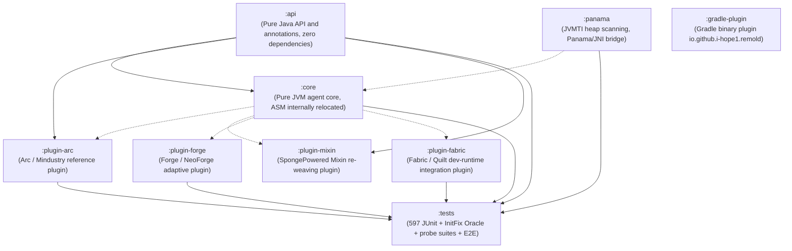

# Remold

**Edit code without restarting — the app keeps running, your change lands in half a second.**

[](https://github.com/I-hope1/Remold/releases)
[](https://jitpack.io/#I-hope1/Remold)
[](https://github.com/I-hope1/Remold/releases)
[](https://github.com/I-hope1/Remold/releases)
[](https://github.com/I-hope1/Remold/issues)
[](https://github.com/I-hope1/Remold/graphs/contributors)
[](https://github.com/I-hope1/Remold/actions)
[](LICENSE)

English | [简体中文](README.md)

Remold is a Java Agent: it watches your compiled output directory and swaps the new bytecode into the live JVM in place.
Two ready-to-run templates are included, one for Mindustry mods and one for Minecraft (Fabric) mods.
0.2.6 adds a two-phase schema-first redefine (read-through protection), opt-in initializer replay for live objects,
and Mixin anonymous/inner-class hot-swap.

## Stuck in this loop?

- Change one number → close the game → rebuild → launch → load the save → walk back to that spot → realize it was wrong → do it all again.
- Add a field to a class, hot-swap, and every existing object still holds `0` / `null` — NPE halfway through.
- Add a Mixin `@Inject`, hot-swap once, and the hook is gone. Restart.
- Tweak the logic inside one anonymous class, and after hot-swapping it lands in a different anonymous class.

## What Remold does

| What you hit | What Remold does |
|:--|:--|
| A change only takes effect after a restart | Watches `build/classes`; about 0.5s after you save, the bytecode is replaced in place — no restart, no reloading your save |
| New fields read as zero on existing objects | Backfills initial values into live instances after the swap; only zero values are touched, your manually changed state is never overwritten |
| Anonymous classes / lambdas land in the wrong slot | Aligns old and new anonymous classes by structural fingerprint instead of class names and indices that drift on every compile |
| Mixin hooks get washed out | Re-weaves the source-level bytecode through Mixin before redefining, keeping `@Inject` / `@Unique` / `@Shadow` intact |
| New code reads a not-yet-patched field right after the swap (sees `0` / NPE) | The internal batch path uses a two-phase redefine: commit the new structure with the old method bodies, patch live instances, then commit the new bodies (on by default in 0.2.6) |
| The first anonymous class inside a Mixin `@Inject` method, or a body-only edit of an already-loaded anonymous class | New bytes feed Mixin's bytecode provider and the generated `Target$Anonymous$<uuid>` is redefined in place — no more `ClassNotFoundException` / silent no-op |
| An initializer changed but you do not want to rebuild the objects | Opt-in double-brace / Kotlin `apply {}` static-holder replay writes the new constant only where the instance still holds the old constant (allowlist-gated, off by default) |
| A batch landing during start-up hangs the JVM | Start-up readiness gate + batch stall watchdog: one full thread dump with `[HOTSWAP-STALL]` when the threshold is crossed |
| Hot-swapping after deleting a field or changing its type crashes | Refuses the redefinition outright while live instances still exist, instead of corrupting memory |

## Demos

**Mindustry: edit a PNG, the in-game icon updates immediately** (no restart, no reloading your save)


**Minecraft (Fabric): change `message0`'s string value → `Ctrl+Shift+F9` → right-click in-game shows the new text immediately**


**Minecraft (Fabric): switch the Mixin injection point from `@At("TAIL")` to `@At("HEAD")` — `[MixinReload]` re-weaves the target class**


## Field note: adding a DPS dummy unit to Mindustry

A full record of one real session — the game stays running, Remold hot-swaps every edit, and IDEA Debugger
pulls the numbers on the main thread. Every figure below is measured output from the debugger, not an estimate.

**What was added**

- `DpsDummyUnit` — the DPS test dummy
  - `DpsDummyEntity extends UnitEntity`, overriding `rawDamage(float)`. Decompiling v160 shows `damage()` is
    `applyArmor → /healthMultiplier → /rules.unitHealth(team) → rawDamage`, and `damagePierce` also feeds
    `rawDamage` directly — so this is the single convergence point for every damage path, one override covers all of it.
  - 1e7 HP, with each hit clamped to `health - 1`, so it always survives with 1 HP and can be measured for minutes.
  - Placed on the enemy team (`rules.waveTeam`) — player turrets and units only lock onto hostiles, so a friendly dummy never gets shot.
  - A 1-second window reports window DPS / peak / cumulative; after 1 second of ceasefire it settles as
    "first hit → last hit" and never charges idle time to the denominator.
  - `EntityMapping.register("dps-dummy-entity", ...)` so saves and multiplayer can restore the custom entity by name.
  - Reuses `UnitTypes.flare`'s texture (checking for the `error` placeholder, not just null) and refreshes
    construction-time properties and localization in `@OnReload`.
- `ExampleJavaMod` — spawn entry: press <kbd>F8</kbd> at the cursor to spawn a dummy (`Trigger.update` polling,
  and it does not steal the key while the chat box is focused); plus `spawnDummyAt(x, y)` for the debugger / console.
  Bundle strings added in both Chinese and English.

**Measured (executed on the debugger's main thread, not derived)**

```plaintext
[VT-0] spawned=true cls=DpsDummyEntity team=crux hp=1.0E7
[VT-A] healthDrop=6000.0 counted=6000.0 diff=0.0          <- 60x100 damage, counter matches actual HP loss exactly
[VT-B] overkillDrop=9993999.0 healthLeft=1.0 alive=true   <- 2x max HP of overkill still leaves 1 HP
[VT-C] windowDamage=0.0 windows=1 bestDps=249.99998       <- 300 damage in a 1.20s window -> 250.0/s
[VT-E] windowsDelta=1 windowStart=-1.0 closed=true        <- settled after ceasefire: 400 damage / 1.00s -> 400.0/s
[VT-D] dummyTotalUnchanged=true                           <- control group: hitting a vanilla flare leaves the counter alone
```

**A real bug found along the way**: `Time.time` is in ticks, while `Time.toSeconds` measures 60 (ticks per second),
not 1/60. The first version multiplied by it, so a 1.2-second window became 4320 seconds and DPS read 0.07/s;
dividing instead landed exactly on 250.0/s. The same pass fixed "the window never closes → 0/s printed every second after ceasefire".

**Signals observed on the hot-swap path**: adding methods printed `+Added: [debugDpsSelfTest, runDpsSelfTest, lambda]`
→ `HotSwap successful`; deleting them printed `[LAYOUT-READERS] ... dangling=0` → `-Removed: [...]` → `HotSwap successful`.
That round both added and removed 3 methods, with no restart at any point. Removing the temporary self-check code took
effect on the next hot-swap, and a cold start afterwards logged `[ExampleJavaMod] Loading content...` with no anomalies.

**On the debugger**: `evaluate_expression` compiles its evaluation class separately, so a lambda that references
`arc`, `mindustry`, or project types fails. The workaround was to write the checks as static methods inside the mod,
call them from the debugger, and delete them afterwards — it works, but it is a detour.

## Up and running in 30 seconds

```bash
git clone https://github.com/I-hope1/Remold && cd Remold
./gradlew :example:runRemold
```

- Mindustry mod template: [`mindustry-mod-template/`](mindustry-mod-template/README.md) (includes a PNG texture hot-reload demo)
- Minecraft Fabric mod template: [`minecraft-fabric-template/`](minecraft-fabric-template/README.md) (**MC 1.21.1 baseline**; Mixin re-weaving + client HotSwap toast demo)
- 1.21.4 Fabric client gametest probe: [`tests/fabric-gametest-1.21.4/`](tests/fabric-gametest-1.21.4/README.md) (1.21.1's fabric-api has no `fabric-client-gametest-api-v1`, so that capability is kept standalone and is not shipped with the template)

## What's new in v0.2.6

- **Two-phase schema-first redefine (on by default).** Commit stage A — the new class structure with the **old**
  method bodies (constructors / `<clinit>` keep the new bodies) — patch live instances, then commit stage C (the new
  bodies). This closes the read-through window between `redefineClasses` returning and InitFix finishing; pure
  method-body edits keep the single-redefine fast path. `-Dremold.agent.two_phase=false` restores the old behaviour.
- **Initializer replay for live objects (L1 / A-track, off by default).** Double-brace initializers that write an
  inherited field, and Kotlin `object` / top-level `val` holders whose `<clinit>` runs `T().apply { field = ... }`,
  replay the new compile-time constant through a **conditional on the old constant**, so runtime-modified values are
  never overwritten.
- **Mixin anonymous/inner-class hot-swap.** The first anonymous class inside an `@Inject` handler no longer kills the
  reload; body-only edits of an already-loaded generated inner class redefine `Target$Anonymous$<uuid>` in place;
  weaving-generated synthetic bytes feed `BytecodeSources` so InitFix can read the constructor's visibility.
- **Structured batch report + client toast.** `api` gained `HotswapBatchReport` and
  `HotswapBatchListener.afterInternalBatchReport()` (elapsed time / redefined classes / Mixin member deltas / InitFix
  stats); the Fabric template's client toast renders it directly.
- **Start-up readiness gate + batch watchdog.** `HotswapPlugin.isHostReady()` lets a host defer batches until it is
  ready; `BatchWatchdog` dumps all thread stacks once with `[HOTSWAP-STALL]` when a batch exceeds
  `batch_stall_ms` (15 s by default).
- **Same-shape anonymous-class ambiguity + holder naming.** A body-similarity tier, then a scan-visible-zero-live-instance
  fallback (zero *visible* to the heap scan, which is not proof that instances are dead); orphan warnings name the real
  holder fields (assignment-flow proven / supertype candidates) and the `@RemoldReinit` escape hatch.
- **Class and asset debounce split.** `.class`/jar and resource/config events use independent trailing-edge quiet
  windows (800 ms / 250 ms by default), so an asset edit no longer postpones a class batch.

Full changes and known limits: [v0.2.6 Release Notes](docs/releases/v0.2.6.md).

## Want the internals?

Behind those capabilities sits a full stack: anonymous class topological alignment, confidence tiers and safety gates, bytecode slicing with effect analysis, and a patch driver for live instances.
You do not need any of it to use Remold — read §2 "What is solved vs known limitations" and §3 "Modular architecture" when you actually need them.

> Technical positioning: robust JVM class redefinition, anonymous class topological alignment, and legacy state reinitialization.

---

## 1. Quick Start

Remold runs as a Java Agent. For high-performance hot reloading of class structure changes, pair it with the enhanced redefinition support in **JetBrains Runtime (JBR 17/21/25+)** or **DCEVM (8/11)**.

### 1.1 Runtime and version baseline

- **Recommended runtime**: **JetBrains Runtime (JBR 17/21/25+)**, launched with `-XX:+AllowEnhancedClassRedefinition`.
- **Behaviour switches**: the two-phase redefine is on by default (`-Dremold.agent.two_phase=false` restores the
  single-phase path); L1 / A-track initializer replay is off by default and needs an allowlist; gate/watchdog
  thresholds and both debounce windows are listed in §1.7.
- **Panama module note**: `remold-panama` targets the finalized Foreign Function & Memory (FFM) API from JDK 22+. On JBR 17/21, prefer the JNI native acceleration library (`LibTool`) bundled in `remold-agent`.
- **Java 24+ native access**: newer JDKs need `--enable-native-access=ALL-UNNAMED`.

---

### 1.2 Option 1: Gradle script plugin (recommended, zero setup)

The lightweight script plugin resolves your class output paths, assembles the JVM arguments, and registers a `runRemold` task for you:

> [!IMPORTANT]
> **The script plugin must be version-pinned too.** `apply(from = ...)` has no `plugins { id(...) version ... }`
> coordinate, so always use a **tag** URL (`.../v0.2.6/remold.gradle.kts`) instead of `.../main/...`.
> The script and the `agent`/`api` must stay on the same version, otherwise the script builds arguments for a
> newer agent while the old agent runs — and it only blows up at runtime.

#### Groovy DSL (`build.gradle`):
```groovy
// Apply the script plugin (tag-pinned; for local development use rootProject.file('remold.gradle'))
def remoldRef = (findProperty('remold.version') ?: '0.2.6')
apply from: "https://raw.githubusercontent.com/I-hope1/Remold/v${remoldRef}/remold.gradle"

remold {
    // Optional: pin the Remold version (defaults to remoldVersion in gradle.properties)
    // The plugin resolves the matching agent jar from the repository or Releases and caches it
    // locally, so you never download it by hand.
    // version = '0.2.6'

    // Optional: point at a local remold-agent.jar. Otherwise libs/remold-agent.jar is preferred,
    // and the plugin downloads and caches one if it is missing.
    // agentJar = "libs/remold-agent.jar"

    // Optional: JBR path (defaults to the JBR_HOME env var or the jbr.home system property)
    // jbrPath = "/path/to/jbr"

    // Optional: class/jar debounce window in milliseconds (default 800; every .class event resets it)
    // fileShakeMs = 800
    // Optional: asset/config debounce window in milliseconds (default 250; never delays class batches)
    // assetShakeMs = 250

    // Optional: enable local JDWP debugging (default false, bound to loopback 127.0.0.1:5005)
    // debug = true
    // debugPort = 5005

    // Optional: main class (inferred automatically if the application plugin is applied)
    // mainClass = "your.package.Main"

    // Optional: JAR launch mode (game mods / standalone clients). Launches the target JAR
    // directly, avoiding class loader conflicts and manual mainClass wiring.
    // jar = "libs/game.jar"
    // args = ["-loadmods"] // Optional: main arguments passed to the launcher
    // autoDeploy = true    // Optional: build and copy the artifact into the deploy directory before launch
    // deployDir = "mods"   // Optional: deploy directory (implies autoDeploy; modsDir is an alias)
    // dependsOn 'jar'      // Optional: extra task to run before launching
}
```

#### Kotlin DSL (`build.gradle.kts`):
```kotlin
// Apply the script plugin (tag-pinned; for local development use file("../remold.gradle.kts"))
val remoldRef = (findProperty("remold.version") as String?) ?: "0.2.6"
apply(from = "https://raw.githubusercontent.com/I-hope1/Remold/v$remoldRef/remold.gradle.kts")

// Note: `remold { }` does NOT work from Kotlin DSL — the extension type lives inside the script plugin,
// so the IDE cannot generate a type-safe accessor for it (Groovy is dynamic and unaffected).
// Configure through gradle.properties or extra instead:
extra["remold.mainClass"] = "your.package.Main"
// extra["remold.version"] = "0.2.6"
// extra["remold.agentJar"] = "libs/remold-agent.jar"
// extra["remold.jbr"] = "/path/to/jbr"
// extra["remold.debug"] = true
// extra["remold.jar"] = "libs/game.jar"       // JAR launch mode
// extra["remold.autoDeploy"] = true
// extra["remold.deployDir"] = "mods"
```

#### Local development / version pinning

Loading a script plugin only has one real decision: **where to take it from**. The templates use these two lines:

```kotlin
// inside the Remold source tree, use the parent script (edits apply immediately); otherwise fetch the tag
apply(from = file("../remold.gradle.kts").takeIf { it.isFile }
    ?: "https://raw.githubusercontent.com/I-hope1/Remold/v${findProperty("remold.version") ?: "0.2.6"}/remold.gradle.kts")
```

- In the repo: `../remold.gradle.kts` exists → the local script is used, edits take effect immediately, no network;
- Outside: the file does not exist → fetch the tag matching `remold.version`, the same version as the agent and api.

#### Variant: Gradle plugin coordinates (uses Gradle's dependency cache, works offline)

Hand everything to the plugin jar; the build script keeps 4 lines and gets Gradle's dependency cache, checksums and
offline mode:

```kotlin
buildscript {
    repositories { maven("https://jitpack.io") }
    dependencies { classpath("com.github.I-hope1.Remold:gradle-plugin:v0.2.6") }   // version = Git tag
}
apply(plugin = "io.github.i-hope1.remold")
```

The plugin carries no second implementation: it bundles the repo-root `remold.gradle(.kts)` into its jar, extracts it to
`.gradle/remold/scripts/` and applies it verbatim (`.kts` for Kotlin DSL projects, `.gradle` for Groovy ones), so both
routes behave identically. Configuration is the same as Option 1 (`gradle.properties` / `extra[...]`; Groovy may use `remold { }`).

> [!TIP]
> The `gradle-plugin` module is published as stable artifacts starting from **`v0.2.0`**. Before that,
> `master-SNAPSHOT` works for a quick look (moves with the branch, not suitable for pinning).

> [!NOTE]
> You may also write `plugins { id("io.github.i-hope1.remold") version "v0.2.6" }`, but JitPack does not host plugin
> markers (`<plugin-id>:<plugin-id>.gradle.plugin`), so you must map it once via
> `pluginManagement.resolutionStrategy.eachPlugin { useModule("com.github.I-hope1.Remold:gradle-plugin:v${requested.version.removePrefix("v")}") }`
> in `settings.gradle.kts`. Publishing to the Gradle Plugin Portal is what removes that block.

A standalone reference for the binary plugin (coordinates, DSL options, task list, requirements) lives in
[`gradle-plugin/README.md`](gradle-plugin/README.md).

Launch with hot reloading:
```bash
./gradlew runRemold
```

> [!TIP]
> **How to avoid tying up the Gradle daemon**
> `runRemold` is a standard Gradle `JavaExec` task, so running it in the foreground blocks the build process. If you want the daemon free to run `./gradlew compileJava` at any time, pick one of these:
> 1. **One-off CLI run**: `./gradlew runRemold --no-daemon` (a temporary JVM, destroyed on exit, never occupies the resident daemon);
> 2. **Detached window**: `./gradlew startRemold` (launches the app in its own window and exits immediately, returning the daemon to IDLE);
> 3. **Generated native script**: `./gradlew generateRemoldScript` (writes `run-remold.bat` / `run-remold.sh` under `build/`, completely outside Gradle);
> 4. **Native IDEA launch**: use an IDEA Application run configuration (see Option 2 below — zero daemon overhead).

> [!TIP]
> **Want to see it immediately?** The repository ships a complete demo module. After cloning:
> ```bash
> ./gradlew :example:runRemold
> ```
> See [`example/README.md`](example/README.md) for details.

---

### 1.3 Option 2: IntelliJ IDEA run configuration (recommended ⭐)

If you prefer clicking "Run / Debug" in IDEA, the script plugin prepares everything for you:
* **Generated automatically**: opening the project or running a build writes a portable `Run_with_Remold.xml` into `.idea/runConfigurations/` (run `./gradlew generateIdeaRunConfig` to refresh it at any time);
* **One canonical location**: the agent and plugin jars are always synced into the project-local `.gradle/remold/` (plugins under `plugins/`), so the generated configuration only ever references `$PROJECT_DIR$/.gradle/remold/...` — never `build/libs` (wiped by `clean`) or `~/.gradle` paths that break on another machine;
* **Ready to use**: the run dropdown in the top-right corner shows **`Run with Remold`** — just hit run or debug;
* **Native and fast**: runs as a plain IDEA JVM process with full breakpoint support and zero Gradle daemon usage.

> [!TIP]
> **Pro Tip: 0.2s Incremental Compilation (Bypassing Gradle Daemon)**
> By default, IDEA may delegate builds to Gradle (*Settings -> Build Tools -> Gradle -> Build and run using: Gradle*). Running your application will monopolize the Gradle Daemon, forcing subsequent rebuilds to cold-start a second Gradle Daemon (costing 15~30s).
> **Best Practice**:
> 1. In IDEA *Settings -> Build, Execution, Deployment -> Build Tools -> Gradle*, switch **`Build and run using`** and **`Run tests using`** to **`IntelliJ IDEA`**;
> 2. After editing code, don't run a Gradle task. Simply press **`Ctrl + Shift + F9`** (on macOS: **`Cmd + Shift + F9`**) to recompile only the active file;
> 3. IDEA's built-in Javac compiles the single `.class` in **100~200ms**, completely bypassing the Gradle Daemon, and Remold swaps it into the live JVM instantly!

> [!NOTE]
> **Fabric Loom Run Configuration Auto-Sync**:
> In Minecraft Fabric development, Loom's `Minecraft Client` / `Minecraft Server` run configurations do not automatically update their VM parameters once generated. During `classes` or config generation the Remold script inspects and updates both `Minecraft_Client.xml` and `Minecraft_Server.xml` (Application-style `VM_PARAMETERS` and Gradle-style `vmOptions` are both supported), injecting `-javaagent`, `-Dremold.plugins=mixin` and the plugin jar. The Fabric Loom / ForgeGradle / NeoForge ModDevGradle **`server` run container, and Fabric's `clientGameTest` / `gameTest` gametest runs, receive the same JVM arguments as the client**, so `./gradlew runServer`, `./gradlew runClientGameTest` and IDEA's `Minecraft Server` launch with the agent attached — no manual VM-options editing.

To configure it by hand instead:

1. Open `Run` → `Edit Configurations...` in IDEA;
2. Select your Application or launch task;
3. Click `Modify options` → enable `Add VM options`;
4. Paste the following into the VM options field:

```text
-XX:+AllowEnhancedClassRedefinition
-javaagent:/path/to/remold-agent.jar=build/classes/java/main;build/classes/kotlin/main
--add-exports=java.base/jdk.internal.misc=ALL-UNNAMED
--add-exports=java.base/jdk.internal.reflect=ALL-UNNAMED
--add-exports=java.base/jdk.internal.loader=ALL-UNNAMED
--enable-native-access=ALL-UNNAMED
```

> [!WARNING]
> If you also need JDWP debugging, always bind it to loopback `127.0.0.1:5005`. Never use `*:5005` or `0.0.0.0:5005` (remote code execution risk):
> ```text
> -agentlib:jdwp=transport=dt_socket,server=y,suspend=n,address=127.0.0.1:5005
> ```

---

### 1.4 Option 3: Manual Gradle `JavaExec` task

Without the script plugin, you can register a `JavaExec` task yourself and feed it the compile output directory:

#### Kotlin DSL (`build.gradle.kts`):
```kotlin
tasks.register<JavaExec>("runWithRemold") {
    group = "application"
    description = "Run application with Remold Agent & JBR DCEVM"
    classpath = sourceSets["main"].runtimeClasspath
    mainClass.set("your.package.Main")

    // 1. Point at your JBR (recommended; javaLauncher / toolchains work too)
    // executable = "/path/to/jbr/bin/java"

    // 2. Resolve the compile output directory and hand it to the agent
    val watchDirs = sourceSets["main"].output.classesDirs.asPath
    val agentJar = file("libs/remold-agent.jar").absolutePath

    jvmArgs(
        "-XX:+AllowEnhancedClassRedefinition",
        "-javaagent:$agentJar=$watchDirs",
        "--add-exports=java.base/jdk.internal.misc=ALL-UNNAMED",
        "--add-exports=java.base/jdk.internal.reflect=ALL-UNNAMED",
        "--add-exports=java.base/jdk.internal.loader=ALL-UNNAMED",
        "--enable-native-access=ALL-UNNAMED"
    )
}
```

#### Groovy DSL (`build.gradle`):
```groovy
tasks.register("runWithRemold", JavaExec) {
    group = "application"
    description = "Run application with Remold Agent & JBR DCEVM"
    classpath = sourceSets.main.runtimeClasspath
    mainClass = "your.package.Main"

    // 1. Point at your JBR (recommended; javaLauncher / toolchains work too)
    // executable = "/path/to/jbr/bin/java"

    // 2. Resolve the compile output directory
    def watchDirs = sourceSets.main.output.classesDirs.asPath
    def agentJar = file("libs/remold-agent.jar").absolutePath

    jvmArgs "-XX:+AllowEnhancedClassRedefinition",
            "-javaagent:${agentJar}=${watchDirs}",
            "--add-exports=java.base/jdk.internal.misc=ALL-UNNAMED",
            "--add-exports=java.base/jdk.internal.reflect=ALL-UNNAMED",
            "--add-exports=java.base/jdk.internal.loader=ALL-UNNAMED",
            "--enable-native-access=ALL-UNNAMED"
}
```

---

### 1.5 Option 4: Command line

Download the latest `remold-agent.jar` from [Releases](https://github.com/I-hope1/Remold/releases) (ASM 9.11.1 and the native acceleration library are shaded and relocated inside it):

```bash
java -XX:+AllowEnhancedClassRedefinition \
     -javaagent:remold-agent.jar=build/classes/java/main \
     --add-exports java.base/jdk.internal.misc=ALL-UNNAMED \
     --add-exports java.base/jdk.internal.reflect=ALL-UNNAMED \
     --add-exports java.base/jdk.internal.loader=ALL-UNNAMED \
     --enable-native-access=ALL-UNNAMED \
     -jar your-application.jar
```

---

### 1.6 Gradle dependency (JitPack)

To use the annotations (`@RemoldReinit`, `@OnReload`) or the extension SPI (`HotswapPlugin`, `BytecodeTransformerBridge`) in your own code, add the `api` module:

```groovy
repositories {
    maven { url 'https://jitpack.io' }
}

dependencies {
    compileOnly 'com.github.I-hope1.Remold:api:v0.2.6'
}
```

Maven Central coordinates are reserved: `io.github.i-hope1.remold:api:0.2.6`.

---

### 1.7 Behaviour switches

These system properties can be passed to the application JVM (the Gradle plugin forwards the agent arguments for
you; the Gradle DSL equivalent is shown in parentheses):

| System property | Default | Effect |
|:--|:--|:--|
| `-Dremold.agent.two_phase` | `true` | Two-phase schema-first redefine (closes the read-through window); `false` restores the single-phase fast path |
| `-Dremold.agent.init_drift.parents` | empty (off) | Parent-class allowlist for L1 double-brace initializer replay (comma separated) |
| `-Dremold.agent.init_drift.apply_holders` | empty (off) | Holder allowlist for A-track Kotlin `object` / top-level `val` replay (comma separated) |
| `-Dremold.agent.ready_timeout_ms` | `0` | Start-up readiness gate timeout; `0` means never release early (better to stay deferred than to land a batch before the host is ready) |
| `-Dremold.agent.batch_stall_ms` | `15000` | Batch stall watchdog threshold (floor `5000`); crossing it prints one `[HOTSWAP-STALL]` full thread dump |
| `-Dremold.agent.file_shake_ms` | `800` | Class/jar debounce window (Gradle DSL: `fileShakeMs`) |
| `-Dremold.agent.asset_shake_ms` | `250` | Resource/config debounce window, independent of the class window (Gradle DSL: `assetShakeMs`) |

The remaining safety-gate switches (`remold.agent.layout_gate`, `anon_align`, `anon_strict`, `local_class_guard`,
`offset_strict`, …) are documented in [`AGENTS.md`](AGENTS.md) and [`docs/status.md`](docs/status.md).

---

## 2. What is Solved vs Known Limitations

Facts first — the capability boundary is stated explicitly.

### 2.1 What is solved

1. **Anonymous class hijacking and misalignment caused by source changes**:
   - `AnonClassAligner` uses confidence tiers 1–4 (exact fingerprint, topological isomorphism, self hash, call-chain tracing) to align anonymous classes across compilations, removing the unreliable name-based pass-through entirely.
2. **New fields on live instances reading as zero after a class grows**:
   - `InitFix` combines constructor parameter tracing, the NestView single-write proof, and reverse bytecode slicing to inject initial values into live heap instances and static state with conditional CAS, so nothing silently reads zero. An opt-in double-brace / Kotlin `apply {}` static-holder replay (L1 / A-track, allowlist-gated) additionally rewrites live values only while they still hold the old constant.
3. **Mixin / AOP slices being washed out by redefinition**:
   - `BytecodeTransformerBridge` plus the dual-baseline scheme (source baseline vs effective baseline) re-weaves Mixin-injected hooks and fields on every hot swap, keeping the AOP chain intact. Newly declared Mixin members, config removal/re-add, brand-new Mixin classes, and anonymous/inner classes introduced or edited inside a Mixin handler all go through the same shared reflection engine and inner-class hot-swap loop.
4. **Destructive field changes breaking live objects**:
   - `LayoutGate` and `LocalClassGuard` refuse the redefinition while live instances exist for a deleted or retyped field, protecting memory safety.
5. **Transparent takeover of redefinitions issued by IDEs / JDWP**:
   - A `ThreadLocal` marker distinguishes the caller, so clicking "Reload Changed Classes" in the IDE still triggers Mixin re-weaving and the safety-gate review.
6. **JVMTI native whole-heap instance lookup with concurrency isolation**:
   - The C++ library scans the whole heap in sub-millisecond time behind a global mutex and dynamic tag isolation; the entire hot-swap pipeline is serialized by the `HOTSWAP_LOCK` reentrant lock.
7. **The read-through window between redefinition and patch completion**:
   - Closed on the internal batch path (file watch → `processChanges`) by the two-phase schema-first redefine; the external IDE/JDWP and `redefineDynamic` single-class channels remain single-phase (see §2.2).
8. **Start-up batches and hot-swap observability**:
   - `StartupGate` + `HotswapPlugin.isHostReady()` defer batches at start-up, `BatchWatchdog` prints one `[HOTSWAP-STALL]` full thread dump when a batch crosses the threshold, and `HotswapBatchReport` reports per-batch elapsed time / redefined classes / Mixin deltas / InitFix stats.

### 2.2 Known limitations

1. **Orphan lambda stack escape**:
   - Only protected framework dispatch points (registered through `OrphanBreakerPredicate`) get a local circuit-break that throws `NoSuchMethodError` to force deregistration; ordinary uncontrolled business stacks degrade to zero values, and a `CallSite` reference held by a business thread cannot be physically revoked.
2. **Named local classes with nested anonymous classes**:
   - Deeply nested anonymous classes inside local classes have a name-based pass-through blind spot in specific scenarios.
3. **JIT constant folding of `static final`**:
   - Constants already folded into JIT-compiled code cannot be reversed by a memory write alone.
4. **Instance snapshot clock window**:
   - Between the JVMTI heap snapshot and the patch taking effect, objects created by concurrent threads fall into a small timing window.
5. **Complex control-flow slices**:
   - Slices containing branches (if/switch), loops, try-catch, or external mutable builders are firmly rejected by the safety gate and recorded in the `FieldLedger` instead of being written silently.
6. **The external redefine channels remain single-phase**:
   - IDE/JDWP redefinitions and the `redefineDynamic` single-class channel commit the full new bytecode before patching, so the read-through window is still open there; fields rejected by the safety gates are not compensated by two-phase either (restart semantics).
7. **NeoForge 26.x / FML 10+ and the production installer launch path are unsupported / unverified**:
   - NeoForge 26.x removed ModLauncher (entry point `net.neoforged.fml.startup.Client`); the cross-ClassLoader bridge is written against ModLauncher semantics, so the 21.1 evidence must not be extrapolated. The production installer (`unix_args.txt`) module ownership and `--add-opens` requirement need a separate test.
8. **plugin and core must ship in lockstep; anonymous-class member changes still need a restart**:
   - Version skew degrades to `NoSuchMethodError` (caught per plugin with a directed log, but unsupported). Adding/removing fields or methods on a Mixin-generated anonymous class is rejected with a directed diagnostic, and `ForgeMixinHotSwap` is not wired into the inner-class loop.
9. **Real-client GUI acceptance is still manual**:
   - Container probes cover dedicated servers (Fabric KnotServer / Forge `runServer`); the client-side result columns of template scenarios 1–8 in [`docs/acceptance/01-manual-checklist.md`](docs/acceptance/01-manual-checklist.md) await manual confirmation.

---

## 3. Modular Architecture

The repository is fully decoupled into modules:



- **`:api`**: the lightweight public API (`@RemoldReinit`, `@OnReload`, `@Profile` plus the `HotswapPlugin`, `OrphanBreakerPredicate`, and `BytecodeTransformerBridge` extension SPIs, the `HotswapBatchReport` / `HotswapBatchListener.afterInternalBatchReport()` structured batch report, and the `HotswapPlugin.isHostReady()` readiness vote).
- **`:core`**: the agent engine. **ASM 9.11.1 is shaded and relocated to `remold.internal.asm.*`**, so there is never an ASM version or class loader clash with application-level frameworks (Mixin, ByteBuddy, Spring). Internally it also hosts the two-phase redefine orchestration (`applyTwoPhase`), the `StartupGate` readiness latch, the `BatchWatchdog`, the `DebounceWindow` class/asset state machine, the `BytecodeSources` port for weaving-generated class bytes, the offset-drift gates, and the shared `remold.reflect.mixin` reflection engine.
- **`:panama`**: the Panama (FFM) and JNI/JVMTI bindings layer; the JVMTI native acceleration library (C++ sources plus prebuilt `libtool` binaries) ships inside `:core`, and together they provide sub-millisecond whole-heap instance lookup on Windows (x64), Linux (x64), and macOS (x64/arm64).
- **`:plugin-arc`**: the reference plugin, showing how to extend UI layout-tree comparison and framework-level polling circuit breaks through the SPI.
- **`:plugin-mixin`**: the SpongePowered Mixin ecosystem plugin. It hands the source-level bytecode back to Mixin before redefinition (preserving `@Inject` / `@Unique` / `@Shadow` output), and when a Mixin class itself changes it refreshes the Mixin runtime state and re-weaves the affected target classes. Fabric Loom projects mount it automatically through the Gradle script.
- **`:plugin-forge`**: the adaptive Minecraft Forge & NeoForge plugin. It punches through ModLauncher / NeoForge classloader isolation for Mixin re-weaving and automatically refreshes and re-registers the event bus upon `@SubscribeEvent` / `@EventBusSubscriber` changes. ForgeGradle and ModDevGradle projects mount it automatically through the Gradle script.
- **`:plugin-fabric`**: the Fabric / Quilt dev-runtime integration plugin. It injects `fabric.classPathGroups` (without it hot reload silently does nothing), excludes the `mods` directory from watching, and quarantines a stale build JAR in `run/mods` that carries the same mod id; Fabric Loom projects mount it automatically through the Gradle script.
- **`:gradle-plugin`**: the Gradle binary plugin (coordinate `io.github.i-hope1.remold`) exposing the typesafe `remold { ... }` DSL, the `runRemold` / `startRemold` / `generateRemoldScript` tasks and IDEA run-configuration generation; the repository-root `remold.gradle(.kts)` is only a thin shim over it.
- **`:example`**: a minimal demo app for agent watching, live-instance field initialization, and the `@OnReload` lifecycle callback.
- **`:tests`**: the regression and compatibility suite — 597 JUnit tests (fixtures compiled on the fly across javac 8/11/17/21/25, covering topology alignment, layout prediction and native heap scanning), 51 scenarios / 350 InitFix Oracle positive/negative assertions, the Mixin/JDWP end-to-end probes such as `mixinProbe`, and the real KnotServer anonymous-class S0–S7 probe.

---

## 4. API & Examples

### 4.1 Plugins & dispatcher

#### Option 1: declarative auto-loading (strongly recommended ⭐)
Remold can load extension plugins declaratively through system properties or Gradle config (for example the Mindustry / Arc plugin `arc`):
- **`gradle.properties`**:
  ```properties
  remold.plugins=arc
  ```
- **Gradle DSL (`build.gradle.kts` / `build.gradle`)**:
  ```kotlin
  remold {
      plugins("arc")
  }
  ```
  The Gradle plugin downloads the matching `remold-plugin-arc.jar` and mounts it on the agent through JVM arguments (`-Dremold.plugins=arc -Dremold.plugin.jars=...`). **Your mod or application code pulls in no Remold dependency at all — zero intrusion, zero residue.**

- **Mixin ecosystems (Fabric / Quilt and friends) need no declaration**: `remold.gradle(.kts)` detects the `fabric-loom` plugin or `net.fabricmc` / `org.spongepowered` dependencies and mounts the `mixin` plugin automatically. Disable it with `-Premold.autoMixin=false`. When developing the plugin itself, point at a local build with `remold { pluginJar("../<remold repo>/plugin-mixin/build/libs/remold-plugin-mixin-<ver>.jar") }`.
- **Forge / NeoForge ecosystems need no declaration**: `remold.gradle(.kts)` detects ForgeGradle or ModDevGradle and mounts the `forge` plugin automatically. Disable it with `-Premold.autoForge=false`.
- **Fabric / Quilt dev-runtime integration needs no declaration**: `remold.gradle(.kts)` detects the `fabric-loom` / `dev.architectury.loom` / `org.quiltmc.loom` / `loom` extension or `net.fabricmc` / `org.quiltmc` dependencies and mounts the `fabric` plugin automatically — it injects `fabric.classPathGroups` (missing it makes hot reload silently do nothing), excludes the `mods` directory from watching, and quarantines a stale build JAR in `run/mods` that shares this project's mod id (renamed to `.remold-disabled`, disable with `-Dremold.agent.mods_quarantine=false`); disable the plugin with `-Premold.autoFabric=false`.

#### Option 2: explicit registration in code
To write and register a custom plugin from application code:
```java
import remold.RemoldAgent;

// 1. Install a main-thread dispatcher (default: Runnable::run)
RemoldAgent.setMainThreadDispatcher(myAppDispatcher::post);

// 2. Register a custom framework plugin
RemoldAgent.registerPlugin(new MyFrameworkHotswapPlugin());

// 3. Register a bytecode re-weaving bridge (Mixin compatibility, for example)
RemoldAgent.addTransformerBridge((loader, className, targetClass, currentBytes) -> {
    return myMixinTransformer.transform(className, currentBytes);
});
```

### 4.2 Annotations for live-field initialization and lifecycle
```java
import remold.annotation.RemoldReinit;
import remold.annotation.OnReload;

public class PlayerService {
    // Default behaviour: a new field is only backfilled where the live instance still holds zero (0/null)
    private String nickname = "DefaultName";

    // OVERWRITE: force a CAS write even if the live instance already holds a non-default value
    @RemoldReinit(mode = RemoldReinit.Mode.OVERWRITE)
    private int scoreVersion = 2;

    // Lifecycle callback fired after the hot reload completes
    @OnReload
    private void onReload() {
        System.out.println("PlayerService reloaded for: " + nickname);
    }
}
```

> **`@OnReload` is a callback on the existing instances of *that class*, not a "your mod was reloaded" notification.**
> An instance method runs once per live instance (zero instances means it never runs); a static method runs once
> per hotswap. It looks like a mod-level notification only because a mod main class usually has exactly one
> instance in the process. If the class was not successfully redefined this round (rejected by the layout gate or
> the aligner), the callback never fires. See the `OnReload` Javadoc for the full contract.

> **When `@RemoldReinit` takes effect, the log names the fields**:
> `[REINIT] @RemoldReinit applied to example.ExampleJavaMod: message (OVERWRITE, static)`.
> The patch log itself only says "N fields patched", which cannot tell "a new field was initialized" apart from
> "the annotation asked for a live value to be reset". Fields that did not take effect are marked on the same
> line with `failed` / `skipped` / `no live instance`. Nothing is printed when no field carries the annotation.

> **It resets when the initializer expression changes, not whenever the class is hotswapped**: a method-body-only
> reload no longer throws live values back to their initializers (the log then shows
> `[REINIT] @RemoldReinit kept as-is`). The decision is made from the initializer slice fingerprint, and only for
> **closed expressions** — literals and constant arithmetic whose value is fully determined by their own bytecode.
> If the initializer reads external state — `= ConfigLoader.getDefaultTag()`, `= Other.VALUE` — the slice can stay
> byte-for-byte identical while the callee changes what it returns in that very round. That case cannot be proven
> unchanged, so it **still resets on every reload**: one redundant write beats silently keeping a stale value.
> See the `RemoldReinit` Javadoc for the full contract.

### 4.3 Batch report

When a batch finishes, the agent publishes an immutable structured report (elapsed time, redefined classes,
Mixin member deltas, InitFix stats) next to the existing `afterInternalBatch(List)` callback — as a supplement,
not a replacement:

```java
import remold.HotswapBatchListener;
import remold.HotswapBatchReport;
import remold.RemoldAgent;

RemoldAgent.addBatchListener(new HotswapBatchListener() {
    @Override
    public void afterInternalBatchReport(HotswapBatchReport report) {
        System.out.println("batch elapsed=" + report.getElapsedMillis() + "ms"
            + " redefined=" + report.getRedefinedClasses().size()
            + " initFix=" + report.getInitFixStats());
        for (HotswapBatchReport.MixinChange change : report.getMixinChanges()) {
            // deltaKnown=false means there is no comparable previous version; the delta fields are 0
            // and must NOT be read as "nothing added". Totals stay valid.
            System.out.println(change.getMixinClass() + " deltaKnown=" + change.isDeltaKnown()
                + " handlers=" + change.getInjectHandlerCount()
                + " uniqueFields=" + change.getUniqueFieldCount());
        }
    }
});
```

- `getElapsedMillis()` returns `HotswapBatchReport.UNKNOWN_ELAPSED` (`-1`) when no start time was available — do not treat it as 0.
- The callback only fires for batches with observable activity, and it may fire on a batch with **no `ClassDefinition`** (for example a Mixin-template-only edit), so "the `afterInternalBatch` list is non-empty" is not an equivalent predicate.
- Host/loader integrations can also implement `HotswapPlugin.isHostReady()` (default `true`) so the agent defers start-up batches instead of trying to land them.

---

## 5. Building & Verification

The project builds with Gradle and requires JDK 21+.

### Run the full verification matrix
```bash
./gradlew fullCheck   # = check + e2eProbe (use this before a release / in CI)
./gradlew check       # day-to-day: JUnit + doc-marker scan + test-count floor
```

The pipeline enforces:
1. **597 JUnit tests** (fixtures compiled on the fly across javac 8/11/17/21/25, covering topology alignment, layout prediction and native heap scanning; asserts 0 skipped, 0 failures);
2. **51 scenarios / 350 InitFix Oracle differential assertions** (covering Java and real Kotlin compiler output, both positive state tracing and negative safety blocking);
3. **Mixin and JDWP redefinition end-to-end checks such as `mixinProbe`**;
4. **The LayoutGate rule table, GhostProbe stack probing, concurrency hardening tests, and deferred-fingerprint E2E assertions**;
5. **A purity scan of status markers in docs and source (`verifyDocStatusMarkers`)** and the test-count guard (`verifyTestCount`).

---

## 6. License

This project uses a per-module multi-licensing scheme:

- **Core engine, Panama extension, and API specification** (`:api`, `:core`, `:panama`): **[Apache License 2.0](LICENSE)** — commercially friendly, no copyleft, includes a patent grant.
- **Gradle build plugin** (`:gradle-plugin`): **[Apache License 2.0](LICENSE)**. It only materializes and applies `remold.gradle(.kts)` and assembles JVM arguments at build time; it neither links nor ships Mindustry / Arc code, so it does not inherit the GPL-3.0 of `:plugin-arc`.
- **Mindustry / Arc framework plugin** (`:plugin-arc`): **[GNU General Public License v3.0 (GPL-3.0)](plugin-arc/LICENSE)**, fully aligned with the upstream GPL-3.0 of Mindustry and Arc.
- **Mixin ecosystem plugin** (`:plugin-mixin`): **[GNU General Public License v3.0 (GPL-3.0)](plugin-mixin/LICENSE)**, consistent with `:plugin-arc`. The copyleft here is **a deliberate policy, not license contagion**: SpongePowered Mixin is MIT and Fabric API is Apache-2.0, and both are `compileOnly` dependencies that are never shipped with the artifact.
- **Mod templates** (`mindustry-mod-template`, `minecraft-fabric-template`): **[MIT](mindustry-mod-template/LICENSE)**, so you can copy them into your own project and modify, commercialize, or distribute them closed-source. The templates only reference Remold through build scripts and the `compileOnly` API — they contain no Remold code, so the GPL-3.0 of the plugin layer does not apply to them.
