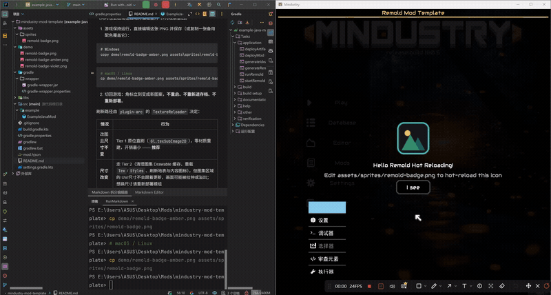
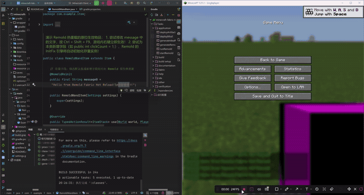
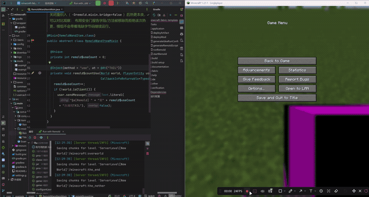

# Remold

<p align="center">
  <a href="https://github.com/I-hope1/Remold/releases"></a>
  <a href="https://jitpack.io/#I-hope1/Remold"></a>
  <a href="https://github.com/I-hope1/Remold/releases"></a>
  <a href="https://github.com/I-hope1/Remold/releases/latest"></a>
  <a href="https://github.com/I-hope1/Remold/issues"></a>
  <a href="https://github.com/I-hope1/Remold/graphs/contributors"></a>
  <a href="https://github.com/I-hope1/Remold/actions"></a>
  <a href="LICENSE"></a>
</p>

English | [简体中文](README.md) · [Gradle plugin reference](gradle-plugin/README.md) · [Status & known limits (status.md)](docs/status.md) · [Mixin subsystem docs](docs/mixin/01-invariants-and-classloader-authority.md)

Remold is a JVM hot-reload agent. It watches your compile output directories (e.g. `build/classes`) and, whenever a `.class` or a resource changes, swaps the new bytes into the running JVM in place — no game restart, no save reload. It currently targets **Mindustry (Arc)** and **Minecraft (Fabric / Quilt / Forge / NeoForge)** mod development, and the repository ships two ready-made project templates: [`mindustry-mod-template/`](mindustry-mod-template/README.md) and [`minecraft-fabric-template/`](minecraft-fabric-template/README.md).

## Demo

**Mindustry: editing a PNG texture refreshes in place** (no restart, no save reload)



**Minecraft (Fabric): change the `message0` string → `Ctrl+Shift+F9` → right-click in game shows the new text**



**Minecraft (Fabric): move a Mixin injection point from `@At("TAIL")` to `@At("HEAD")` — the target class is re-woven**



---

## Getting started

You need **JetBrains Runtime (JBR 17/21/25+)** with `-XX:+AllowEnhancedClassRedefinition` (a plain JDK only accepts method-body edits; structural changes are skipped automatically. Java 24+ additionally needs `--enable-native-access=ALL-UNNAMED`).

To see it working first, run the bundled example module (JDK 21+; dependencies are downloaded on first run):

```bash
git clone https://github.com/I-hope1/Remold && cd Remold
./gradlew :example:runRemold
```

### Wiring it into your own project

The plugin is published to the **Gradle Plugin Portal**, so no extra repository is needed (JitPack included):

```groovy
plugins { id 'io.github.i-hope1.remold' version '0.2.8' }
```

Alternatively apply the script plugin in `build.gradle` (pin the URL to a concrete version tag — never `main` — so the build plugin and the agent stay on the same version):

```groovy
def remoldRef = (findProperty('remold.version') ?: '0.2.8')
apply from: "https://raw.githubusercontent.com/I-hope1/Remold/v${remoldRef}/remold.gradle"

remold {
    // Reads remold.version from gradle.properties by default; downloads and caches the matching remold-agent.jar.
    // If a local remold-agent.jar manifest version differs from remold.version, the configured release is
    // re-resolved and synced over .gradle/remold/remold-agent.jar (an explicit agentJar is only warned about).
    // jbrPath = "/path/to/jbr" // defaults to the JBR_HOME env var or the jbr.home system property
    // fileShakeMs = 800        // .class debounce window in ms (default 800)
    // assetShakeMs = 250       // resource/config debounce window in ms (default 250)
    // attach('run', tasks.named('test')) // inject agent + JBR into existing JavaExec / Test tasks without mainClass
}
```

With the Kotlin DSL (`build.gradle.kts`), `apply(from = ...)` gives the IDE no type-safe accessors for the script extension, so either pull in the binary plugin `com.github.I-hope1.Remold:gradle-plugin:v<version>` via `buildscript` and `apply(plugin = "io.github.i-hope1.remold")`, or configure through `extra["remold.mainClass"] = "..."`. Offline builds can point at a local plugin jar with `-Premold.pluginJar=<path>`; see [`gradle-plugin/README.md`](gradle-plugin/README.md).

The plugin attaches extensions based on the project type:
- **Fabric / Quilt projects**: when Loom is detected it attaches the `mixin` and `fabric` plugins (injects `fabric.classPathGroups`, and renames stale build jars of the same modId under `run/mods` to `.remold-disabled` to isolate them);
- **Forge / NeoForge projects**: when ForgeGradle or ModDevGradle is detected it attaches the `forge` plugin (re-weaves Mixin through ModLauncher, and refreshes `EVENT_BUS` when `@SubscribeEvent` methods are added or removed);
- **Mindustry projects**: add one line `remold.plugins=arc` to `gradle.properties` to enable UI layout comparison plus texture/audio/shader/bundle hot reload.

### Day-to-day workflow (IDEA incremental compilation recommended)

Do not run `./gradlew runRemold` in the foreground while also compiling through Gradle — the two processes fight over the Gradle daemon and every compile costs ten-odd extra seconds. Recommended:

1. Open the project or run `./gradlew generateIdeaRunConfig`; IDEA generates a **`Run with Remold`** run configuration in the top-right corner (Loom / Forge / NeoForge projects also get the `-javaagent` arguments mirrored into `Minecraft Client`, `Minecraft Server` and the `gameTest` configurations).
2. In *Settings -> Build, Execution, Deployment -> Build Tools -> Gradle*, set both **`Build and run using`** and **`Run tests using`** to **`IntelliJ IDEA`**.
3. Start the game with `Run with Remold` (or `Minecraft Client`); after an edit press **`Ctrl + Shift + F9`** (macOS: `Cmd + Shift + F9`). IDEA's built-in `javac` writes the single `.class` in ~0.1–0.2 s and the change lands once the debounce window elapses.

If you bypass the Gradle plugin and configure the VM arguments by hand in IDEA or on the CLI, there are only two of them (for JDWP remote debugging, always bind to `127.0.0.1:5005`, never `0.0.0.0`):

```text
-XX:+AllowEnhancedClassRedefinition
-javaagent:/path/to/remold-agent.jar=build/classes/java/main;build/classes/kotlin/main
```

### System properties

The following JVM system properties can be overridden as needed (the Gradle plugin forwards the matching DSL entries):

| System property | Default | Effect |
|:--|:--|:--|
| `-Dremold.agent.two_phase` | `true` | Two-phase schema-first redefine; `false` falls back to single-phase |
| `-Dremold.agent.init_drift.parents` | empty (off) | L1 double-brace initializer replay allowlist of parent classes (comma separated) |
| `-Dremold.agent.init_drift.apply_holders` | empty (off) | A-track Kotlin `object` / top-level `val` holder allowlist (comma separated) |
| `-Dremold.agent.ready_timeout_ms` | `0` | Start-up readiness gate timeout in ms; `0` means never release early |
| `-Dremold.agent.batch_stall_ms` | `15000` | Batch stall watchdog threshold (floor `5000`); one `[HOTSWAP-STALL]` full thread dump on timeout |
| `-Dremold.agent.file_shake_ms` | `800` | Class/jar debounce window (Gradle DSL: `fileShakeMs`) |
| `-Dremold.agent.asset_shake_ms` | `250` | Resource/config debounce window, independent of the Class window (Gradle DSL: `assetShakeMs`) |

The remaining safety-gate switches (`layout_gate`, `anon_align`, `anon_strict`, `local_class_guard`, `offset_strict`, …) are documented in [`AGENTS.md`](AGENTS.md) and [`docs/status.md`](docs/status.md).

---

## How it works

Running mod development on plain JBR hot-swap plus the IDE's built-in HotSwap usually runs into uninitialised new fields, shifted lambda ordinals and washed-out Mixin hooks. Remold sits between the file watcher and `Instrumentation.redefineClasses`:

| What you hit | What Remold does |
|:--|:--|
| Every change needs a restart | Watches `build/classes` and swaps bytecode and resources in place |
| Old objects hold `0` / `null` for a newly added field | Scans live instances on the heap and backfills initial values by constructor slice |
| New code reads a not-yet-patched field right after the swap | Commits "new structure + old method bodies" first, patches instances, then switches to the new bodies |
| Adding/removing lambdas or anonymous classes shifts event or button slots | Remaps `lambda$*` and `$1` / `$2` slots by structural fingerprint |
| Deleting a listener lambda makes the main loop throw every frame | Generates an orphan fallback stub that unregisters itself at the framework dispatch point |
| Mixin hooks get washed out, or editing a Mixin errors out | Re-weaves the target class before redefining, syncs `ClassInfo` and hot-swaps inner classes |
| Changing a Mixin anonymous class's captured variables makes the client crash with a sporadic NPE | Any member-schema change on an already-loaded synthetic class is refused, and the host target class **stops with it** (transactional co-abort); restoring the capture list lets the same session heal itself |
| Deleting a field or changing a type might corrupt memory | Checks live instances, out-of-batch readers and physical offsets; refuses and asks for a restart when unsafe |

Implementation notes:
- **Two-phase redefine and `InitFix`.** When a class gains fields, stage A commits the new field layout together with the *old* method bodies (constructors keep the new bodies); a bundled JVMTI native library then walks live instances and writes the values sliced out of `<init>` back through a hidden companion class with a conditional CAS (by default only zero values are filled, runtime-modified state is never overwritten; with the allowlist enabled, double-brace initialisers and Kotlin `apply {}` static holders also replay their old constants). Stage C then commits the new bodies, which closes the concurrent read-through window between `redefineClasses` returning and the patch completing.
- **Lambda and anonymous-class alignment (`LambdaAligner` / `AnonClassAligner`).** Adding or removing a lambda or anonymous class early in a source file shifts every `javac`-generated ordinal, and a change in capture state (static/instance) can trigger `IncompatibleClassChangeError`. Remold parses `invokedynamic` bootstrap arguments, instruction fingerprints and method-body similarity to remap shifted methods and anonymous-class names back onto the old slots that already-bound instances refer to.
- **Cross-classloader Mixin closed loop.** Remold maintains a source-level baseline and an effective baseline, and hands ordinary classes back to Mixin for re-weaving before redefining them. When a Mixin template adds or removes `@Inject` / `@Unique` members, edits `*.mixins.json`, introduces a new Mixin class, or adds/edits an anonymous inner class (`Target$Anonymous$<uuid>`) inside an `@Inject` method, it first syncs the metadata through `ClassInfoMemberSync` and feeds the synthetic class bytes back into `BytecodeSources`, then cascades the redefinition into the target class.
- **Single exit, transactional co-abort for synthetic anonymous classes (`redefineSyntheticSafely` / `BytecodeTransformerBridge.Abort`).** A Mixin-generated anonymous class stores its captured variables in synthetic fields, so changing the capture list changes both the field table and the `<init>` descriptors. On JBR/DCEVM a member-schema change on an *already loaded* synthetic class makes the VM re-lay-out instances and wipe fields of unrelated classes — even when that class has zero instances on the heap. Such edits are therefore refused outright and the host target is aborted with them (no `redefineClasses` for the host in that round); refusals are de-duplicated by **candidate-byte signature**, and restoring the capture list clears the record so the same session heals. See [`docs/mixin/05-synthetic-inner-gate-and-abort.md`](docs/mixin/05-synthetic-inner-gate-and-abort.md).
- **Safety gates (`LayoutGate` / `RemovedMemberReaders` / `SuperclassDriftGate`).** When a field or method is deleted, out-of-batch constant-pool readers are scanned per JVMS 5.4.3.2 / 5.4.6; when a superclass gains or loses fields, a throwaway class loader predicts whether subclass physical offsets would invalidate `VarHandle`s, and Gson / Jackson / Arc Json reflection caches are evicted after the redefine.

### Documentation index

| Topic | Document |
|:--|:--|
| Mixin hot-swap subsystem (8 parts: classloader authority / admission & overlay / re-weave & member alignment / reload structure contracts / synthetic gate / walkthrough / runtime diagnostics / decision ledger) | [`docs/mixin/01..08`](docs/mixin/01-invariants-and-classloader-authority.md) |
| Anonymous-class topology alignment (admission, cascading pipeline, confidence tiers, layout gate, lambda capture bridge) | [`docs/topology/01..09`](docs/topology/01-invariants-and-remapping.md) |
| InitFix safety gates, closure and ledger, two-phase design | [`docs/initfix/01..13`](docs/initfix/01-safety-gate.md) |
| Physical offsets and third-party cache eviction | [`docs/offset/01`](docs/offset/01-offset-and-reflection-cache.md) |
| Per-feature implementation status, acceptance evidence, known risks (single source of truth) | [`docs/status.md`](docs/status.md) |

---

## Annotations and extension API

With automatic hot reload alone, business code needs no Remold dependency at all. To control re-initialisation of existing fields, write reload callbacks or consume `HotswapBatchReport`, add `:api` as `compileOnly` (replace the version with the tag you use):

```groovy
repositories { maven { url 'https://jitpack.io' } }
dependencies { compileOnly 'com.github.I-hope1.Remold:api:v0.2.8' }
```

```java
import remold.annotation.RemoldReinit;
import remold.annotation.OnReload;

public class PlayerService {
    // Default: a newly added field is only backfilled on existing instances while it is still zero (0/null)
    private String nickname = "DefaultName";

    // OVERWRITE: when this field's initializer expression changes, force the old value on existing instances via CAS
    @RemoldReinit(mode = RemoldReinit.Mode.OVERWRITE)
    private int scoreVersion = 2;

    // Instance methods run once per live instance (no live instance, no call); static methods run once per round
    @OnReload
    private void onReload() {
        System.out.println("Reloaded: " + nickname);
    }
}
```

Two semantic details worth knowing:
- `@OnReload` is a callback on **live instances of that class**, not a "the mod received a reload notification" hook; it only looks like a global notification when written on the mod main class, because that class happens to be a singleton. If the class is refused by a safety gate in that round, the callback does not run.
- `@RemoldReinit` only resets existing values when **the initializer expression itself changes**; editing ordinary method bodies never resets a field. If the initializer calls an external method or reads another class's static field (so the compiler cannot prove the value is unchanged), it resets every round.

---

## How it compares

| Approach | What it does | What it does not do |
|:--|:--|:--|
| **Plain JBR (DCEVM) + MixinAgent** | Replaces class structure and method bodies at the VM level, re-weaves basic Mixin edits | No initial-value backfill for existing instances; no realignment of shifted `lambda$*` and `$1`/`$2`; newly added `@Inject` / `@Unique` members are often rejected because the old `ClassInfo` is not synced |
| **HotswapAgent** | Generic class and plugin reload for enterprise containers such as Spring / Hibernate / Tomcat | No specific handling for SpongePowered Mixin dual-baseline re-weaving, ModLauncher cross-classloader isolation, constructor-slice backfill or lambda slot remapping |
| **Hotwire** (Fabric only, source closed, see the [`v0.6.0` docs](https://github.com/dearIrene/hotwire-public)) | Lets players toggle/unload mods in game (relying on AI-assisted cleanup logic for hundreds of popular mods); on a plain JVM it splits out `Sidecar` + `WeakMap` to simulate new members and instruments a `Tripwire` at method entry; on JBR it uses native redefinition | Per its public docs, no reverse-sliced initial-value backfill for existing objects and no compile-time lambda/anonymous-class ordinal alignment; on inconsistent state it intercepts the exception, shows a dialog and "soft-restarts the whole mod" (re-running initialisation) |
| **NeoHotModInjector** (NeoForge client only, see the [public repository](https://github.com/yiyuyan/NeoHotModInjector)) | Makes game classes `public` at runtime and injects `.jar`s into the client through trampolines (`TRAMPOLINE`) or version-specific DLL memory-flag patching (`NATIVE`) | No mod unloading or registry changes; no initial-value backfill for already existing instances (target classes must be injected before they are instantiated) |
| **Remold** (open source; Fabric / Quilt / Forge / NeoForge / Mindustry) | Swaps bytecode in place on JBR, two-phase redefine plus constructor slicing to backfill old objects, aligns drifting lambdas and anonymous classes, re-weaves Mixin across classloaders | No player-side whole-mod unloading, no business-method instrumentation or `WeakMap` field simulation; structural changes depend on JBR, and destructive edits that cannot be safely backfilled or that still have live readers are refused with a restart prompt |

---

## Known limits

Some edits still require a restart. The full, continuously audited ledger lives in [`docs/status.md`](docs/status.md); the main boundaries are:

1. **Complex field initializers.** Field initialisers whose constructors contain branches (`if`/`switch`), loops, `try-catch` or an external mutable builder are not backfilled automatically; they are refused by the safety gate and recorded in `FieldLedger`.
2. **Member deletion and hierarchy changes.** Changing a superclass or interface, changing a field type, or deleting a field/method while live instances exist (or out-of-batch readers remain) results in a refusal.
3. **Deeply nested local classes and constant folding.** A named local class that itself contains an anonymous class (e.g. `Foo$1Helper$1`) still passes through by its original name at certain offsets; a `static final` whose value was inlined by `javac` or constant-folded by JIT C2 cannot be reversed by writing memory alone.
4. **Escaping orphan lambdas.** A deleted lambda can only throw at framework dispatch points that registered an `OrphanBreakerPredicate`; a `CallSite` held by an ordinary business thread can only degrade to returning zero values.
5. **External JDWP channel and small windows.** Clicking "Reload Changed Classes" in the IDE (external JDWP) or calling `redefineDynamic` still performs a single-phase redefine with its read-through window; there is also a small window for concurrently created objects between the JVMTI heap snapshot and the patch landing.
6. **NeoForge 26.x (FML 10+) and the production installer.** NeoForge 21.1 is verified end-to-end, but 26.x, which removed ModLauncher, is not adapted; the module `--add-opens` requirements under the production installer launch path are untested.
7. **`plugin` and `core` must be released together.** A version skew between plugin and kernel degrades to `NoSuchMethodError` (there is a per-plugin `catch` and targeted logging, but it is unsupported).
8. **Mixin synthetic anonymous classes cannot change member structure at all.** Once the captured fields or `<init>` descriptors of `<Target>$Anonymous$<hash>` change, the edit is refused regardless of whether instances exist, and the host target class is aborted for that round (avoiding a split state where the host calls a new `<init>` while the synthetic class is still the old one). The same candidate is not retried automatically; restoring the capture list to match the loaded class and editing only method bodies lets hot reload continue in the same session, otherwise restart or carry the state in `@RemoldReinit` / a lambda. `ForgeMixinHotSwap` is not yet wired into the inner-class hot-swap closed loop.
9. **Real-client GUI acceptance is still manual.** Automated container probes cover dedicated servers only (Fabric KnotServer / Forge `runServer` / NeoForge `runServer`); the client GUI acceptance checklist for template scenarios 1–8 is in [`docs/acceptance/01-manual-checklist.md`](docs/acceptance/01-manual-checklist.md).

---

## Building and licensing

Building and testing require JDK 21+ (the CI matrix is in `.github/workflows/ci.yml`: `javac` 8/11/17/21/25 compile fixtures, JBR 21 `liveDcevmTest`, JBR 17/21 `p05Probe`, and the doc-marker scan `verifyDocStatusMarkers`):

```bash
./gradlew check       # daily quick check: JUnit matrix + InitFix Oracle assertions + doc and test-count guards
./gradlew fullCheck   # full check: check + Mixin / JDWP end-to-end probes
```

The project uses a per-module licensing strategy:
- **Core engine, Panama extension, API and build plugin** (`:api`, `:core`, `:panama`, `:gradle-plugin`, `:example`, `:tests`): **[Apache License 2.0](LICENSE)**; the `:core` engine does not reference, distribute or hold any Mindustry / Arc class or field name.
- **Mindustry / Arc framework plugin** (`:plugin-arc`): **[GPL-3.0](plugin-arc/LICENSE)** (compiled against upstream GPL-3.0 Mindustry with `compileOnly`).
- **Mixin and MC loader plugins** (`:plugin-mixin`, `:plugin-forge`, `:plugin-fabric`): **[GPL-3.0](plugin-mixin/LICENSE)** (SpongePowered Mixin, Fabric, ModLauncher and friends are all `compileOnly` and are not bundled into the artifacts).
- **Mod project templates** (`mindustry-mod-template`, `minecraft-fabric-template`): **[MIT License](mindustry-mod-template/LICENSE)**.
