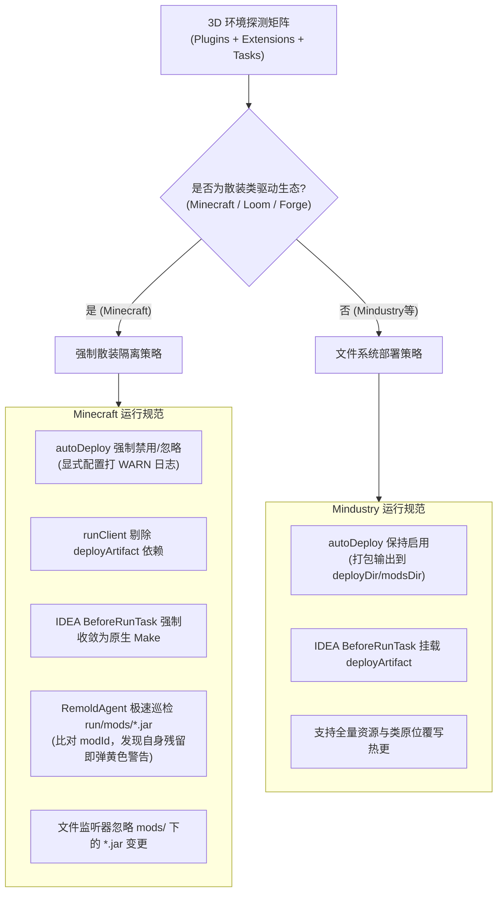

# 模组生态分类与构建产物隔离规范

本规范定义 Remold 在不同游戏模组引擎（Minecraft Fabric / Quilt / NeoForge / Forge 与 Mindustry / Arc）下的运行环境划分基准、构建产物（JAR）输出隔离协议、IDEA `BeforeRunTask` 调度契约以及运行时残留制品冲突防御机制。

---

## 1. 问题背景与现象分析

在模组热重载开发过程中，关于**“本地运行前是否应将编译打包的模组 JAR 拷贝到运行目录的 `mods/` 文件夹”**，开发者常因混淆不同引擎的加载机理而引发严重故障。

典型故障现象如下图所示：

```
RuntimeException: Mixin transformation of net.minecraft.client.main.Main failed
  at net.fabricmc.loader.impl.launch.knot.KnotClassDelegate.getPostMixinClassByteArray(KnotClassDelegate.java:427)
...
MixinApplyError: Mixin [example_mod.mixins.json:TitleScreenMixin from mod example_mod] from phase [DEFAULT] in config [example_mod.mixins.json] FAILED during PREPARE
...
ClassNotFoundException: The specified mixin 'com.example.mixin.TitleScreenMixin' was not found
  at org.spongepowered.asm.mixin.transformer.MixinInfo.loadMixinClass(MixinInfo.java:1318)
```

### 1.1 根因深潜：双源加载引发的类加载与 Mixin 崩溃

在 Minecraft Fabric 运行环境中，启动器（`KnotClassLoader` / `KnotClassDelegate`）在开发模式（`fabric.development=true`）下默认将项目的散装输出目录（`build/classes/java/main` 或 `out/production`）作为当前开发中模组（In-Development Mod）的代码源。

若构建脚本或 IDE 运行配置在启动前执行了 `jar` 或 `remapJar` 并将其拷贝进 `run/mods/example_mod-1.0.0.jar`：
1. **双重候选者检出**：Fabric Loader 在扫描 Classpath 的同时也会遍历 `run/mods/` 目录，从而检出同一 `modId` 的两份候选容器；
2. **命名空间与类检索割裂**：
   - 若放入的是未经重映射的原生 `jar`（处于 Named 命名空间），内部资源与元数据会与 Classpath 冲突；
   - 若放入的是经过生产混淆重映射的 `remapJar`（处于 Intermediary 或 Mojmap 命名空间），开发环境的 ClassLoader 在解析 Mixin 声明（如 `TitleScreenMixin`）时，由于父子加载器隔离或类路径遮蔽，`MixinInfo.loadMixinClass` 无法在预期的加载器层次中正确定位到字节码，抛出 `ClassNotFoundException` 并导致游戏在准备阶段（PREPARE Phase）直接崩溃；
3. **字节码回退与缓存失效**：由于某些 ClassLoader 优先从 JAR 条目中读取 `getResourceAsStream`，开发者修改源码触发增量编译后，JVM 进程或 Mixin 重织入器读到的依然是旧 JAR 里的冻结字节码，使得热更逻辑彻底空转。

---

## 2. 模组引擎生态二元划分

不同的 JVM 游戏引擎在架构设计上存在根本性的模组加载范式差异：

| 评估维度 | Classpath 散装类驱动生态 (如 Minecraft) | 文件系统制品驱动生态 (如 Mindustry) |
| :--- | :--- | :--- |
| **代表框架** | Fabric Loom, Architectury, Quilt, NeoForge ModDev, ForgeGradle | Mindustry 原生模组系统, Arc 引擎 |
| **底层加载机制** | 启动器（Knot / ModLauncher）直接把 `build/classes`、`out/production` 与资源目录挂入启动 Classpath，作为活体代码源 | 游戏启动后由 `Mods.java` 遍历本地文件系统（`%APPDATA%/Mindustry/mods/`）的 Zip/JAR 或解压目录，不感知启动 Classpath 中的散装类 |
| **开发期部署制品** | **严禁输出 JAR 到 `run/mods/`**；开发期只消费内存与散装目录 | **必须输出 JAR / 目录到 `mods/`**；否则游戏核心无法发现任何模组 |
| **运行前最佳任务** | IDEA 原生编译 `Make`（零打包延迟，亚秒级输出） | `deployArtifact`（打包并拷贝至 `mods/` 目录） |
| **热更监听源** | `build/classes`、`out/production`、`src/main/resources` | 目标部署目录中的 `.jar` 或散装解压目录 |

---

## 3. Minecraft 研发期输出 JAR 到 `run/mods/` 的五大危害

在 Minecraft（Fabric / NeoForge / Forge）开发环境中，向 `run/mods/` 输出构建 JAR 会带来灾难性的副作用：

### 3.1 命名空间混淆断裂（Obfuscation / Namespace Conflict）
- 未重映射的 `jar` 任务产物属于开发环境的 Named 命名空间；
- 经过生产重映射的 `remapJar` 任务产物属于生产环境的 Intermediary 或 Mojmap 命名空间；
- 若将 `remapJar` 放入开发环境，运行时 ClassLoader 在 Named 环境下加载生产命名空间的符号，必然引发 `NoSuchMethodError`、`NoClassDefFoundError` 或 Mixin 注入失败崩溃。

### 3.2 旧字节码静默回退与资源覆写（Bytecode Rollback & Resource Shadowing）
- 当 `run/mods/` 存在 JAR 时，部分类加载器（如 Knot 或 URLClassLoader）的 `getResourceAsStream` 遍历顺序可能优先命中 JAR 文件；
- 开发者修改代码并热更后，Remold 虽对内存类执行了 Redefine，但后续框架（如 Mixin 重织入、数据包重载、反射读取注解）重新向类加载器索要类字节码时，会读回旧 JAR 中的陈旧字节码，造成逻辑回退。

### 3.3 每次启动的构建延迟惩罚（Cold Start Latency Penalty）
- 每次调试或启动前如果都挂载 `deployArtifact` -> `jar` / `remapJar`，需要经历 JAR 压缩、清单合并、资源重映射等多道繁重工序；
- 增量编译只需 100~300ms，而打包重映射通常消耗 5~15 秒，严重破坏热更新即时调试的交互体验。

### 3.4 模组元数据与 ModID 重复冲突（Duplicate ModID Collision）
- Fabric Loader 与 ModLauncher 在启动阶段均包含元数据校验；
- 当 Classpath 中存在正在开发的模组且 `run/mods/` 中又躺着一份打好的旧 JAR 时，加载器会判定为“发现重复的 Mod ID”，直接弹出冲突警告或因双重注册引发未知竞态。

### 3.5 热更新文件监听风暴与文件锁竞争（Watch Storm & File Lock Contention）
- 若 Agent 监控目录包含了 `run/mods/*.jar`，每次构建打包都会触发高频的文件重写通知；
- 在 Windows 系统下，JVM 运行期若通过 `ZipFile` 保持对 `run/mods/*.jar` 的打开句柄，会导致 Gradle 后续构建写入失败，抛出 `FileSystemException: The process cannot access the file because it is being used by another process`。

---

## 4. Remold 架构规范与自动化裁决契约

基于上述客观机理，Remold 确立以下自动化处理与安全隔离契约：



### 4.1 三维环境探测矩阵 (`isClassBasedEnvironment`)
构建脚本与 Gradle 插件通过“插件 ID + 扩展对象 + 核心任务”三维联合判定，杜绝单一硬编码漏判：
1. **Plugin IDs**：
   - Fabric / Quilt: `fabric-loom`, `dev.architectury.loom`, `org.quiltmc.loom`；
   - NeoForge: `net.neoforged.moddev`, `net.neoforged.gradle.userdev`；
   - Forge: `net.minecraftforge.gradle`；
   - 多版本体系: `gg.essential.multi-version`。
2. **Extensions**：
   - 探测是否存在 `loom`、`minecraft`、`neoForge` 等 Extension。
3. **Tasks**：
   - 探测是否存在 `runClient`，且同时伴随 `remapJar` 或 `jar`。

### 4.2 `autoDeploy` 状态决议与警告契约
- **散装类生态**：`shouldAutoDeploy` 无条件解析为 `false`。若开发者在 `build.gradle(.kts)` 中显式设置 `autoDeploy = true`，Gradle 构建期打印警告：
  `[Remold] [WARN] 'autoDeploy = true' is ignored in Minecraft/Loom environment. In-dev runs use loose classes; outputting JARs to run/mods causes namespace crashes and bytecode rollbacks.`
- **文件系统生态**：若配置了 `deployDir` / `modsDir`，`shouldAutoDeploy` 默认解析为 `true`。

### 4.3 IDEA 运行配置清洗契约 (`IdeaRunConfigGenerator`)
- 针对 Loom 生成的 **Application 风格** `Minecraft_Client.xml` 与 `Minecraft_Server.xml`，其 `<method v="2">` 中的启动前任务必须清洗为：
  ```xml
  <method v="2">
    <option name="Make" enabled="true" />
  </method>
  ```
- 若检测到原有配置包含 `deployArtifact`、`:classes` 或 `classes`，替换为原生 `Make`，杜绝启动前误触发打包任务。
- **Gradle 风格（`GradleRunConfiguration`）不适用上述清洗**：它通过 `taskNames` 自行调度任务，替换 `method` 会破坏运行语义；JVM 参数位于 `vmOptions` 选项，只在该选项存在时原位合并 `-javaagent` 与 `-Dremold.*`。
- 运行期注入覆盖 client、server 与 gametest 三类 run 环境：Fabric Loom / ForgeGradle / NeoForge ModDevGradle 的 `server` 运行容器、以及 Fabric 的 `clientGameTest` / `gameTest` 运行配置，与 `client` 一样接收同一组 JVM 参数。

### 4.4 运行时残留制品隔离契约 (`plugin-fabric`)
为了防止开发者曾经手动运行过 `jar` 任务或从旧配置残留了 JAR：
1. **元数据提取**：监控路径装配完成时（`HotswapPlugin.onWatchPathsChanged`），从监听路径中的 `fabric.mod.json` 或 `META-INF/neoforge.mods.toml` / `META-INF/mods.toml` 读取当前开发项目的唯一标识符（`id` / `modId`）；
2. **零文件锁极速探测**：通过 `java.util.zip.ZipFile`（短连接即开即关，不产生 Windows 文件锁）极速遍历 `run/mods/*.jar` 的根目录元数据；
3. **就地隔离（不是只报警）**：一旦发现 `run/mods/` 中存在同名 `modId` 的静态 JAR，把它重命名为
   `<name>.jar.remold-disabled`（**只改名、不删除**，改回原名即可恢复），并打印高可见度黄色警告说明改了什么、为什么、怎么恢复。
   只处理与当前工程同 `modId` 的制品，其它模组 JAR 一律不动；改名失败（占用/只读）时退回告警，绝不中断启动。
   关闭方式：`-Dremold.agent.mods_quarantine=false`。
   **依据**：同 `modId` 的打包 JAR 留在 `run/mods` 时，加载器会把它当作该开发中模组的候选容器，开发期实际运行的可能是 JAR 里的旧字节码，
   而散装类路径被忽略——且不报错。仅告警不改变这一行为。
4. **监听剔除**：文件监听系统（`WatchService`）明确忽略任何路径包含 `/mods/` 或 `\mods\` 的 `.jar` 变更，阻断监听风暴。

> **归属**：以上四项均由 `plugin-fabric` 通过 `HotswapPlugin` 的三个通用窗口（`onPremain` / `onWatchPathsChanged` / `isWatchPathIgnored`）实现，引擎核心（`core`）不含任何加载器专属的目录或属性约定。Gradle 侧检测到 Loom 系生态时自动挂载该插件（`-Premold.autoFabric=false` 可关闭）；直接用 `-javaagent` 且未配置 `remold.plugin.jars` 时不加载，因此不会有 class path group 注入与 `mods` 目录排除。
