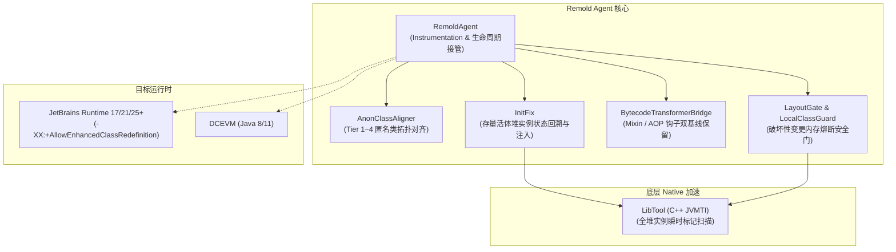

[English](index_en.md) | 简体中文

# Remold 技术文档导航与架构全景

> **文档类型**：索引（链接导航；实现状态以 [`docs/status.md`](status.md) 为准）

欢迎查阅 `Remold`（JVM 热重载、匿名类拓扑对齐与存量状态回溯引擎）的技术规范与设计文档中心。

---

## 1. 核心定位与系统全景

Remold 是一个专注于 JVM 类热更新（Class Redefinition / Retransformation）深层一致性与安全防护的底层 Agent 引擎。

- **实现状态唯一真相源**：全部特性的研发进度、落地位置、验收证据与技术债务统一收录在 [**`docs/status.md`**](status.md)。各设计规格文档严格保持客观中立，不混入易腐进度标记。
- **工程导航与归档**：[`代码地图 (code-map.md)`](code-map.md) · [`探针与变异检查手册 (testing-guide.md)`](testing-guide.md) · [`战役实证战报 (battles/)`](battles/README.md) · [`版本发布与历史归档 (releases/)`](releases/historical-rounds-archive.md)

---

## 2. 专题技术规格文档目录

### 2.1 匿名类拓扑对齐与安全门 (Topology Alignment)
解决跨编译版本下，因源码局部增删导致的匿名类编译物理编号（`$1`, `$2`）漂移、宿主槽位篡夺与旧实例逻辑错位问题：

| 文档 | 主题与核心内容 |
| :--- | :--- |
| [`01-invariants-and-remapping.md`](topology/01-invariants-and-remapping.md) | 核心不变量（INV-Remap）、字节码改写范围契约与栈图处理机制 |
| [`02-admission-and-reserved-names.md`](topology/02-admission-and-reserved-names.md) | 属性优先准入、SwitchMap 专门评估、保留名域划分与挂起避让 |
| [`03-cascading-pipeline.md`](topology/03-cascading-pipeline.md) | 层级交错对齐流水线、Self Hash 特征码、调用链反向追溯（INV-1/INV-2） |
| [`04-tiers-and-rejection.md`](topology/04-tiers-and-rejection.md) | Tier 1~4 置信梯队细则、Tier 3 拓扑相等过滤与宿主级原子拒绝 |
| [`05-walkthrough.md`](topology/05-walkthrough.md) | 典型演化场景端到端推演案例（方法重排序、嵌套匿名类级联对齐） |
| [`06-runtime-and-perf.md`](topology/06-runtime-and-perf.md) | JBR-21/DCEVM 运行时能力与限制、乐观预登记事务模型、算法复杂度硬闸门与系统配置开关 |
| [`07-layout-gate-and-risks.md`](topology/07-layout-gate-and-risks.md) | 实例状态布局安全门（`LayoutGate`）、局部类编号漂移止血门（`LocalClassGuard`）与蜕变测试原则 |
| [`08-decisions.md`](topology/08-decisions.md) | 拓扑对齐架构决策记录（ADR）、设计偏离原因与真实运行时测试数据 |

### 2.2 存量状态回溯与运行时驱动 (InitFix)
解决类扩容（添加新字段）热更新后，JVM 默认将存量堆对象中新增字段初始化为零值（0 / null）导致应用 NPE 或业务逻辑损坏的问题：

| 文档 | 主题与核心内容 |
| :--- | :--- |
| [`01-safety-gate.md`](initfix/01-safety-gate.md) | T0~T3 判决分层、最小效应安全门、参数回溯不可变证明与多根构造器共识 |
| [`02-closure-and-ledger.md`](initfix/02-closure-and-ledger.md) | 跨字段依赖闭包计算、Tarjan 强连通分量成环检测与待补字段台账（`FieldLedger`） |
| [`03-runtime-driver.md`](initfix/03-runtime-driver.md) | 伴生补丁类生成、逐实例补丁驱动、条件 CAS 写入协议与 `@RemoldReinit` 存量覆写 |
| [`04-target-design.md`](initfix/04-target-design.md) | 目标架构设计：两阶段重定义（Two-Phase Redefine）与类加载期构造器插桩（路线图与落地状态见 [`status.md`](status.md) §4.1/§4.2） |
| [`05-jvmti-heap.md`](initfix/05-jvmti-heap.md) | JVMTI 全堆实例标记检索底座（`LibTool`）、Tag 隔离与并发重入保护 |
| [`06-decisions.md`](initfix/06-decisions.md) | InitFix 架构决策记录（ADR）、历史缺陷复盘与例外放宽变异检查要求 |
| [`07-p05-probe-results.md`](initfix/07-p05-probe-results.md) | P0.5 前置验证的实测方法与原始数据（连续 Schema Redefine、阶段 A 伴生类链接、百万级堆遍历） |

### 2.3 物理偏移稳定性与反射缓存驱逐 (Offset & Reflection Cache)
解决父类插入新字段导致子孙类字段物理偏移漂移、`Unsafe` 错位踩踏破坏内存，以及 Jackson/Gson/Arc 反射元数据缓存滞后问题：

| 文档 | 主题与核心内容 |
| :--- | :--- |
| [`01-offset-and-reflection-cache.md`](offset/01-offset-and-reflection-cache.md) | 物理偏移量预测器（`LayoutPredictor`）、漂移安全门（`SuperclassDriftGate`）与反射/序列化缓存驱逐 SPI |

### 2.4 模组生态与构建集成规范 (Ecosystem & Build Integration)
解决不同模组开发框架（Minecraft Fabric/NeoForge/Forge 与 Mindustry/Arc）在散装类与制品打包、启动前任务调度及残留制品防御上的范式差异：

| 文档 | 主题与核心内容 |
| :--- | :--- |
| [`01-mod-artifact-and-class-isolation.md`](ecosystem/01-mod-artifact-and-class-isolation.md) | 模组生态二元分类、五大构建制品冲突危害、3D 环境探测矩阵与运行时残留 JAR 巡检契约 |

### 2.5 变更集 VCS、活体对齐与代际字段台账 (Changeset VCS & Generational Ledger, `docs/vcs/`)
解决"这一轮热更到底改了哪些字节、跨轮次如何寻址与回放"的版本层（`01`/`02`），其上的活体对齐输入契约与真实规模读数（`03`/`04`），以及回退后如何按代对账存量字段（`05`/`06`）：

| 文档 | 主题与核心内容 |
| :--- | :--- |
| [`01-bytecode-changeset-vcs.md`](vcs/01-bytecode-changeset-vcs.md) | 内容寻址的逐代 `Changeset` 链与热更版本层规格（`seq` 寻址与窗口、`patchTiming` 时刻语义、`replayFacts` 事实模型、派生数据缓存键契约） |
| [`02-derived-data-cache-probe.md`](vcs/02-derived-data-cache-probe.md) | 派生数据缓存的粒度、条目/字节双预算边界与开/关等价性实测读数 |
| [`03-live-raw-to-raw-alignment.md`](vcs/03-live-raw-to-raw-alignment.md) | 活体对齐的 Raw ↔ Raw 输入选择、G1/G2/G3 准入闸门与 `Eff_prev` 继承集枚举/落地顺序 |
| [`04-raw-to-raw-realworld-readings.md`](vcs/04-raw-to-raw-realworld-readings.md) | 真实规模语料下 Raw ↔ Raw 对齐的命中、失配与耗时读数 |
| [`05-generational-field-ledger.md`](vcs/05-generational-field-ledger.md) | 代际字段台账（B2）：`FieldLedger` / `REINIT_APPLIED` 的按代存储（`GenRef(seq,id)`）、回退后 CAS 期望只取目标代与 fail-closed 口径、`replayFacts` 跨代消费规则 |
| [`06-b1-gc-baseline-readings.md`](vcs/06-b1-gc-baseline-readings.md) | B1 旁路账的内存与 GC 基线读数（保留堆/GC 口径与 B2 引入后的对比方法） |
| [`07-load-frontier-and-birth-watermark.md`](vcs/07-load-frontier-and-birth-watermark.md) | 加载前沿与出生水位线：编辑/加载双轨、回放水位线与格式版本化、出生点补丁的三条护栏、保守退化与三态可见性 |

### 2.6 Mixin 热更子系统 (Mixin Hot-Reload)
体系化收录 Mixin 类加载器权威、覆盖层注入、级联重织入、结构契约突破与合成内部类闸门（`docs/mixin/01..08`）：

| 文档 | 主题与核心内容 |
| :--- | :--- |
| [`01-invariants-and-classloader-authority.md`](mixin/01-invariants-and-classloader-authority.md) | 类加载器权威仲裁 / 基线防覆盖 / 访问权限单调不降级 / `ClassInfo.cache` 锚回 |
| [`02-admission-and-bytecode-overlay.md`](mixin/02-admission-and-bytecode-overlay.md) | 新 Mixin 准入、四级字节来源、覆盖层与 `config.service` 替换、待决接力 |
| [`03-reweave-and-member-alignment.md`](mixin/03-reweave-and-member-alignment.md) | 级联重织入管线、`refeedForTarget`、成员名/顺序回映、方法桩与字段墓碑保留 |
| [`04-structural-reload-and-retarget.md`](mixin/04-structural-reload-and-retarget.md) | `priority` / `targets` / `interfaces` 三大结构契约的突破与回滚 |
| [`05-synthetic-inner-gate-and-abort.md`](mixin/05-synthetic-inner-gate-and-abort.md) | 合成类单出口闸门、事务共退、自愈账本 |
| [`06-walkthrough.md`](mixin/06-walkthrough.md) | 四个真实闭环场景的字节流与读数 |
| [`07-runtime-and-diagnostics.md`](mixin/07-runtime-and-diagnostics.md) | 启动门闩、批次看门狗、`[VM-INFO]`、双通道堆哨兵 |
| [`08-decisions-and-empirical-ledger.md`](mixin/08-decisions-and-empirical-ledger.md) | Lambda vs 匿名类、放弃原地扩容的实证链、未闭合项与 P2 |

### 2.7 Lambda 对齐与捕获桥 (`docs/lambda/`)
覆盖 `LambdaAligner` 的单向捕获桥合成、孤儿方法体保留与按类发布契约：

| 文档 | 主题与核心内容 |
| :--- | :--- |
| [`01-capture-bridge.md`](lambda/01-capture-bridge.md) | Lambda 捕获桥（单向）：删除与可证明新增捕获变量的桥接、三道判定门与产物形态 |
| [`02-orphan-body-retention.md`](lambda/02-orphan-body-retention.md) | 孤儿 Lambda 方法体保留：非 void 默认保留旧体、本类成员存活性判据与幽灵身份解耦 |
| [`03-publication-contract.md`](lambda/03-publication-contract.md) | Lambda 对齐结论按类发布与检索契约 |

### 2.8 构建触发与运行时边界实测 (`docs/runtime/`)
收录 Agent 构建触发 marker 契约及非拓扑类 JVM/枚举运行时边界实测：

| 文档 | 主题与核心内容 |
| :--- | :--- |
| [`01-build-trigger-mode.md`](runtime/01-build-trigger-mode.md) | 构建完成 marker（build-trigger）：提前触发与兜底取消契约 |
| [`02-build-trigger-probe.md`](runtime/02-build-trigger-probe.md) | build-trigger 探针实测读数与对照组 |
| [`03-jbr-dcevm-jit-drain-tail-latency.md`](runtime/03-jbr-dcevm-jit-drain-tail-latency.md) | Fabric + DCEVM 4 秒尾延迟调查：JIT drain safepoint 实测与退避定位 |
| [`04-enum-constant-append-infeasibility.md`](runtime/04-enum-constant-append-infeasibility.md) | 枚举常量集合变更不做运行期修复的 JBR 21 实测记录与否决证据 |

---

## 3. 构建机制与基础设施 (Build & Infrastructure)

### 3.1 编译脱糖工具链 (`_libs/compiler.jar`)
为了让 Remold 核心引擎源码能无障碍使用现代 Java 21+ 语法（如 Record、模式匹配 `instanceof`、模式匹配 `switch`、密封类等），同时生成的 Agent 字节码产物能够直接向下兼容并挂载运行在 **Java 11（major version 55）** 运行时（如 DCEVM 11、JBR 11/17/21/25），项目引入了专门的编译脱糖处理器：

- **介入机制**：通过 Gradle 配置 `annotationProcessor files("${rootDir}/_libs/compiler.jar")` 并附带编译参数 `-AtargetVersion=11`；
- **核心职能**：
  1. **语法展开**：利用 OpenJDK `javac` 原生内置的 `TransPatterns` 阶段自动将 `instanceof` 模式匹配降解为基础类型检查与类型强转；
  2. **Switch 消除**：通过自定义 `SwitchDesugar` 拦截模式匹配 switch，转换为传统控制流分支，消除了对 Java 21 运行时 `java.lang.runtime.SwitchBootstraps`（indy）的强依赖；
  3. **版本改写**：由 `MyClassWriter` 将最终生成的 `.class` 文件版本标头重写为目标主版本号 `55.0`（Java 11）；
  4. **动态穿透**：内部通过 `HopeReflect` 借助 `sun.misc.Unsafe` 在内存中自举打开模块权限（`openModule()`），开发者与 CI 构建均无需在 Gradle 中配置繁重的 `jdk.compiler` `--add-exports` 参数。

### 3.2 自动化测试与持续集成 (CI Matrix)
Remold 建立了完备的防御性测试体系，全部挂载于 `./gradlew check` 门禁：

1. **JUnit 编译器矩阵测试 (`tests:test`)**：
   - 包含 187 项多版本编译器现编测试，覆盖 javac 8/11/17/21/25 五套工具链编译产物在对齐器下的拓扑行为；
2. **InitFix 差分 Oracle 测试 (`tests:initFixOracle`)**：
   - 包含 48 个实测场景、318 项差分断言，覆盖 Java 源码以及真实 `kotlinc` 编译产物的存量状态回溯与负向安全阻断；
3. **真实 DCEVM 端到端测试 (`tests:liveDcevmTest`)**：
   - 在真实 JetBrains Runtime 21 环境下验证 44 项全链路热更新用例（覆盖字段保活、实例篡夺对比、孤儿避让与两轮位移）；
4. **规范标记纯净度门禁 (`tests:verifyDocStatusMarkers`)**：
   - 递归扫描全部设计规范与核心源码，严格杜绝易腐状态标记混入规范正文。
