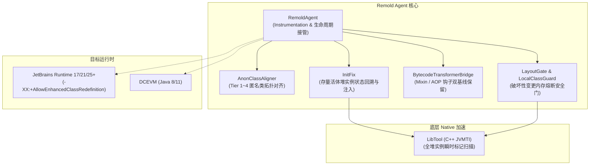

[English](index_en.md) | 简体中文

# Remold 技术文档导航与架构全景

欢迎查阅 `Remold`（JVM 热重载、匿名类拓扑对齐与存量状态回溯引擎）的技术规范与设计文档中心。

---

## 1. 核心定位与系统全景

Remold 是一个专注于 JVM 类热更新（Class Redefinition / Retransformation）深层一致性与安全防护的底层 Agent 引擎。

- **实现状态唯一真相源**：全部特性的研发进度、落地位置、验收证据与技术债务统一收录在 [**`docs/status.md`**](status.md)。各设计规格文档严格保持客观中立，不混入易腐进度标记。

---

## 2. 专题技术规格文档目录

### 2.1 匿名类拓扑对齐与安全门 (Topology Alignment)
解决跨编译版本下，因源码局部增删导致的匿名类编译物理编号（`$1`, `$2`）漂移、宿主槽位篡夺与旧实例逻辑错位问题：

| 文档 | 主题与核心内容 |
| :--- | :--- |
| [`01-invariants-and-remapping.md`](topology/01-invariants-and-remapping.md) | 核心不变量（INV-Remap）、字节码改写范围契约与栈图处理机制 |
| [`02-admission-and-reserved-names.md`](topology/02-admission-and-reserved-names.md) | 属性优先准入、SwitchMap 专门评估、保留名域划分与挂起避让 |
| [`03-cascading-pipeline.md`](topology/03-cascading-pipeline.md) | 层级交错对齐流水线、Self Hash 特征码、调用链反向追溯（INV-1/INV-2） |
| [`04-tiers-and-rejection.md`](topology/04-tiers-and-rejection.md) | Tier 1~4 置信梯队细则、Tier 3 拓扑相等过滤与宿主级原子拒绝 |
| [`05-walkthrough.md`](topology/05-walkthrough.md) | 典型演化场景端到端推演案例（方法重排序、嵌套匿名类级联对齐） |
| [`06-runtime-and-perf.md`](topology/06-runtime-and-perf.md) | JBR-21/DCEVM 运行时能力与限制、乐观预登记事务模型、算法复杂度硬闸门与系统配置开关 |
| [`07-layout-gate-and-risks.md`](topology/07-layout-gate-and-risks.md) | 实例状态布局安全门（`LayoutGate`）、局部类编号漂移止血门（`LocalClassGuard`）与蜕变测试原则 |
| [`08-decisions.md`](topology/08-decisions.md) | 拓扑对齐架构决策记录（ADR）、设计偏离原因与真实运行时测试数据 |

### 2.2 存量状态回溯与运行时驱动 (InitFix)
解决类扩容（添加新字段）热更新后，JVM 默认将存量堆对象中新增字段初始化为零值（0 / null）导致应用 NPE 或业务逻辑损坏的问题：

| 文档 | 主题与核心内容 |
| :--- | :--- |
| [`01-safety-gate.md`](initfix/01-safety-gate.md) | T0~T3 判决分层、最小效应安全门、参数回溯不可变证明与多根构造器共识 |
| [`02-closure-and-ledger.md`](initfix/02-closure-and-ledger.md) | 跨字段依赖闭包计算、Tarjan 强连通分量成环检测与待补字段台账（`FieldLedger`） |
| [`03-runtime-driver.md`](initfix/03-runtime-driver.md) | 伴生补丁类生成、逐实例补丁驱动、条件 CAS 写入协议与 `@RemoldReinit` 存量覆写 |
| [`04-target-design.md`](initfix/04-target-design.md) | 目标架构路线图：两阶段重定义（Two-Phase Redefine）与类加载期构造器插桩设计 |
| [`05-jvmti-heap.md`](initfix/05-jvmti-heap.md) | JVMTI 全堆实例标记检索底座（`LibTool`）、Tag 隔离与并发重入保护 |
| [`06-decisions.md`](initfix/06-decisions.md) | InitFix 架构决策记录（ADR）、历史缺陷复盘与例外放宽变异检查要求 |
| [`07-p05-probe-results.md`](initfix/07-p05-probe-results.md) | P0.5 前置验证的实测方法与原始数据（连续 Schema Redefine、阶段 A 伴生类链接、百万级堆遍历） |

---

## 3. 构建机制与基础设施 (Build & Infrastructure)

### 3.1 编译脱糖工具链 (`_libs/compiler.jar`)
为了让 Remold 核心引擎源码能无障碍使用现代 Java 21+ 语法（如 Record、模式匹配 `instanceof`、模式匹配 `switch`、密封类等），同时生成的 Agent 字节码产物能够直接向下兼容并挂载运行在 **Java 11（major version 55）** 运行时（如 DCEVM 11、JBR 11/17/21/25），项目引入了专门的编译脱糖处理器：

- **介入机制**：通过 Gradle 配置 `annotationProcessor files("${rootDir}/_libs/compiler.jar")` 并附带编译参数 `-AtargetVersion=11`；
- **核心职能**：
  1. **语法展开**：利用 OpenJDK `javac` 原生内置的 `TransPatterns` 阶段自动将 `instanceof` 模式匹配降解为基础类型检查与类型强转；
  2. **Switch 消除**：通过自定义 `SwitchDesugar` 拦截模式匹配 switch，转换为传统控制流分支，消除了对 Java 21 运行时 `java.lang.runtime.SwitchBootstraps`（indy）的强依赖；
  3. **版本改写**：由 `MyClassWriter` 将最终生成的 `.class` 文件版本标头重写为目标主版本号 `55.0`（Java 11）；
  4. **动态穿透**：内部通过 `HopeReflect` 借助 `sun.misc.Unsafe` 在内存中自举打开模块权限（`openModule()`），开发者与 CI 构建均无需在 Gradle 中配置繁重的 `jdk.compiler` `--add-exports` 参数。

### 3.2 自动化测试与持续集成 (CI Matrix)
Remold 建立了完备的防御性测试体系，全部挂载于 `./gradlew check` 门禁：

1. **JUnit 编译器矩阵测试 (`tests:test`)**：
   - 包含 187 项多版本编译器现编测试，覆盖 javac 8/11/17/21/25 五套工具链编译产物在对齐器下的拓扑行为；
2. **InitFix 差分 Oracle 测试 (`tests:initFixOracle`)**：
   - 包含 48 个实测场景、318 项差分断言，覆盖 Java 源码以及真实 `kotlinc` 编译产物的存量状态回溯与负向安全阻断；
3. **真实 DCEVM 端到端测试 (`tests:liveDcevmTest`)**：
   - 在真实 JetBrains Runtime 21 环境下验证 44 项全链路热更新用例（覆盖字段保活、实例篡夺对比、孤儿避让与两轮位移）；
4. **规范标记纯净度门禁 (`tests:verifyDocStatusMarkers`)**：
   - 递归扫描全部设计规范与核心源码，严格杜绝易腐状态标记混入规范正文。
