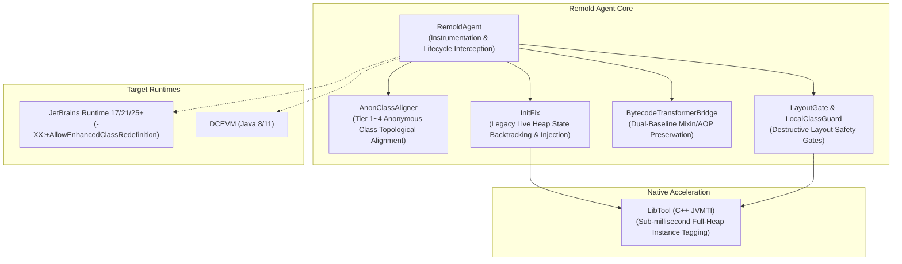

English | [简体中文](index.md)

# Remold Technical Documentation & Architecture Hub

> **文档类型**：索引（链接导航；实现状态以 [`docs/status.md`](status.md) 为准）

Welcome to the technical specifications and architectural documentation center for `Remold` (JVM Class Redefinition, Anonymous Class Topological Alignment, and Legacy State Reinitialization Engine).

---

## 1. Core Mission & Architecture Overview

Remold is a specialized JVM agent framework designed to ensure deep consistency and memory safety during JVM class redefinition and retransformation.

- **Single Source of Truth for Status**: The detailed implementation status, code locations, regression test evidence, and technical debts are maintained in [**`docs/status.md`**](status.md). Design specifications strictly define objective invariants and contracts without perishable progress tags.
- **Engineering Navigation & Archives**: [`Code Map (code-map.md)`](code-map.md) · [`Testing & Probe Guide (testing-guide.md)`](testing-guide.md) · [`Battle Reports (battles/)`](battles/README.md) · [`Release Notes & Archives (releases/)`](releases/historical-rounds-archive.md)

---

## 2. Topic Specifications Directory

### 2.1 Anonymous Class Topological Alignment & Safety Gates (Topology)
Eliminates physical index drift (`$1`, `$2`), slot hijacking, and logical corruption caused by partial code edits across compilation versions:

| Document | Subject & Core Contents |
| :--- | :--- |
| [`01-invariants-and-remapping.md`](topology/01-invariants-and-remapping.md) | Core invariants (`INV-Remap`), bytecode rewrite scope contract, and stack map frames preservation |
| [`02-admission-and-reserved-names.md`](topology/02-admission-and-reserved-names.md) | Attribute-first admission, SwitchMap evaluation, reserved name domains, and suspension avoidance |
| [`03-cascading-pipeline.md`](topology/03-cascading-pipeline.md) | Cascading interleaved pipeline, Self Hash signatures, and reverse call-chain tracing (`INV-1`/`INV-2`) |
| [`04-tiers-and-rejection.md`](topology/04-tiers-and-rejection.md) | Tier 1~4 confidence tiers, Tier 3 topological isomorphic filtering, and atomic host-level rejection |
| [`05-walkthrough.md`](topology/05-walkthrough.md) | End-to-end evolution walkthrough cases (method reordering, nested anonymous classes cascade) |
| [`06-runtime-and-perf.md`](topology/06-runtime-and-perf.md) | JBR-21/DCEVM runtime capabilities, optimistic pre-registration transaction lifecycle, and tuning options |
| [`07-layout-gate-and-risks.md`](topology/07-layout-gate-and-risks.md) | Instance state layout safety gate (`LayoutGate`), local class drift guard (`LocalClassGuard`), and metamorphic testing |
| [`08-decisions.md`](topology/08-decisions.md) | Architecture Decision Records (ADRs), deviation rationales, and real runtime benchmark data |

### 2.2 Legacy State Reinitialization (InitFix)
Resolves the issue where newly added fields in existing live heap objects default to uninitialized zero values (0 / null) after class redefinition, preventing NPEs and corrupted business state:

| Document | Subject & Core Contents |
| :--- | :--- |
| [`01-safety-gate.md`](initfix/01-safety-gate.md) | T0~T3 decision tiers, minimal effect safety gate, parameter backtracking immutability proof, and multi-root consensus |
| [`02-closure-and-ledger.md`](initfix/02-closure-and-ledger.md) | Dependency closure calculation, Tarjan SCC cycle detection, and unpatched field ledger (`FieldLedger`) |
| [`03-runtime-driver.md`](initfix/03-runtime-driver.md) | Companion patch class synthesis, per-instance driver, conditional CAS writing protocol, and `@RemoldReinit` |
| [`04-target-design.md`](initfix/04-target-design.md) | Target architecture: Two-Phase Redefine and classload-time constructor instrumentation (roadmap & status live in [`status.md`](status.md) §4.1/§4.2) |
| [`05-jvmti-heap.md`](initfix/05-jvmti-heap.md) | JVMTI full heap instance scanning engine (`LibTool`), tag isolation, and re-entrant concurrency safety |
| [`06-decisions.md`](initfix/06-decisions.md) | InitFix ADRs, historical defect post-mortems, and mutation testing requirements for gate exemptions |
| [`07-p05-probe-results.md`](initfix/07-p05-probe-results.md) | P0.5 pre-flight measurements: back-to-back schema redefinitions, stage-A companion linkage, million-instance heap scan |

### 2.3 Physical Offset Stability & Reflection Cache Eviction (Offset & Reflection Cache)
Resolves physical offset drift on subclass fields when inserting fields into superclasses, unsafe memory corruptions, and reflection metadata cache staleness:

| Document | Subject & Core Contents |
| :--- | :--- |
| [`01-offset-and-reflection-cache.md`](offset/01-offset-and-reflection-cache.md) | Layout predictor (`LayoutPredictor`), drift safety gate (`SuperclassDriftGate`), and reflection cache eviction SPI |

### 2.4 Ecosystem & Build Integration Specification (Ecosystem)
Governs paradigms across mod environments (Minecraft Fabric/NeoForge/Forge vs. Mindustry/Arc) regarding loose classes vs. JAR packaging, BeforeRunTask orchestration, and stale artifact defense:

| Document | Subject & Core Contents |
| :--- | :--- |
| [`01-mod-artifact-and-class-isolation.md`](ecosystem/01-mod-artifact-and-class-isolation.md) | Mod ecosystem duality, 5 build artifact hazards, 3D environment detection matrix, and runtime stale JAR guard |

### 2.5 Changeset VCS, Live Alignment & Generational Field Ledger
Covers the version layer that answers "which bytes changed in this round, and how are they addressed and replayed across rounds" (16/17), the live-alignment input contract and its real-scale readings (18/19), and how legacy fields are reconciled per generation after a revert (20/21):

| Document | Subject & Core Contents |
| :--- | :--- |
| [`16-bytecode-changeset-vcs.md`](topology/16-bytecode-changeset-vcs.md) | Content-addressed per-generation `Changeset` chain and hot-swap version layer (`seq` addressing and window, `patchTiming` semantics, `replayFacts` fact model, derived-cache key contract) |
| [`17-derived-data-cache-probe.md`](topology/17-derived-data-cache-probe.md) | Derived-data cache granularity, entry/byte budget boundaries, and cache-on/off equivalence readings |
| [`18-live-raw-to-raw-alignment.md`](topology/18-live-raw-to-raw-alignment.md) | Live-alignment Raw ↔ Raw input selection, G1/G2/G3 admission gates, and `Eff_prev` inheritance set enumeration/order |
| [`19-raw-to-raw-realworld-readings.md`](topology/19-raw-to-raw-realworld-readings.md) | Real-scale Raw ↔ Raw alignment readings: hits, mismatches, and timings |
| [`20-generational-field-ledger.md`](topology/20-generational-field-ledger.md) | Generational field ledger (B2): per-generation `FieldLedger` / `REINIT_APPLIED` storage (`GenRef(seq,id)`), post-revert CAS expectations taken strictly from the target generation with fail-closed discipline, and cross-generation `replayFacts` consumption rules |
| [`21-b1-gc-baseline-readings.md`](topology/21-b1-gc-baseline-readings.md) | B1 side-ledger memory and GC baseline readings (retained-heap/GC methodology and the before/after comparison method for B2) |

### 2.6 Mixin Hot-Reload Subsystem (`docs/mixin/01..08`)
Systematically specifies Mixin classloader authority, bytecode overlay injection, cascading re-weave, structural reload contracts, and synthetic inner-class gates:

| Document | Subject & Core Contents |
| :--- | :--- |
| [`01-invariants-and-classloader-authority.md`](mixin/01-invariants-and-classloader-authority.md) | Classloader authority arbitration, baseline protection, monotonic visibility, and `ClassInfo.cache` anchoring |
| [`02-admission-and-bytecode-overlay.md`](mixin/02-admission-and-bytecode-overlay.md) | New Mixin admission, four-tier byte sources, overlay & `config.service` replacement, pending retry |
| [`03-reweave-and-member-alignment.md`](mixin/03-reweave-and-member-alignment.md) | Cascading re-weave pipeline, `refeedForTarget`, member alignment, method stub & tombstone retention |
| [`04-structural-reload-and-retarget.md`](mixin/04-structural-reload-and-retarget.md) | `priority`, `targets`, and `interfaces` structural reload contracts & rollback |
| [`05-synthetic-inner-gate-and-abort.md`](mixin/05-synthetic-inner-gate-and-abort.md) | Single-exit synthetic inner-class gate, host transaction abort, abort retry ledger |
| [`06-walkthrough.md`](mixin/06-walkthrough.md) | Four real-world closed-loop bytecode walkthroughs and readings |
| [`07-runtime-and-diagnostics.md`](mixin/07-runtime-and-diagnostics.md) | Startup readiness gate, batch watchdog, `[VM-INFO]`, dual-channel heap watch |
| [`08-decisions-and-empirical-ledger.md`](mixin/08-decisions-and-empirical-ledger.md) | Lambda vs anonymous classes, empirical evidence against in-place widening, open items & P2 |

---

## 3. Build & Infrastructure

### 3.1 Compilation Desugaring Toolchain (`_libs/compiler.jar`)
To allow Remold core source code to seamlessly utilize modern Java 21+ language features (Records, pattern matching `instanceof`, pattern matching `switch`, etc.) while ensuring that generated agent classes remain directly compatible with **Java 11 (major version 55)** runtimes (e.g. DCEVM 11, JBR 11/17/21/25):

- **Hook Mechanism**: Configured via Gradle `annotationProcessor files("${rootDir}/_libs/compiler.jar")` with compiler argument `-AtargetVersion=11`;
- **Core Functions**:
  1. **Pattern Desugaring**: Leverages OpenJDK javac's native `TransPatterns` lowering phase to translate `instanceof` pattern matching into standard type-checks and casts;
  2. **Switch Lowering**: Intercepts pattern-matching switch statements via custom `SwitchDesugar` into standard control flow, eliminating runtime dependencies on Java 21+ `java.lang.runtime.SwitchBootstraps`;
  3. **Version Retargeting**: Rewrites the `.class` header major version to `55.0` (Java 11) via `MyClassWriter`;
  4. **Dynamic Bootstrap**: Utilizes `HopeReflect` with `sun.misc.Unsafe` to dynamically open JVM internal modules (`openModule()`), removing the need for manual `--add-exports` flags in Gradle.

### 3.2 Automated Verification & Continuous Integration (CI Matrix)
Remold enforces a multi-tiered verification pipeline hooked directly into `./gradlew check`:

1. **JUnit Toolchain Matrix Tests (`tests:test`)**:
   - 187 compiler matrix tests validating alignment behavior against live fixtures compiled on javac 8/11/17/21/25;
2. **InitFix Differential Oracle (`tests:initFixOracle`)**:
   - 48 scenarios and 318 assertions covering Java source and real Kotlin compiler outputs;
3. **Live DCEVM End-to-End Suite (`tests:liveDcevmTest`)**:
   - 44 live assertions on JetBrains Runtime 21 verifying instance state preservation, hijacking prevention, and orphan slot avoidance;
4. **Specification Status Marker Purity Gate (`tests:verifyDocStatusMarkers`)**:
   - Scans all design specs to ensure objective documentation remains unpolluted by status tags.