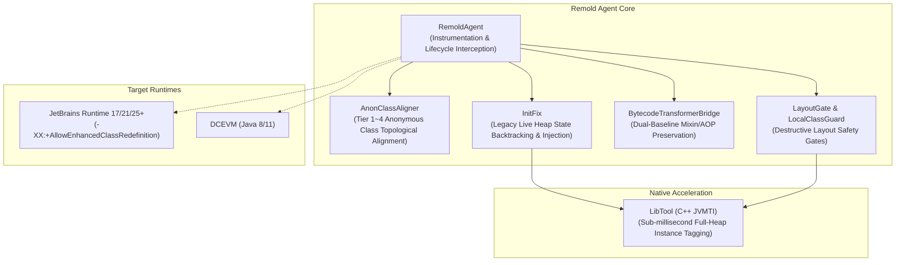

English | [简体中文](index.md)

# Remold Technical Documentation & Architecture Hub

Welcome to the technical specifications and architectural documentation center for `Remold` (JVM Class Redefinition, Anonymous Class Topological Alignment, and Legacy State Reinitialization Engine).

---

## 1. Core Mission & Architecture Overview

Remold is a specialized JVM agent framework designed to ensure deep consistency and memory safety during JVM class redefinition and retransformation.

- **Single Source of Truth for Status**: The detailed implementation status, code locations, regression test evidence, and technical debts are maintained in [**`docs/status.md`**](status.md). Design specifications strictly define objective invariants and contracts without perishable progress tags.

---

## 2. Topic Specifications Directory

### 2.1 Anonymous Class Topological Alignment & Safety Gates (Topology)
Eliminates physical index drift (`$1`, `$2`), slot hijacking, and logical corruption caused by partial code edits across compilation versions:

| Document | Subject & Core Contents |
| :--- | :--- |
| [`01-invariants-and-remapping.md`](topology/01-invariants-and-remapping.md) | Core invariants (`INV-Remap`), bytecode rewrite scope contract, and stack map frames preservation |
| [`02-admission-and-reserved-names.md`](topology/02-admission-and-reserved-names.md) | Attribute-first admission, SwitchMap evaluation, reserved name domains, and suspension avoidance |
| [`03-cascading-pipeline.md`](topology/03-cascading-pipeline.md) | Cascading interleaved pipeline, Self Hash signatures, and reverse call-chain tracing (`INV-1`/`INV-2`) |
| [`04-tiers-and-rejection.md`](topology/04-tiers-and-rejection.md) | Tier 1~4 confidence tiers, Tier 3 topological isomorphic filtering, and atomic host-level rejection |
| [`05-walkthrough.md`](topology/05-walkthrough.md) | End-to-end evolution walkthrough cases (method reordering, nested anonymous classes cascade) |
| [`06-runtime-and-perf.md`](topology/06-runtime-and-perf.md) | JBR-21/DCEVM runtime capabilities, optimistic pre-registration transaction lifecycle, and tuning options |
| [`07-layout-gate-and-risks.md`](topology/07-layout-gate-and-risks.md) | Instance state layout safety gate (`LayoutGate`), local class drift guard (`LocalClassGuard`), and metamorphic testing |
| [`08-decisions.md`](topology/08-decisions.md) | Architecture Decision Records (ADRs), deviation rationales, and real runtime benchmark data |

### 2.2 Legacy State Reinitialization (InitFix)
Resolves the issue where newly added fields in existing live heap objects default to uninitialized zero values (0 / null) after class redefinition, preventing NPEs and corrupted business state:

| Document | Subject & Core Contents |
| :--- | :--- |
| [`01-safety-gate.md`](initfix/01-safety-gate.md) | T0~T3 decision tiers, minimal effect safety gate, parameter backtracking immutability proof, and multi-root consensus |
| [`02-closure-and-ledger.md`](initfix/02-closure-and-ledger.md) | Dependency closure calculation, Tarjan SCC cycle detection, and unpatched field ledger (`FieldLedger`) |
| [`03-runtime-driver.md`](initfix/03-runtime-driver.md) | Companion patch class synthesis, per-instance driver, conditional CAS writing protocol, and `@RemoldReinit` |
| [`04-target-design.md`](initfix/04-target-design.md) | Roadmap target architecture: Two-Phase Redefine and classload-time constructor instrumentation |
| [`05-jvmti-heap.md`](initfix/05-jvmti-heap.md) | JVMTI full heap instance scanning engine (`LibTool`), tag isolation, and re-entrant concurrency safety |
| [`06-decisions.md`](initfix/06-decisions.md) | InitFix ADRs, historical defect post-mortems, and mutation testing requirements for gate exemptions |
| [`07-p05-probe-results.md`](initfix/07-p05-probe-results.md) | P0.5 pre-flight measurements: back-to-back schema redefinitions, stage-A companion linkage, million-instance heap scan |

---

## 3. Build & Infrastructure

### 3.1 Compilation Desugaring Toolchain (`_libs/compiler.jar`)
To allow Remold core source code to seamlessly utilize modern Java 21+ language features (Records, pattern matching `instanceof`, pattern matching `switch`, etc.) while ensuring that generated agent classes remain directly compatible with **Java 11 (major version 55)** runtimes (e.g. DCEVM 11, JBR 11/17/21/25):

- **Hook Mechanism**: Configured via Gradle `annotationProcessor files("${rootDir}/_libs/compiler.jar")` with compiler argument `-AtargetVersion=11`;
- **Core Functions**:
  1. **Pattern Desugaring**: Leverages OpenJDK javac's native `TransPatterns` lowering phase to translate `instanceof` pattern matching into standard type-checks and casts;
  2. **Switch Lowering**: Intercepts pattern-matching switch statements via custom `SwitchDesugar` into standard control flow, eliminating runtime dependencies on Java 21+ `java.lang.runtime.SwitchBootstraps`;
  3. **Version Retargeting**: Rewrites the `.class` header major version to `55.0` (Java 11) via `MyClassWriter`;
  4. **Dynamic Bootstrap**: Utilizes `HopeReflect` with `sun.misc.Unsafe` to dynamically open JVM internal modules (`openModule()`), removing the need for manual `--add-exports` flags in Gradle.

### 3.2 Automated Verification & Continuous Integration (CI Matrix)
Remold enforces a multi-tiered verification pipeline hooked directly into `./gradlew check`:

1. **JUnit Toolchain Matrix Tests (`tests:test`)**:
   - 187 compiler matrix tests validating alignment behavior against live fixtures compiled on javac 8/11/17/21/25;
2. **InitFix Differential Oracle (`tests:initFixOracle`)**:
   - 48 scenarios and 318 assertions covering Java source and real Kotlin compiler outputs;
3. **Live DCEVM End-to-End Suite (`tests:liveDcevmTest`)**:
   - 44 live assertions on JetBrains Runtime 21 verifying instance state preservation, hijacking prevention, and orphan slot avoidance;
4. **Specification Status Marker Purity Gate (`tests:verifyDocStatusMarkers`)**:
   - Scans all design specs to ensure objective documentation remains unpolluted by status tags.