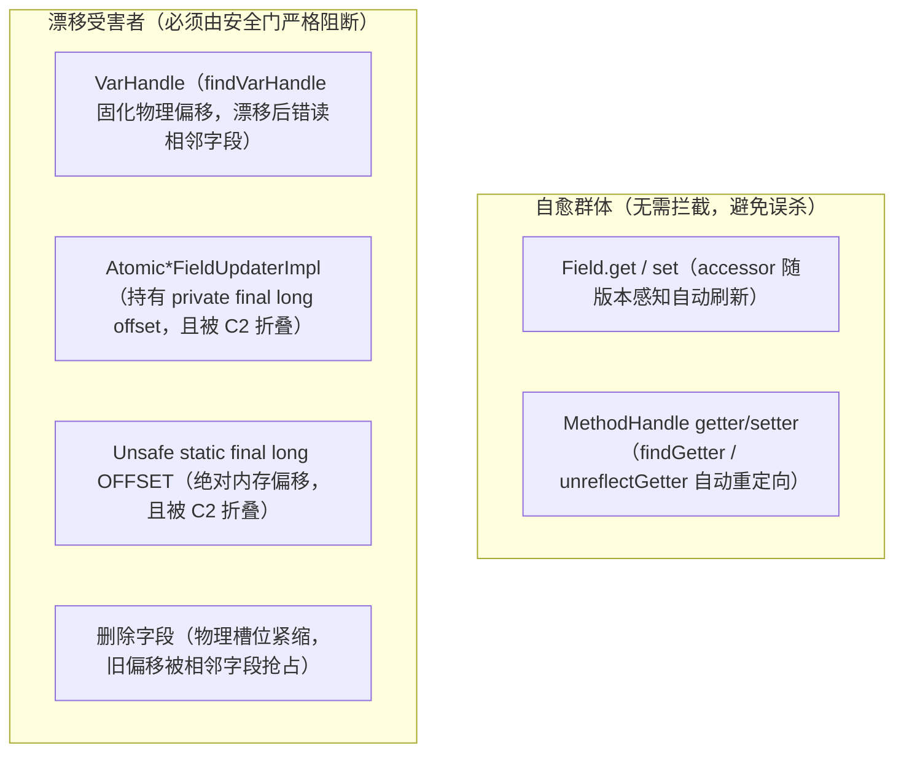
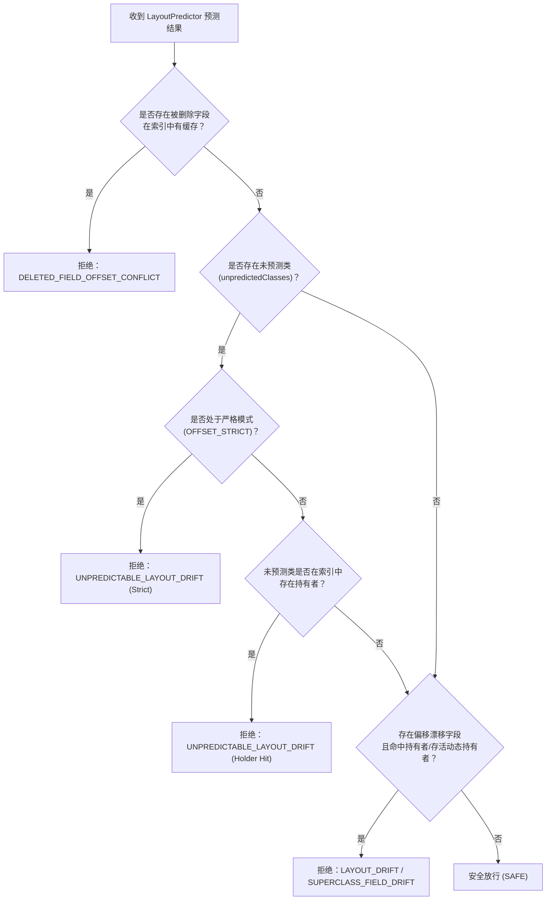
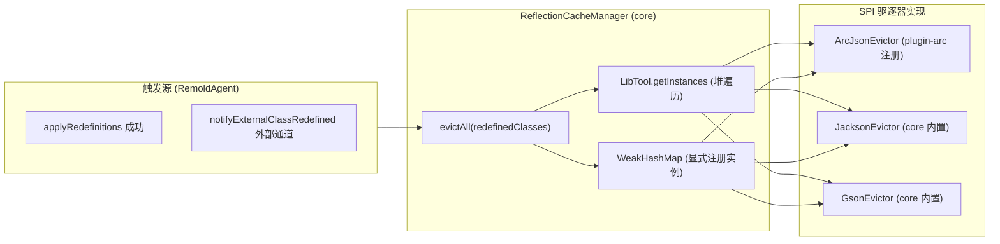

# 物理内存偏移与第三方缓存驱逐规格说明

> **文档类型**：设计规格（只写规格/决策；实现状态以 [`docs/status.md`](../status.md) 为准）

本文档定义类重定义（Redefine）场景下物理字段偏移量（Field Offset）漂移的防护体系（P0）与第三方反射/序列化框架缓存驱逐契约（P1）。
实现状态唯一真相源参见 [docs/status.md](../status.md)。实测探针源码参见 [OffsetStabilityProbe.java](../../tests/src/OffsetStabilityProbe.java)。

---

## 1. 物理真相与问题边界

### 1.1 布局重排与漂移成因

在增强类重定义运行时（DCEVM / JBR）下，新增字段并非简单尾部追加，HotSpot 布局算法会根据字段尺寸排序以填补对齐空洞（Padding Hole）并进行基本类型聚类（Primitive Clustering）：

1. **单类填洞漂移**：若存量字段间存在对齐空洞，新增同等大小字段会填入空洞，导致空洞之后的存量字段物理偏移向后顺移；
2. **单类类型聚类漂移**：存量全引用类型类新增基本类型（如 `long`、`double`）时，基本类型排在引用类型之前，导致存量引用字段整体向后挤压；
3. **父类变更引发子类级联漂移**：基类新增实例字段会导致所有已加载子孙类**自身声明**的实例字段按照对齐步长整体后移；从父类继承来的字段不在 `SuperclassDriftGate` 的 declared-field 扫描范围内，继承字段的偏移绑定属已知盲区。

### 1.2 实例迁移与物理槽位紧缩的双重性

类重定义删除字段时，JVM 行为存在两层异构语义：

* **字节码语义（实例迁移）**：DCEVM 在重定义期间执行实例状态迁移（Instance Migration），按字段名将存量实例的数据复制到新槽位。因此通过未修改的字节码访问未删字段（如 `getfield y`）依然能正确读取原值；
* **物理内存语义（槽位紧缩）**：物理内存布局实际紧凑压缩回收被删字段槽位。原位于旧偏移的内存区域将被后续字段覆盖。若外部底层代码直接通过 `Unsafe.getInt(liveObj, oldOffset)` 访问，将产生严重的内存错位读写（读写到相邻字段）。

因此，只要外部存在对被删除字段物理偏移的持有者，该次重定义必须坚决阻断（判 `DELETED_FIELD_OFFSET_CONFLICT`）。

---

## 2. 访问器自愈能力与受害者边界

通过对各类反射与方法句柄机制进行实测比对，确立以下受害者边界：

### 2.1 自愈群体（不纳入 Binding）

* **反射 `Field` 访问器**：现代 JDK 中缓存的 `Field` 实例在重定义后，底层 accessor 自动感知版本变动并按新偏移读取，不会读取错位内存；
* **`MethodHandle` getter / setter**：`MethodHandles.Lookup.findGetter`、`findSetter`、`findStaticGetter`、`findStaticSetter`、`unreflectGetter`、`unreflectSetter` 获取的直接方法句柄在重定义发生后，底层 DirectMethodHandle 被 VM 自动失效并重定向至最新物理偏移。
* **边界契约**：`OffsetScanner` 严禁将上述 MethodHandle 产生源抓入 `OffsetBindingIndex`，防止对 Jackson、Record、Kotlin 等依赖反射句柄的现代框架造成误杀。

### 2.2 漂移受害者（必须纳入 Binding）

* **`VarHandle`**：`findVarHandle`、`findStaticVarHandle`、`unreflectVarHandle` 以及 `ConstantBootstraps.fieldVarHandle` 产生的句柄内部固化了物理偏移量，且在重定义后不会自愈，继续读写旧偏移；
* **`Atomic*FieldUpdater`**：内部字段 `offset` 在构造时确定，且极易被 JIT C2 激进常量折叠；
* **`Unsafe.objectFieldOffset`**：直接计算出的物理偏移量。

---

## 3. P0 阶段：结果驱动型安全门与布局预测器（S1）

### 3.1 抛弃式 ClassLoader 布局预测器（`LayoutPredictor`）

在执行实际重定义之前，利用 `EphemeralClassLoader` 进行干净加载（Clean-Load）：

1. **协同注入加载**：
   * 本批次重定义目标类注入新字节码；
   * 目标类的所有已加载子孙类（`descendants`）使用原字节码注入同一 `EphemeralClassLoader`，使其在干净环境中链接到新基类上；
2. **包级私有父类 Runtime Package 隔离防御**：
   * 若子类 `com.foo.Sub` 继承自未改动的包级私有父类 `com.foo.Base`，若将 `Base` 委派给父 ClassLoader，JVM 会因 `(EphemeralClassLoader, com.foo)` 与 `(AppClassLoader, com.foo)` 属于不同运行时包而在 `defineClass` 时抛出 `IllegalAccessError`；
   * **防御规格**：在构建预测类加载器时，必须通过 `fallbackProvider` 将目标类及其全部已加载子孙类的**整条非 JDK 祖先链（superclass hierarchy）**预先提取并注入同一个 `EphemeralClassLoader`，保证子类与祖先类处于同一运行时包内；
3. **未预测类安全降级（`PredictionResult.unpredictedClasses`）**：
   * 运行时生成类（动态代理、Hidden Class、Lambda 等）或跨 Loader 导致字节码不可读/链接报错者，严禁当作“无漂移”放行，必须记入 `unpredictedClasses`。

### 3.2 判定规则序列（`SuperclassDriftGate.checkLayoutDrift`）

---

## 4. P1 阶段：第三方框架实例级缓存驱逐 SPI（S4）

### 4.1 废除无效的 JVM 内部反射清理

* JDK 12+ 已通过 `Reflection.fieldFilterMap` 屏蔽 `Class.reflectionData`，反射访问必抛 `NoSuchFieldException`；
* JVM 在类重定义成功后自动递增内部 `classRedefinedCount`，`Class.reflectionData()` 下次调用时检测到计数器不一致会自动重建。因此无需且禁止对 `Class.reflectionData` 做任何非法反射入侵。

### 4.2 实例级缓存驱逐架构

框架元数据（如字段映射、类型适配器）通常缓存在具体的解析器实例内部，需要进行实例级清理：

### 4.3 框架适配规格

1. **Arc `arc.util.serialization.Json`**（实现位于 `:plugin-arc` 的 `remold.arc.ArcJsonEvictor`）：
   * 目标字段：`typeToFields`（`ObjectMap<Class, OrderedMap<String, FieldMetadata>>`）、`classToDefaultValues`（`ObjectMap<Class, Object[]>`）、`classToSerializer`（`ObjectMap<Class, Serializer>`）；
   * 动作：调用 `remove(redefinedClass)` 清除变动类的缓存条目，驱逐后下次读写自动重新反射字段元数据；
   * 分层约束：类与字段以 Arc 编译期类型引用（`Json`、`ObjectMap`），只有"私有字段名"仍是字符串契约；字段不可读时在装载期 `warn`，不静默失效。该驱逐器由 `ArcHotswapPlugin.onAgentInit` 经 `RemoldAgent.registerCacheEvictor` 注册，核心引擎不持有任何 Arc 类名或字段名。
2. **Jackson `ObjectMapper`**（`core` 内置）：
   * 全局缓存：调用 `TypeFactory.defaultInstance().clearCache()`；
   * 实例缓存：对每个存活 `ObjectMapper`，分别对其 `_serializerProvider._serializerCache` 与 `_deserializationContext._cache` 执行 `flush()`。
3. **Gson `Gson`**：
   * 实例缓存：对每个存活 `Gson` 实例，清除其 `typeTokenCache`（`ConcurrentMap`）。
4. **双通道获取策略**：
   * **原生堆遍历通道**：若 Native 探针 `LibTool` 可用，通过 `LibTool.getInstances(targetClass)` 自动发现堆中所有存活解析器实例，实现免注册无感清理；
   * **显式注册通道**：使用弱引用集合持有实例，作为无 native 时的确定性通道。各框架的注册入口归属其实现所在层：`RemoldAgent.registerObjectMapper` / `registerGson`（core）与 `ArcJsonEvictor.register`（plugin-arc）。

## 5. 分 JVM 实测读数（元数据漂移检测，`tests/src/ParameterAnnotationDriftProbe.java`）

探针入口 `./gradlew :tests:parameterAnnotationDriftProbe`，可加 `-Pkprobe.javaHome=<jdk>` 与 `-Pkprobe.dcevm`
切换运行时；入参是"变更前后两份 class 字节"，与变更类型无关。
读数分四档：**旧句柄**（重定义前取得的 `Method`）、**重新 `getDeclaredMethods()`**、**首次解析**（按签名现取），
另加"重定义期间并发读"与"GC + 常量池争用后重读"。每格都记录 `java.version` 与完整 `inputArguments`，
并用"加一个实例字段再 redefine"的真实结果区分 DCEVM 格与标准 HotSpot 格（不靠参数名或 JVM 名字推断）。

### 5.1 三种运行时环境

| 格 | java.version / vm | 结构重定义能力实测 | 备注 |
|:--|:--|:--|:--|
| ① JBR 25 标准 HotSpot | `25.0.2+1-b329.72`（`OpenJDK 64-Bit Server VM`） | `THROWN:java.lang.UnsupportedOperationException`（`attempted to change the schema (add/remove fields)`） | 无 DCEVM 参数 |
| ② JBR 21 标准 HotSpot | `21.0.9+1-b1163.86`（同上） | 同上 `UnsupportedOperationException` | 无 DCEVM 参数 |
| ③ JBR 21 + DCEVM | 同② | `OK`（字段增加后 redefine 成功） | `inputArguments` 含 `-XX:+AllowEnhancedClassRedefinition` |

### 5.2 三种运行时 × 九场景 × 三组读数

| 场景 | 读数 API | 格 | 旧句柄 | 重新 getDeclaredMethods() | 首次解析 |
|:--|:--|:--|:--|:--|:--|
| control-identical | getParameterAnnotations | ① JBR 25 标准 | `value=v1 type=java.lang.Object` | `value=v1 type=java.lang.Object` | `value=v1 type=java.lang.Object` |
| control-identical | getParameterAnnotations | ② JBR 21 标准 | `value=v1 type=java.lang.Object` | `value=v1 type=java.lang.Object` | `value=v1 type=java.lang.Object` |
| control-identical | getParameterAnnotations | ③ JBR 21+DCEVM | `value=v1 type=java.lang.Object` | `value=v1 type=java.lang.Object` | `value=v1 type=java.lang.Object` |
| param-annotation-value-change | getParameterAnnotations | ① JBR 25 标准 | `value=v1 type=java.lang.Object` | `value=v2-a-much-longer-value type=java.lang.Object` | `value=v2-a-much-longer-value type=java.lang.Object` |
| param-annotation-value-change | getParameterAnnotations | ② JBR 21 标准 | `value=v1 type=java.lang.Object` | `value=v2-a-much-longer-value type=java.lang.Object` | `value=v2-a-much-longer-value type=java.lang.Object` |
| param-annotation-value-change | getParameterAnnotations | ③ JBR 21+DCEVM | `value=v2-a-much-longer-value type=java.lang.Object` | `value=v2-a-much-longer-value type=java.lang.Object` | `value=v2-a-much-longer-value type=java.lang.Object` |
| param-annotation-removed | getParameterAnnotations | ① JBR 25 标准 | `value=v1 type=java.lang.Object` | `[#0={}]` | `[#0={}]` |
| param-annotation-removed | getParameterAnnotations | ② JBR 21 标准 | `value=v1 type=java.lang.Object` | `[#0={}]` | `[#0={}]` |
| param-annotation-removed | getParameterAnnotations | ③ JBR 21+DCEVM | `THROWN java.lang.reflect.GenericSignatureFormatError` | `[#0={}]` | `[#0={}]` |
| generic-signature-change | getGenericParameterTypes | ① JBR 25 标准 | `[java.util.List<java.lang.String>]` | `[java.util.List<java.lang.Integer>]` | `[java.util.List<java.lang.Integer>]` |
| generic-signature-change | getGenericParameterTypes | ② JBR 21 标准 | `[java.util.List<java.lang.String>]` | `[java.util.List<java.lang.Integer>]` | `[java.util.List<java.lang.Integer>]` |
| generic-signature-change | getGenericParameterTypes | ③ JBR 21+DCEVM | `[java.util.List<java.lang.String>]` | `[java.util.List<java.lang.Integer>]` | `[java.util.List<java.lang.Integer>]` |
| annotation-and-signature-change | getParameterAnnotations | ① JBR 25 标准 | `value=v1 type=java.lang.Object` | `value=v2 type=java.lang.Object` | `value=v2 type=java.lang.Object` |
| annotation-and-signature-change | getParameterAnnotations | ② JBR 21 标准 | `value=v1 type=java.lang.Object` | `value=v2 type=java.lang.Object` | `value=v2 type=java.lang.Object` |
| annotation-and-signature-change | getParameterAnnotations | ③ JBR 21+DCEVM | `value=v2 type=java.lang.Object` | `value=v2 type=java.lang.Object` | `value=v2 type=java.lang.Object` |
| param-annotation-moved-between-parameters | getParameterAnnotations | ① JBR 25 标准 | `value=v1 type=java.lang.Object` | `value=v1 type=java.lang.Object` | `value=v1 type=java.lang.Object` |
| param-annotation-moved-between-parameters | getParameterAnnotations | ② JBR 21 标准 | `value=v1 type=java.lang.Object` | `value=v1 type=java.lang.Object` | `value=v1 type=java.lang.Object` |
| param-annotation-moved-between-parameters | getParameterAnnotations | ③ JBR 21+DCEVM | `value=v1 type=java.lang.Object` | `value=v1 type=java.lang.Object` | `value=v1 type=java.lang.Object` |
| param-annotation-type-changed | getParameterAnnotations | ① JBR 25 标准 | `value=v1 type=java.lang.Object` | `[#0={@java.lang.Deprecated(since=,forRemoval=false)}]` | `[#0={@java.lang.Deprecated(since=,forRemoval=false)}]` |
| param-annotation-type-changed | getParameterAnnotations | ② JBR 21 标准 | `value=v1 type=java.lang.Object` | `[#0={@java.lang.Deprecated(since=,forRemoval=false)}]` | `[#0={@java.lang.Deprecated(since=,forRemoval=false)}]` |
| param-annotation-type-changed | getParameterAnnotations | ③ JBR 21+DCEVM | `[#0={@java.lang.Deprecated(since=,forRemoval=false)}]` | `[#0={@java.lang.Deprecated(since=,forRemoval=false)}]` | `[#0={@java.lang.Deprecated(since=,forRemoval=false)}]` |
| class-generic-signature-change | getGenericSuperclass | ① JBR 25 标准 | `java.util.ArrayList<java.lang.String>` | `java.util.ArrayList<java.lang.String>` | `java.util.ArrayList<java.lang.String>` |
| class-generic-signature-change | getGenericSuperclass | ② JBR 21 标准 | `java.util.ArrayList<java.lang.String>` | `java.util.ArrayList<java.lang.String>` | `java.util.ArrayList<java.lang.String>` |
| class-generic-signature-change | getGenericSuperclass | ③ JBR 21+DCEVM | `java.util.ArrayList<java.lang.String>` | `java.util.ArrayList<java.lang.Integer>` | `java.util.ArrayList<java.lang.Integer>` |
| annotation-class-literal-value-change | getParameterAnnotations | ① JBR 25 标准 | `value=v1 type=java.lang.String` | `value=v1 type=java.lang.Integer` | `value=v1 type=java.lang.Integer` |
| annotation-class-literal-value-change | getParameterAnnotations | ② JBR 21 标准 | `value=v1 type=java.lang.String` | `value=v1 type=java.lang.Integer` | `value=v1 type=java.lang.Integer` |
| annotation-class-literal-value-change | getParameterAnnotations | ③ JBR 21+DCEVM | `value=v1 type=java.lang.String` | `value=v1 type=java.lang.Integer` | `value=v1 type=java.lang.Integer` |

### 5.3 读数摘要（逐字取自上表，不写机制标签）

**两种形态的现状（同一格内不同形态结果不同，不能合并成一句话）：**

| 形态 | 标准 HotSpot（JBR 25 / JBR 21） | JBR 21 DCEVM（JBR 21 + DCEVM） |
|:--|:--|:--|
| 参数注解被删除（`param-annotation-removed`） | 旧句柄读到 `value=v1`（无异常） | 旧句柄 `getParameterAnnotations()` **抛出** `java.lang.reflect.GenericSignatureFormatError: Signature Parse error: Expected Field Type Signature` |
| 参数注解值变化（`param-annotation-value-change`） | 旧句柄读到 `value=v1`（无异常） | 旧句柄读到 `value=v2-a-much-longer-value`（无异常） |
| 泛型签名变化（`generic-signature-change`） | 旧句柄读到 `List<java.lang.String>`（无异常） | 旧句柄同样读到 `List<java.lang.String>`（无异常） |
| 类级 `Signature`（`getGenericSuperclass`） | 重定义前后均为 `ArrayList<java.lang.String>` | 重定义后为 `ArrayList<java.lang.Integer>`（刷新） |

- JBR 21 DCEVM 的 `param-annotation-removed` 在**同一台机器、同一组启动参数（JBR 21.0.9 + `-XX:+AllowEnhancedClassRedefinition`）、同一探针提交**下连跑 3 次均复现（**3/3 复现，同机同参数**；n=3 不足以支撑更强结论）。
- **第 2 组读数（重新 `getDeclaredMethods()`）的恢复效果，分粒度、按运行时限定**：
  - **成员级**（参数注解 / 方法泛型签名 / 字段泛型签名 / 注解位置移动）：三种运行时共 **21 行均读到新状态**
    （`value=v2-a-much-longer-value`、`{}`、`@Deprecated`、`List<java.lang.Integer>`、`t=Integer`、
    注解移到 `#1` 槽位），且 **R2 无任何异常**；
  - **对照场景**（`control-identical`，字节未变）：3 行读到与重定义前相同的值（本就不该变化）；
  - **类级泛型签名**（`getGenericSuperclass`）：**JBR 25 标准 HotSpot 与 JBR 21 标准 HotSpot 仍读到旧值 `ArrayList<java.lang.String>`**，
    只有 JBR 21 DCEVM 刷新为 `ArrayList<java.lang.Integer>`。
  因此"句柄读数的恢复"在三种运行时**不成立**（类级不成立），该结论只写在本节，**不进运行时 WARN**。
- JBR 25 与 JBR 21 标准 HotSpot 的旧句柄在 9 个测试场景均**未触发异常**，读数为旧值；三组读数之间不一致。
- **跨格不一致**：同一场景的旧句柄读数在①②与③之间不同（①②旧值、③新值或抛 `Error`），类级 `getGenericSuperclass()` 只在③刷新。**本主题任何"旧句柄行为"的表述都必须分 JVM 写，不得跨格归纳。**

### 5.4 灵敏度对照（证明读数链路能看见 `Error`，同时暴露其边界）

| 对照 | API | 真实 `Throwable` |
|:--|:--|:--|
| `param-annotation-count-mismatch`（属性 `num_parameters` 与实际参数数不符） | `getParameterAnnotations` | `java.lang.annotation.AnnotationFormatError: Unexpected end of parameter annotations.` |
| `malformed-generic-signature`（方法 `Signature` 语法非法） | `getGenericParameterTypes` | `java.lang.reflect.GenericSignatureFormatError: Signature Parse error: expected ')'` |
| `param-annotation-type-is-not-an-annotation` | `getParameterAnnotations` | 无异常（JDK 静默忽略） |
| `duplicate-annotation-member` | `getParameterAnnotations` | 无异常（JDK 静默忽略） |

**边界**：四种损坏形态中只有 **2 种**能被本探针捕获，另 2 种被 JDK 静默忽略。因此
"JBR 25 与 JBR 21 标准 HotSpot 未触发 `Error`"**只对已测的 9 个场景成立**，不能读成"不存在其他 `Error` 级失败形态"；
探针灵敏度有边界，未覆盖的损坏形态不在此结论范围内。
两份损坏字节由 ASM 直接生成，异常全部由 JVM / 反射库解析器抛出；探针内没有任何 `throw` 语句，
该对照**不构成**复现证据。

### 5.5 与缓存驱逐的关系（交付状态与缺口）

- 本主题**交付**的是"检测 + 成员级 WARN 点名"：`ReflectionCacheManager.detectMemberMetadataDrift` /
  `describeMemberMetadataDrift` 与 `RemoldAgent.reportMemberMetadataDrift` 接线；
  真实流水线确实发出 WARN，由接线探针 `:tests:metadataDriftWarnProbe` 断言（驱动真实 `processChanges`）。
- **把关口径（重要）**：`:tests:test` 对接线短路**没有分辨力**——把 `processChanges` 里的调用点短路后
  `remold.evict.*` 仍然全绿（实测 `mut-4da1` survived）。接线仅由 `:tests:metadataDriftWarnProbe`
  **单点把关**（它驱动真实批次并断言 WARN 点名），合流门禁为 **`:tests:check`**（该任务已 `dependsOn`
  到探针；`:tests:check --dry-run` 的任务图里可见它）。
- **未交付**：`EvictionScope.WITH_DESCENDANTS` 驱逐范围扩展整体停在 `parked/k-eviction-scope` 分支
  （含 3 条"驱逐器实际收到哪些类"的用例），**不在**本主题的合流候选里。缺的读数是
  **"已注册缓存（Gson/Jackson/插件）驱逐前读到错误值、驱逐后读到正确值"的前后对照**；
  在该对照取得之前，本主题不主张驱逐范围扩展的任何效果。
- 缓存驱逐能力边界：驱逐只作用于**已注册**的框架缓存；用户自持的 `Method` 句柄不在其覆盖范围。
  JBR 21 DCEVM 的复现**在检测 + WARN 落到主干之后依旧存在**（同一探针、同一阶段，
  `param-annotation-removed` 旧句柄仍抛 `GenericSignatureFormatError`）——本主题不改变这一点。
- WARN 文案**不含任何恢复效果陈述**：只写 类名/成员名 + 变化种类 + "旧反射句柄读数不可靠、请勿继续使用"
  + 缓存驱逐能力边界（仅覆盖已注册缓存）。运行时日志装不下按运行时限定，故两种已观测形态（标准 HotSpot 静默旧值 /
  JBR 21 + DCEVM 抛 `GenericSignatureFormatError` 或返回新值）只写在 §5.3 的表里，不进日志。

### 5.6 检测覆盖范围：**不含类级泛型签名**（未纳入检测范围）

`collectMemberMetadataDrift` 只比较**两版都存在且 `name + descriptor` 相同的字段与成员**
（`ClassNode.fields` / `ClassNode.methods` 的 `Signature` 与参数注解属性）；
**类级 `ClassNode.signature`（`getGenericSuperclass()` 那一类）不在比较范围内**，因此：
类级泛型签名变化**未被检测、也不会产生 WARN**。§5.2 表里 `class-generic-signature-change` 一行的
读数只记录运行时刷新差异，**不对应检测能力**。该项作为已知未覆盖项留待后续处理，不得读成"类级已覆盖"。

### 5.7 复现所需的固定输入（N=37 语料可复现）

- 探针与夹具：`tests/src/ParameterAnnotationDriftProbe.java`（提交 `f6420c8`），9 场景 × 9 读数档。
- Mixin 相关语料版本（本主题文档所引 Mixin 生态上下文）：`plugin-mixin` 与 `plugin-forge` 的
  编译期依赖固定为 **`org.spongepowered:mixin:0.8.5`（`compileOnly`）**；
  `tests` 侧对应 `implementation "org.spongepowered:mixin:0.8.5"`。N=37 语料按此版本复现。
- 探针的 JVM 选择与回退：优先 `-Pp05.jbr=<jdk>`，其次环境变量 `JBR_HOME` / `JAVA_HOME_DCEVM` /
  `JAVA_HOME_21_X64`；**四者都缺时用默认 JVM 继续跑（不 skip、不静默跳过）**——属性级 redefine 在
  标准 HotSpot 上同样生效，因此缺 DCEVM 只会让"JBR 21 DCEVM"那一档变成标准 HotSpot 读数，日志里
  `PROBE-ENV` 行会明确写出实际 `java.version` 与 `inputArguments`。
- 运行时：JBR 21.0.9（`jbrsdk_jcef-21.0.9`）与 JBR 25.0.2（`jbrsdk_jcef-25.0.2`），
  JBR 21 DCEVM 额外 `-XX:+AllowEnhancedClassRedefinition`；三种运行时的 `java -version` 全文与完整 `inputArguments`
  见 §5.1 与探针日志（`PROBE-ENV` 行）。

### 5.8 未测项

- 运行时：JBR **8 / 11 / 17** 未测（本轮只有 JBR 21 与 JBR 25）。
- 框架缓存：**Gson / Jackson 真实缓存路径未测**（因此没有 §5.5 所说的前后对照读数）。
- 探针灵敏度只对 §5.4 的 4 种损坏形态做过对照。
- 分 JVM 读数来自探针提交 `f6420c8`；拆分（`db578d2`）与 WARN 文案改写（`2524569`）只影响检测/告警，
  不改变探针读数；JBR 21 DCEVM 的负面读数已在拆分后重跑。
