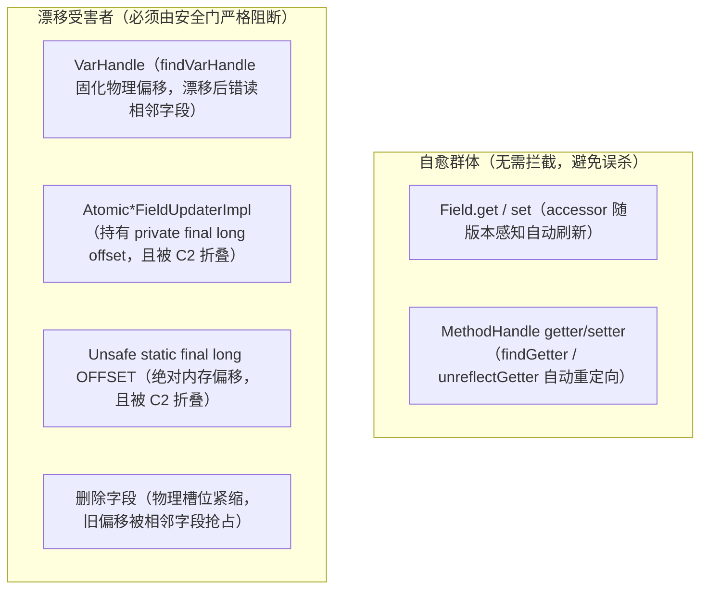
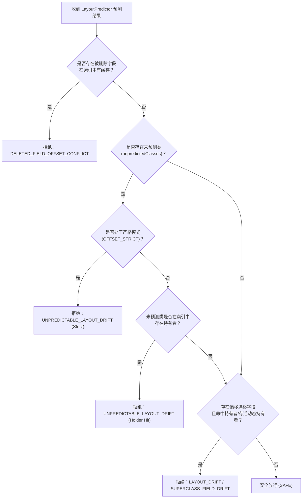
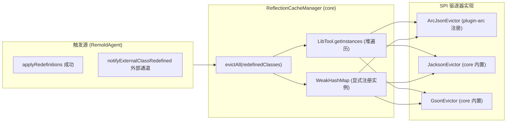

# 物理内存偏移与第三方缓存驱逐规格说明

本文档定义类重定义（Redefine）场景下物理字段偏移量（Field Offset）漂移的防护体系（P0）与第三方反射/序列化框架缓存驱逐契约（P1）。
实现状态唯一真相源参见 [docs/status.md](../status.md)。实测探针源码参见 [OffsetStabilityProbe.java](../../tests/src/OffsetStabilityProbe.java)。

---

## 1. 物理真相与问题边界

### 1.1 布局重排与漂移成因

在增强类重定义运行时（DCEVM / JBR）下，新增字段并非简单尾部追加，HotSpot 布局算法会根据字段尺寸排序以填补对齐空洞（Padding Hole）并进行基本类型聚类（Primitive Clustering）：

1. **单类填洞漂移**：若存量字段间存在对齐空洞，新增同等大小字段会填入空洞，导致空洞之后的存量字段物理偏移向后顺移；
2. **单类类型聚类漂移**：存量全引用类型类新增基本类型（如 `long`、`double`）时，基本类型排在引用类型之前，导致存量引用字段整体向后挤压；
3. **父类变更引发子类级联漂移**：基类新增实例字段会导致所有已加载子孙类的全部实例字段按照对齐步长整体后移。

### 1.2 实例迁移与物理槽位紧缩的双重性

类重定义删除字段时，JVM 行为存在两层异构语义：

* **字节码语义（实例迁移）**：DCEVM 在重定义期间执行实例状态迁移（Instance Migration），按字段名将存量实例的数据复制到新槽位。因此通过未修改的字节码访问未删字段（如 `getfield y`）依然能正确读取原值；
* **物理内存语义（槽位紧缩）**：物理内存布局实际紧凑压缩回收被删字段槽位。原位于旧偏移的内存区域将被后续字段覆盖。若外部底层代码直接通过 `Unsafe.getInt(liveObj, oldOffset)` 访问，将产生严重的内存错位读写（读写到相邻字段）。

因此，只要外部存在对被删除字段物理偏移的持有者，该次重定义必须坚决阻断（判 `DELETED_FIELD_OFFSET_CONFLICT`）。

---

## 2. 访问器自愈能力与受害者边界

通过对各类反射与方法句柄机制进行实测比对，确立以下受害者边界：

### 2.1 自愈群体（不纳入 Binding）

* **反射 `Field` 访问器**：现代 JDK 中缓存的 `Field` 实例在重定义后，底层 accessor 自动感知版本变动并按新偏移读取，不会读取错位内存；
* **`MethodHandle` getter / setter**：`MethodHandles.Lookup.findGetter`、`findSetter`、`findStaticGetter`、`findStaticSetter`、`unreflectGetter`、`unreflectSetter` 获取的直接方法句柄在重定义发生后，底层 DirectMethodHandle 被 VM 自动失效并重定向至最新物理偏移。
* **边界契约**：`OffsetScanner` 严禁将上述 MethodHandle 产生源抓入 `OffsetBindingIndex`，防止对 Jackson、Record、Kotlin 等依赖反射句柄的现代框架造成误杀。

### 2.2 漂移受害者（必须纳入 Binding）

* **`VarHandle`**：`findVarHandle`、`findStaticVarHandle`、`unreflectVarHandle` 以及 `ConstantBootstraps.fieldVarHandle` 产生的句柄内部固化了物理偏移量，且在重定义后不会自愈，继续读写旧偏移；
* **`Atomic*FieldUpdater`**：内部字段 `offset` 在构造时确定，且极易被 JIT C2 激进常量折叠；
* **`Unsafe.objectFieldOffset`**：直接计算出的物理偏移量。

---

## 3. P0 阶段：结果驱动型安全门与布局预测器（S1）

### 3.1 抛弃式 ClassLoader 布局预测器（`LayoutPredictor`）

在执行实际重定义之前，利用 `EphemeralClassLoader` 进行干净加载（Clean-Load）：

1. **协同注入加载**：
   * 本批次重定义目标类注入新字节码；
   * 目标类的所有已加载子孙类（`descendants`）使用原字节码注入同一 `EphemeralClassLoader`，使其在干净环境中链接到新基类上；
2. **包级私有父类 Runtime Package 隔离防御**：
   * 若子类 `com.foo.Sub` 继承自未改动的包级私有父类 `com.foo.Base`，若将 `Base` 委派给父 ClassLoader，JVM 会因 `(EphemeralClassLoader, com.foo)` 与 `(AppClassLoader, com.foo)` 属于不同运行时包而在 `defineClass` 时抛出 `IllegalAccessError`；
   * **防御规格**：在构建预测类加载器时，必须通过 `fallbackProvider` 将目标类及其全部已加载子孙类的**整条非 JDK 祖先链（superclass hierarchy）**预先提取并注入同一个 `EphemeralClassLoader`，保证子类与祖先类处于同一运行时包内；
3. **未预测类安全降级（`PredictionResult.unpredictedClasses`）**：
   * 运行时生成类（动态代理、Hidden Class、Lambda 等）或跨 Loader 导致字节码不可读/链接报错者，严禁当作“无漂移”放行，必须记入 `unpredictedClasses`。

### 3.2 判定规则序列（`SuperclassDriftGate.checkLayoutDrift`）

---

## 4. P1 阶段：第三方框架实例级缓存驱逐 SPI（S4）

### 4.1 废除无效的 JVM 内部反射清理

* JDK 12+ 已通过 `Reflection.fieldFilterMap` 屏蔽 `Class.reflectionData`，反射访问必抛 `NoSuchFieldException`；
* JVM 在类重定义成功后自动递增内部 `classRedefinedCount`，`Class.reflectionData()` 下次调用时检测到计数器不一致会自动重建。因此无需且禁止对 `Class.reflectionData` 做任何非法反射入侵。

### 4.2 实例级缓存驱逐架构

框架元数据（如字段映射、类型适配器）通常缓存在具体的解析器实例内部，需要进行实例级清理：

### 4.3 框架适配规格

1. **Arc `arc.util.serialization.Json`**（实现位于 `:plugin-arc` 的 `remold.arc.ArcJsonEvictor`）：
   * 目标字段：`typeToFields`（`ObjectMap<Class, OrderedMap<String, FieldMetadata>>`）、`classToDefaultValues`（`ObjectMap<Class, Object[]>`）、`classToSerializer`（`ObjectMap<Class, Serializer>`）；
   * 动作：调用 `remove(redefinedClass)` 清除变动类的缓存条目，驱逐后下次读写自动重新反射字段元数据；
   * 分层约束：类与字段以 Arc 编译期类型引用（`Json`、`ObjectMap`），只有"私有字段名"仍是字符串契约；字段不可读时在装载期 `warn`，不静默失效。该驱逐器由 `ArcHotswapPlugin.onAgentInit` 经 `RemoldAgent.registerCacheEvictor` 注册，核心引擎不持有任何 Arc 类名或字段名。
2. **Jackson `ObjectMapper`**（`core` 内置）：
   * 全局缓存：调用 `TypeFactory.defaultInstance().clearCache()`；
   * 实例缓存：对每个存活 `ObjectMapper`，分别对其 `_serializerProvider._serializerCache` 与 `_deserializationContext._cache` 执行 `flush()`。
3. **Gson `Gson`**：
   * 实例缓存：对每个存活 `Gson` 实例，清除其 `typeTokenCache`（`ConcurrentMap`）。
4. **双通道获取策略**：
   * **原生堆遍历通道**：若 Native 探针 `LibTool` 可用，通过 `LibTool.getInstances(targetClass)` 自动发现堆中所有存活解析器实例，实现免注册无感清理；
   * **显式注册通道**：使用弱引用集合持有实例，作为无 native 时的确定性通道。各框架的注册入口归属其实现所在层：`RemoldAgent.registerObjectMapper` / `registerGson`（core）与 `ArcJsonEvictor.register`（plugin-arc）。
