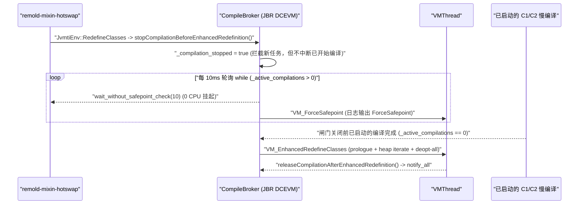

# 从 400ms 到 4 秒：Minecraft Fabric + JBR DCEVM 热重载长尾排查实录

> **文档类型**：实测记录（一次性读数/证据；实现状态以 [`docs/status.md`](../status.md) 为准）

> **TL;DR**
> 在 JetBrains Runtime（JBR 21）开启 `-XX:+AllowEnhancedClassRedefinition` 对 Minecraft `LivingEntity` 进行 Mixin 热更新时，第 1 轮仅约 400ms，从第 2 轮起却稳定飙升到 1.1s–1.4s，甚至偶发超过 4 秒。
> 排查到底层后，根因既不是 Mixin 重织入，也不是 GC 或 Transformer，而是 **JBR `CompileBroker::stopCompilationBeforeEnhancedRedefinition()` 在每次增强重定义前，以每 10ms 触发一次 `ForceSafepoint` 的轮询方式等待所有已在进行中的 C1/C2 编译结束**——而 DCEVM 每次重定义又会执行 `deopt-all` 引发客户端大面积重编译，导致后续每一轮几乎必然撞上长耗时 C2 编译。
> 追加 **`-XX:TieredStopAtLevel=1`**（仅保留 C1 编译）后，连续 5 轮实测中的 `ForceSafepoint` 次数全部归零（从 64–374 次降至 0 次），`redefine` 耗时稳定在 **235–295ms**，端到端（重织入 + 重定义）稳定在 **372–417ms**；若仅修改方法体且关闭增强重定义，标准 HotSpot 路径可进一步压至 **54–63ms**。

---

## 一、实验环境与诡异的基准现象

| 维度 | 配置 |
|:--|:--|
| 游戏与加载器 | Minecraft 1.21.1 + Fabric Loader 0.16.9 + Sponge Mixin `0.15.4+mixin.0.8.7` |
| 运行时 | `JBR-21.0.9+1-1163.86-jcef`（`-XX:+AllowEnhancedClassRedefinition`） |
| 热更代理 | Remold Agent（`-Dremold.agent.perf_log=true`） |
| 目标类 | `net.minecraft.entity.LivingEntity`（挂载含 `@Unique` 字段与 `@Inject(tick)` 的 `LivingEntityErosionMixin`，运行期已加载 **110 个子类**） |

连续改两轮方法体后，第 1 轮轻快，第 2 轮突然暴涨：

- **第 1 轮**：`bridge=29ms`, `align=7ms`, **`redefine=322ms`**, `total=388ms`
- **第 2 轮（再改/还原方法体）**：`bridge=154ms`, `align=12ms`, **`redefine=1065ms`**, `total=1247ms`

最异常的是 **`redefine=`**：第 1 轮 `322ms`，第 2 轮直接涨到 `1065ms`（多出 **743ms**）。对照 [RemoldAgent.java](../../core/src/remold/RemoldAgent.java#L5481-L5483) 的单阶段路径，`redefine=` 计时区严格只包裹这一句：

```java
long tRedef = System.nanoTime();
inst.redefineClasses(new ClassDefinition(targetClass, runtimeBytes));
redefMs = TimeUnit.NANOSECONDS.toMillis(System.nanoTime() - tRedef);
```

计时区间内没有任何 Agent 侧的 `sleep`、`wait` 或业务锁，增量耗时完全落在 JVM 内部。

---

## 二、把黑盒拆开：Safepoint 与 `redefine+class+timer` 定位真凶窗口

加上 JVM 原生诊断日志：

```text
-Xlog:redefine+class+timer=debug,safepoint=info:stdout:uptime,tid,tags
```

第 1 轮与第 2 轮立刻展现出鲜明反差：

**第 1 轮：**
```text
[82.822s] Safepoint "ForceSafepoint", Total: 46300 ns
[82.832s] Safepoint "ForceSafepoint", Time since last: 9985800 ns, Total: 34600 ns
[83.135s] Safepoint "RedefineClasses", At safepoint: 188272300 ns
[83.135s] [redefine,class,timer] vm_op: all=291  prologue=103  doit=188
[83.135s] [redefine,class,timer] doit: heap iterate=114  fullgc=0
```

**第 2 轮：**
```text
[141.663s] .. [142.403s] 连续 73 次 Safepoint "ForceSafepoint"，间隔几乎恒定 ~10ms
[142.718s] Safepoint "RedefineClasses", At safepoint: 220322400 ns
[142.719s] [redefine,class,timer] vm_op: all=304  prologue=84  doit=220
[142.719s] [redefine,class,timer] doit: heap iterate=150  fullgc=0
```

这组对比直接推翻了两个常见猜想：

1. **不是 Transformer 或字节码校验退化**：`prologue`（含 `ClassFileLoadHook`、类解析与校验）两轮分别为 `103ms` 和 `84ms`，第 2 轮反而更快；`doit` 仅差 `32ms`（`188ms` vs `220ms`），整个 `vm_op` 总共只差 **13ms**（`291ms` vs `304ms`）。
2. **也不是 Safepoint 停顿本身或全局间隔参数导致**：73 次 `ForceSafepoint` 单次停顿仅数十微秒，累计不过几毫秒；通过 `jcmd <pid> VM.flags -all` 确认未覆盖 `GuaranteedSafepointInterval`，客户端空闲时正常 Safepoint 间隔为 1–8 秒。

真正决定耗时的是 `vm_op` 之前的时间窗口：
- 第 1 轮：`redefine (322ms) - vm_op (291ms) = 31ms` —— 前面 **2 次** `ForceSafepoint` 跨度约 10ms；
- 第 2 轮：`redefine (1065ms) - vm_op (304ms) = 761ms` —— 前面 **73 次** `ForceSafepoint`（`141.663s`–`142.403s`）跨度 **740ms**，最后一次 `ForceSafepoint` 刚结束，`prologue` 随即启动。

也就是说，**这批以 ~10ms 为周期出现的 `ForceSafepoint`，本身就是某个发生在 `VM_EnhancedRedefineClasses` 进入 `vm_op` 之前的轮询等待循环的副产物**。

---

## 三、对照实验与线程采样：排除“源码还原”与“短暂抖动”

为排除“还原源码动作”或偶然后台干扰，在同一客户端进程中连续执行 **4 轮递进非还原修改（`-101L -> -102L -> -103L -> -104L`）+ 静置等待 32 秒后的第 5 轮（`-105L`）**：

| 轮次 | `ForceSafepoint` 次数（跨度） | `vm_op: all` (`prologue` + `doit` / `heap iterate`) | `redefine=` | **`vm_op` 外 (`redefine - all`)** |
|---|---:|---:|---:|---:|
| R1 (`-101L`) | 2 次 (~10ms) | 304ms (111 + 193 / 114) | 337ms | **33ms** |
| R2 (`-102L`, 非还原) | 64 次 (660ms) | 277ms (83 + 194 / 127) | 957ms | **680ms** |
| R3 (`-103L`, 非还原) | 64 次 (661ms) | 286ms (74 + 212 / 144) | 968ms | **682ms** |
| R4 (`-104L`, 非还原) | 75 次 (770ms) | 265ms (79 + 186 / 112) | 1057ms | **792ms** |
| **R5 (`-105L`, 静置 32s 后)** | **94 次 (965ms)** | 295ms (76 + 219 / 143) | **1281ms** | **986ms** |

后续补充测试中还观测到 **`ForceSafepoint` x374（跨度 3831ms）、`vm_op=298ms`、`redefine=4152ms`** 的极端长尾。

结论明确：
- 非还原修改同样触发退化，从第 2 轮起稳定复现；
- 静置等待 32 秒无效，等待甚至增至 94 个周期；
- 每轮严格满足 `vm_op 外耗时 ≈ ForceSafepoint 次数 × ~10.3ms`。

随后在等待窗口内使用 `HotSpotVirtualMachine.remoteDataDump("-l")` 高频抓线程栈（未用 JFR 是因为实测 `jcmd JFR.start` 在 JBR-21 上会动态将 `AllowEnhancedClassRedefinition` 翻转为 `-XX:-AllowEnhancedClassRedefinition`）。在跨越 380ms 的连续三次采样（间隔 210ms / 170ms）中，`remold-mixin-hotswap` 线程始终停在同一个本地调用且 CPU 时间零增长：

```text
"remold-mixin-hotswap" #77 daemon ... cpu=2187.50ms ... waiting on condition
   java.lang.Thread.State: RUNNABLE
	at sun.instrument.InstrumentationImpl.redefineClasses0(Native Method)
	at sun.instrument.InstrumentationImpl.redefineClasses(InstrumentationImpl.java:251)
	at remold.RemoldAgent.redefineDynamic(RemoldAgent.java:5482)
```

CPU 时间为 `2187.50ms -> 2187.50ms -> 2187.50ms`，证明线程处于纯粹的阻塞等待状态。

---

## 四、底层根因：JBR `compileBroker.cpp` 中的编译排空循环

对照同版本 JBR 源码（tag `jbr-release-21.0.9b1163.86`），`compileBroker.cpp` 中的 `CompileBroker::stopCompilationBeforeEnhancedRedefinition()` 与实测日志完全吻合：

```cpp
void CompileBroker::stopCompilationBeforeEnhancedRedefinition() {
  if (AllowEnhancedClassRedefinition) {
    DcevmCompilation_lock->lock_without_safepoint_check();
    _compilation_stopped = true;
    while (_active_compilations > 0) {
      DcevmCompilation_lock->wait_without_safepoint_check(10);   // 等 10ms
      if (_active_compilations > 0) {
        DcevmCompilation_lock->unlock();
        VM_ForceSafepoint forceSafePoint;                         // 触发一次 ForceSafepoint
        VMThread::execute(&forceSafePoint);
        DcevmCompilation_lock->lock_without_safepoint_check();
      }
    }
    ...
```

完整因果链条如下：



第 1 轮快、第 2 轮起永久变慢（甚至静置 32 秒也无法缓解）的原因在于自激循环：
1. 第 1 轮触发时，主菜单态 JIT 队列基本已空闲，只需等待极少数周期（~20ms）；
2. DCEVM 在 `VM_EnhancedRedefineClasses` 的 `flush_dependent_code()` 中会执行全局去优化（`deopt-all`）；
3. 第 1 轮结束后，Minecraft 渲染/游戏循环及 Remold 管线高频路径立即进入大面积重编译，32 秒不足以消化完毕；
4. 第 2 轮及之后任意时刻触发 `redefineClasses`，大概率会撞上已开始执行的慢速 C2 Tier 4 编译，从而在 `while (_active_compilations > 0)` 中按 10ms 粒度陪跑到该编译结束。

### 附带排障记录：`-Xlog:jit+compilation=debug` 的“视觉陷阱”

配合 `-Xlog:jit+compilation=debug` 观察时曾出现看似矛盾的现象：
- `ForceSafepoint` 窗口期内 `[jit,compilation]` 零输出，而在 `RedefineClasses` 结束的同一毫秒内，4 个编译线程同时打印出 `ByteVector::putUTF8`、`Frame::accept` 等编译日志；
- Thread dump 中 `C2 CompilerThread1` 标示着 `Compiling: ... ByteVector::putUTF8` 却在 380ms 内 CPU 时间零增长。

对照 JBR 源码可知这并非编译死锁：`CompileTaskWrapper` 先调用 `thread->set_task(task)`（因此线程栈会打印任务名），随后停在 `while (_compilation_stopped) locker.wait(20)` 闸门前——既尚未计入 `_active_compilations`，也未执行 `invoke_compiler_on_method()` 首行的 `task->print_ul()`。直到重定义收尾执行 `notify_all`，门外排队的 4 个线程才被同时唤醒并真正开始编译。真正卡住 `_active_compilations > 0` 的，是在关闸前就已经跑起来的重型 C2 任务。

---

## 五、优化实测：`-XX:TieredStopAtLevel=1` 归零编译排空等待

既然等待上界取决于“关闸前已开始的最慢编译任务何时结束”，而开发热更阶段并不需要 C2 的峰值稳态吞吐，最直接的消解手段就是添加 **`-XX:TieredStopAtLevel=1`**，将 JIT 编译上限约束在毫秒级完成的 C1。

在完全相同的 `LivingEntity` 5 轮热更（4 轮非还原 `-101L..-104L` + 第 5 轮还原）下实测：

| 轮次 | `ForceSafepoint` | `vm_op: all` (`prologue` + `doit` / `heap iterate`) | `redefine=` | **`vm_op` 外等待 (`redefine - all`)** | `DYNAMIC-REDEFINE` `total` | 端到端 (`re-woven + redefined`) |
|---|---:|---:|---:|---:|---:|---:|
| R1 (`-101L`) | **0 次** | 294ms (102 + 192 / 124) | **295ms** | **1ms** | 374ms | 402ms |
| R2 (`-102L`) | **0 次** | 254ms (96 + 158 / 105) | **255ms** | **1ms** | 383ms | 417ms |
| R3 (`-103L`) | **0 次** | 235ms (88 + 147 / 92) | **237ms** | **2ms** | 351ms | 372ms |
| R4 (`-104L`) | **0 次** | 234ms (76 + 158 / 104) | **235ms** | **1ms** | 355ms | 378ms |
| R5 (还原) | **0 次** | 238ms (86 + 152 / 99) | **238ms** | **0ms** | 360ms | 381ms |

效果汇总：
- `ForceSafepoint` 从 **64–374 次**降为 **5 轮全 0 次**；
- `vm_op` 外等待从 **680–3,854ms** 压到 **0–2ms**；
- `redefine` 稳定在 **235–295ms**，端到端稳定在 **372–417ms**，长尾消失。

---

## 六、剩余 ~380ms 构成与推荐开发配置

排空等待清零后，增强模式下剩余开销集中在三个明确项：

1. **`doit` 中的 `heap iterate`（92–124ms）与其余 `doit`（55–65ms）**：DCEVM 堆遍历与 `deopt-all` 的固有成本，无运行时参数可绕过。
2. **`prologue`（76–102ms）**：DCEVM 会将 `LivingEntity` 连同 **110 个已加载子类**共 111 个类全部送过 CFLH 与校验阶段。经核实，[AnnotationTransformer.java](../../core/src/remold/AnnotationTransformer.java#L151-L160) 的 `INTERNAL_AFFECTED_PASSTHROUGH` 路径已在最前端直接 `return null` 透传非目标子类（早于建继承树和 ASM 解析），该开销主要为 DCEVM 遍历 111 个类的固有耗时。
3. **文件防抖窗口（`File Shake MS: 800`）**：当重定义本身降至 ~380ms 后，默认 `800ms` 防抖会成为保存→生效链路中的最大单项，可按本地增量编译产出稳定性下调至 `200–300ms`。

如果业务改写仅涉及方法体（无需增删字段/方法或调整 Mixin 结构），关闭 `AllowEnhancedClassRedefinition` 走标准 HotSpot `redefine_single_class` 路径可进一步压缩：

| 模式 | 轮次 | `ForceSafepoint` | `hooks` (`target`, `passthrough`) | 内核分支 | `vm_op: all` | `redefine=` |
|---|---|---:|---|---|---:|---:|
| `-XX:-AllowEnhancedClassRedefinition` | R1 | **0 次** | `[1, 0]` | `redefine_single_class` | 61ms (14 + 47) | **63ms** |
| `-XX:-AllowEnhancedClassRedefinition` | R2 | **0 次** | `[1, 0]` | `redefine_single_class` | 52ms (12 + 40) | **54ms** |

### 配置选型建议

1. **结构性热更日常推荐**：`-XX:+AllowEnhancedClassRedefinition -XX:TieredStopAtLevel=1`（支持增删字段/方法与 Mixin 结构重织入，端到端稳定 ~380ms；代价是禁用 C2 峰值优化，重负载开发期需权衡游戏运行帧率）。
2. **纯方法体极速模式（可选）**：频繁微调逻辑且不改类结构时去掉 `-XX:+AllowEnhancedClassRedefinition`，`redefine` 仅 **54–63ms**（无堆遍历、不触发子类 CFLH）。
